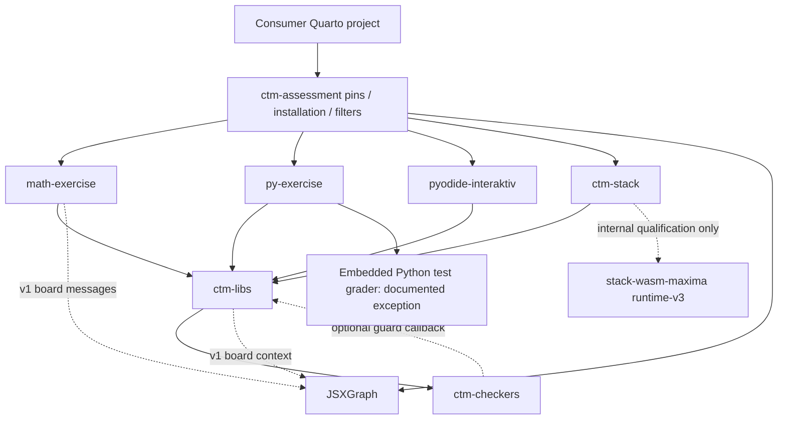
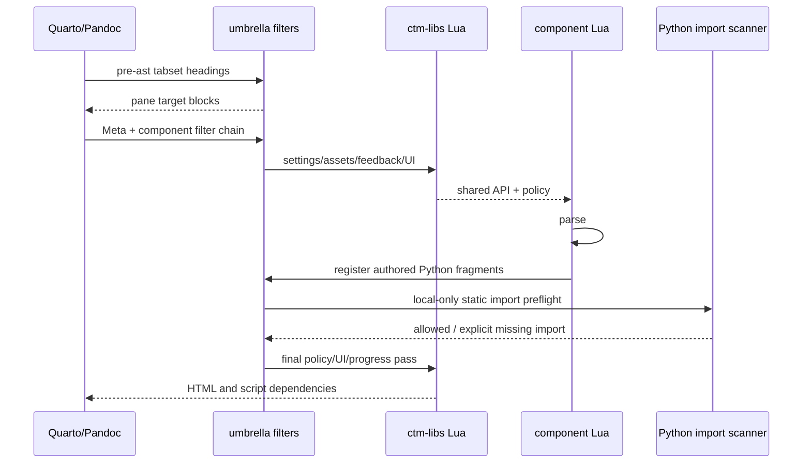
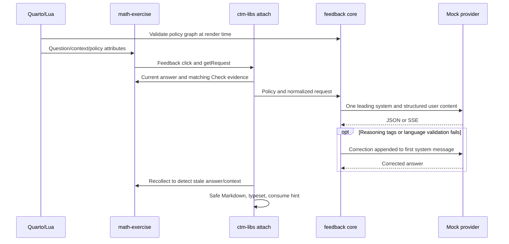
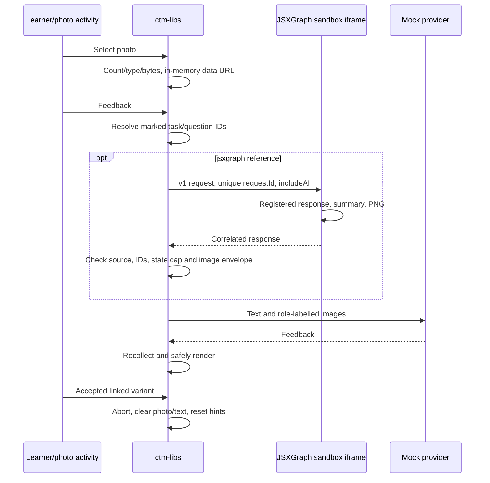
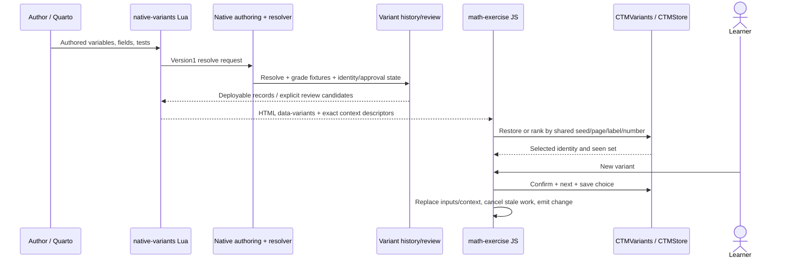

# Independent extended CTM Assessment audit — November 2026

Execution date: **30 October 2026**. This report reviews the November audit target; it does not claim a future execution date. All source citations refer to the exact commits below. The live `main` pin manifest was re-read through GitHub and matched the requested pins. Existing checkouts were preserved; different pins were reviewed from exact Git archives. JSXGraph/IDE cached archives were independently compared byte-for-byte with fetched Git archives (only the cache marker differed).

| Component / repository | Audited commit (full SHA) | Selection |
|---|---|---|
| Erasmus-CTM/ctm-assessment | [`cf1ca2a9abdb3647b04b8fd298d2b123002ebcaf`](https://github.com/Erasmus-CTM/ctm-assessment/tree/cf1ca2a9abdb3647b04b8fd298d2b123002ebcaf) | live current main |
| Erasmus-CTM/ctm-libs | [`b1e7ec80b198eacd04793fd1cec2adb776555b73`](https://github.com/Erasmus-CTM/ctm-libs/tree/b1e7ec80b198eacd04793fd1cec2adb776555b73) | repos.json pin; main |
| Erasmus-CTM/ctm-checkers | [`4cff6aa604fb04de838e7c479d38f14ad9e21c57`](https://github.com/Erasmus-CTM/ctm-checkers/tree/4cff6aa604fb04de838e7c479d38f14ad9e21c57) | repos.json pin; main |
| Erasmus-CTM/math-exercise | [`39df17ee28789e7d8d5d8e0abc01dcb967fc8858`](https://github.com/Erasmus-CTM/math-exercise/tree/39df17ee28789e7d8d5d8e0abc01dcb967fc8858) | repos.json pin; main |
| Erasmus-CTM/py-exercise | [`5682787dbdff309890b8cb85503cc060d981b4e4`](https://github.com/Erasmus-CTM/py-exercise/tree/5682787dbdff309890b8cb85503cc060d981b4e4) | repos.json pin; main |
| Erasmus-CTM/pyodide-interaktiv | [`793a87262e60ada72c08560ed8c5db011483baae`](https://github.com/Erasmus-CTM/pyodide-interaktiv/tree/793a87262e60ada72c08560ed8c5db011483baae) | repos.json pin; feature/shared-feedback-integration |
| Erasmus-CTM/ctm-stack | [`e8437f1f7420ec33dd9f7b7f5a8469e2b6473b55`](https://github.com/Erasmus-CTM/ctm-stack/tree/e8437f1f7420ec33dd9f7b7f5a8469e2b6473b55) | repos.json pin; main |
| aacchhee/jsxgraph-quarto | [`49a1c7d575e08b2133e39098e8f9deda61567287`](https://github.com/aacchhee/jsxgraph-quarto/tree/49a1c7d575e08b2133e39098e8f9deda61567287) | repos.json pin; audit/2026-10 |
| Erasmus-CTM/stack-wasm-maxima | [`63ee8e434339f6553a7bd2a263e794769f40ad9a`](https://github.com/Erasmus-CTM/stack-wasm-maxima/tree/63ee8e434339f6553a7bd2a263e794769f40ad9a) | live current main |
| aacchhee/ctm-demo | [`891e5ffd1c7cd7f400a6f07aa0fc2a13bfd290f8`](https://github.com/aacchhee/ctm-demo/tree/891e5ffd1c7cd7f400a6f07aa0fc2a13bfd290f8) | live current main |
| aacchhee/freehand_ai_assessment | [`2803b6b6ab3b9a936d03a7985693a97763cf7f4f`](https://github.com/aacchhee/freehand_ai_assessment/tree/2803b6b6ab3b9a936d03a7985693a97763cf7f4f) | live current main |
| aacchhee/ingmat3a_ntnu | [`5915fa446ba6644ac4c9c9c62cbc315bdd2fb82c`](https://github.com/aacchhee/ingmat3a_ntnu/tree/5915fa446ba6644ac4c9c9c62cbc315bdd2fb82c) | live current main |


Maxima's lightweight CI tests additionally use their **own** checker pin `c366f175aba6b62caa628bc60f57bb1167fc087b`, not the umbrella checker. The PR45 parity comparison uses math base `17f1acefeca8a8da7128ffe73301347256e226d8` and the table's head, with the same current pinned dependencies on both sides. This is an explicit comparison exception, not another audited deployment snapshot.

## 1. Summary for AC

**Verdict:** fix two reproduced grading defects before relying on the affected checks: inclusive numeric tolerance can reject valid boundary answers, and freehand's derivative checker can award full credit to a different rational function. Shared libraries, exact package pins, generated-data rebinding and normal worker replacement are in good shape. The package is a browser learning system; this audit does not establish an authoritative exam grade boundary against the learner or other same-origin scripts.

| Priority | Finding | Assessment |
|---:|---|---|
| 1 | GR-1: exact upper tolerance boundaries rejected | Critical; verified in CPython and Pyodide |
| 2 | GR-2: freehand 3b fixed samples admit a non-derivative | Critical; verified; consumer-only |
| 3 | A-01: authored learner input retains broad SymPy evaluation | High for integrity-dependent exams; plausible; prior M3 remains unclosed |
| 4 | B2: standalone IDE ships an older shared library | Medium; verified byte/capability divergence; umbrella excludes that copy |
| 5 | R-01: matching cache marker is treated as clean pinned source | Medium; verified; reused build workspace |
| 6 | B1: mixed-installation guard accepts different same-version libraries | Medium; verified; retained prior M4/M5 |
| 7 | GR-4: restored practice keys retain edited computed badges | Medium; verified; generated practice only |
| 8 | P01: stream output has no size/total-time limit | Medium; verified against loopback mock |
| 9 | UX-1: math answer fields have no accessible name | Medium; verified in en/nb and consumer pages |
| 10 | R-04: release flag does not bind checkout to release tag | Medium; verified guard behavior |

**Good evidence:** 1,763 checker tests passed; the PR45 parity corpus has 1,668 responses per build and zero differences; all 53 similar-practice browser cases passed; actual custom-givens restore rebinds context and disables mismatched display; provider JSON/SSE compatibility and real 30/60/100-second failure diagnostics were exercised with no real AI key. Consumer renders passed. Neither AI feedback rendering nor photo feedback produced an authored grade event. Already repaired issues are listed separately below.

Important limits: managed Chromium blocks diagram data: frames. Actual SEB/assistive-technology acceptance, Firefox/WebKit worker runs and fresh full native Maxima/STACK parity were unavailable. Node/jsdom and Chromium measurements are labeled separately. Test parity is evidence of consistency, not mathematical correctness.

## 2. Snapshot and test-suite results

The full snapshot is at the top. Toolchain: Quarto 1.8.27; Node 24.19.0; CPython 3.12.14; host/Pyodide SymPy 1.13.3; npm Pyodide 0.28.3; installed Chromium 154.0.8037.57; axe-core 4.14.0. Tests ran in disposable source archives/clones, preserving existing consumer extensions and unrelated uncommitted Maxima work.

| Repository / group | Exact suite / operation | Pass | Fail | Skip / not run | Context |
|---|---|---:|---:|---|---|
| ctm-assessment | npm test (full fixture environment) | 135 | 0 | 7 | 142 cases; same pinned source, ordinary skip paths retained |
| ctm-assessment | Python unittest discovery | 253 | 0 | 0 | full setup campaign environment |
| ctm-assessment | npm run test:integration | 29 | 0 | 0 | exact rendered common package |
| ctm-libs | npm test | 458 | 0 | 0 | canonical local original-lock Pyodide cache; first remote attempt450pass/7fail/1skip |
| math-exercise | npm test: embedded Python | 47 | 0 | 0 | native authoring/wheel installed |
| math-exercise | npm test: Node | 207 | 0 | 1 | legacy missing-feature branch inapplicable to current library |
| py-exercise | npm test / Python unittest | 50 / 17 | 0 | 0 | component and current canonical libraries |
| pyodide-interaktiv | npm test | 135 | 0 | 0 | exact793a872 source; standalone shipped copy distinguished |
| ctm-checkers | pytest -q -ra | 1763 | 0 | 147 | SymPy1.13.3; installed Chromium; skip grouping below |
| ctm-stack | pytest | 57 | 0 | 0 | pinned e8437f1 with audited package/native-authoring; render cases included |
| JSXGraph | node --test tests/*.test.mjs | 27 | 5 | 1 | 33 cases; five managed data: navigation timeouts; one dependent control skipped |
| stack-wasm-maxima | existing lightweight CI group | 10 script invocations | 0 | 0 | includes34Python cases; own c366f175 checker pin; no npm test script |
| math-exercise | own Playwright asset/similar/example specs | 69 | 0 | 0 | 2+53+14; original assertions; local transport configurations documented |
| math-exercise | own graphical Playwright specs | 0 | 1 | 0 explicit;3not run | first environment timeout;3not run (reporter labels those skipped); managed policy |
| math-exercise | official PR45 grading-parity corpus | 1668 per build | 0 | 0 | zero differences/missing/harness errors;40authored groups |
| consumer renders | quarto render | 21 demo +4freehand +2combined +1course index | 0 | 0 | consumer source SHAs fixed; compatibility with audited package tuple |
| ctm-assessment supplemental | node --test tests/*.browser.cjs | 7 | 0 | 0 | browser contract assertions recovered independently after chained failure;357.23s |
| required umbrella campaign | setup-feedback-integration.py --test --browser | all unit/integration phases;23 browser checkpoints | exit1 | 0 | stops at first JSXGraph data: policy block; downstream chain not reached; see separate supplemental runs |

Repositories without an npm/pytest suite manifest are not credited with a nonexistent test run. Maxima/JSXGraph use the listed direct CI/test commands; the three consumers have no npm/Python project suite manifest and are credited with actual renders. Full course render was not run; its index was. Consumer standalone helper/acceptance scripts outside those renders were not exhausted. Actual full Maxima Wasm/native STACK replay and actual SEB were unavailable; Firefox/WebKit executables were absent. No engine or policy restriction was bypassed.

**Browser policy diagnosis:** installed Chromium's `/etc/chromium/policies/managed/urls.json` uses URLBlocklist `*` and an allowlist for http/https/wss, excluding data:. Independent diagnostics observed `chrome-error://chromewebdata/` and “Your organization doesn’t allow you to view this site” in the generated iframe; decoded source still contains the MathJax startup script. Five JSXGraph timeouts and the graphical/umbrella stop therefore do not establish a source regression. They remain failed/unverified, not counted as passes. See [diagnostic summary](inventory/jsxgraph-own-suite-diagnostic.json).


Independent recovery after the chained stop: seven browser-contract cases passed; the mixed STACK browser script passed real math/IDE/STACK grading, validation, qtests and runtime reuse. The Pyodide lifecycle script passed its static service-worker placement check, then the first isolated runtime scenario failed dynamic-module/Monaco fetching through the SW-controlled path. Zero lifecycle scenarios are credited. No policy or TLS checks were changed.

Counts below distinguish individual cases, script invocations and rendered pages. They are not summed into a misleading grand total. Initial missing-dependency/browser/CDN failures were retained in raw logs, diagnosed and rerun with the documented toolchain. Source assertions were not edited. Network transport substitutions are explicitly test fixtures.

**Why 147 skips, not the task's expected 148:** 133 mutation cases are opt-in (including unchanged baselines); 14 require upstream STACK (2), three-browser admission (3), legacy authored math (6), the pinned umbrella recorder (2), or legacy STACK (1). The exact number depends on installed prerequisites. The ordinary wheel golden-replay PR gate is now implemented: earlier November H2 is fixed; do not describe it as still manual-only. See [exact skip accounting and documentation review](appendix-test-health.md).

**Local-runtime provenance:** the original official umbrella run failed on seven CDN-backed SymPy cases. Browser requests through the environment proxy also failed TLS validation. No TLS checks were disabled. A persistent trust-store CA import was rejected by automatic approval review and did not execute. Safer local mirroring fetched canonical Pyodide package bytes and npm assets using the configured system trust; canonical wheels are SHA256-checked against the untouched npm 0.28.3 lock and npm packages against registry SHA512 integrity. Separate parity/similar-browser fixtures used PyPI/repacked pure wheels with an explicitly patched **scratch** lock; original hashes and the distinction are recorded in their appendices. No wheel, vendor lock, P13 receipt, pin or application source was changed in the audited trees.

## 3. Threat model and security findings

Assets are authored grades/checker semantics, practice correctness, answer/photo privacy, provider keys, author/CI execution, course storage and offline artifact provenance. Learners and same-origin sibling pages may be adversarial. Teachers/authored checkers are trusted code but can make mistakes. AI replies and learner responses remain data. CDNs, dependency pins, CI artifacts and mutable build caches are separate supply-chain boundaries.

| Boundary | Observed control | Remaining conclusion |
|---|---|---|
| Provider/learner text → rendered feedback | Escaped restricted Markdown; KaTeX trust:false; context/image envelopes | No new reproduced XSS; complete hostile browser/TeX matrix remains unverified |
| Model data → generated mathematical expressions | Bounded AST interpreter, token admission, callable dispatch allowlist | Recipe validity does not prove question/key semantics; generated practice is not an independently proved assessment |
| Authored learner input → SymPy parse_expr | Retained dunder-only admission path | A-01 remains plausible; previous exploit is not claimed independently reproduced here |
| Learner Python → interpreter/worker | Worker separation from page; scoped calls, guards and Stop/restart | Learner Python is not a hostile-code security sandbox; a worker is not a separate origin or grading authority |
| Page/site → storage/provider settings | Versioned CTM identities; path/course keys; per-origin provider config | A sibling script can read origin storage; namespacing prevents accidents, not confidentiality |
| Immutable Git pin → build cache/package | Exact pins, generated wheel checks and copied-file hashes | R-01: cache marker alone does not attest cached source bytes |
| P13 receipt → ZIP | Hashes, exact application refs, eight executable-file checks, extraction verification | Ordinary committed feedback-core changes remain ref-gated; rendered whole-site coverage is narrower (R-02) |
| Repository writer → AC approval | Receipt is ordinary reviewed repository data | GOV-1: AC-exclusive approval is a governance assumption, not authenticated by these scripts |

Threat details and every requested rendering/authoring/Python/worker surface are in [Appendix A/security](appendix-security.md). Trusted authored raw HTML, including caption/variant/rich-output paths, is distinguished from untrusted model output. Source panels escape the displayed source, including the freehand adaptation. Generated custom contexts were actually rebound and compared on restore. Adversarial generated-expression resource paths beyond the executed bounds are explicitly unverified, rather than passed based on earlier audits.

**GOV-1 (medium; plausible; retained governance limitation):** `ctm-assessment/.github/workflows/exam-site-zip.yml:41` reads receipt and pins from the same checkout; `scripts/build-p13-assets.py:54` compares reproduced digest/count; `integration/p13-complete-assets.json:3` contains digest/count/refs, no authenticated reviewer. `scripts/review-p13-assets.py:65` emits UNAPPROVED output, but its acceptance does not consume an AC signature/actor check. A repository writer who can land matching code/receipt can satisfy the technical checks without AC. No unauthorized merge/receipt change was attempted. Live GitHub branch metadata reported umbrella main `protected:false` on the audit date, separate from snapshot code. Require protected receipt/pin paths with AC review or an independent signed attestation. This is not a learner/model receipt-forgery finding.

**CSP verdict:** a strict nonce/hash policy is feasible after render/build changes, but cannot be promised today. Inline dependency/config/board scripts and styles, Monaco's code paths, opaque iframe data URLs, blob workers and Wasm compilation must be inventoried. Start with Report-Only, local assets and explicit connect/image/frame/worker destinations; move inline scripts to hashed/nonce-authorized payloads, and test `wasm-unsafe-eval` separately from JavaScript unsafe-eval. Notebook rich authored HTML requires an explicit policy decision. The [security appendix](appendix-security.md#a10-csp-proposal-and-cost) provides a provisional compatibility policy and staged cost; it was not deployed or certified. Do not advertise `script-src 'self'` as sufficient today.

## 4. Separation of code

The canonical package largely follows its intended ownership. Python-exercise grading is a documented exception to “all grading in ctm-checkers.” The standalone IDE's generated old library is coherent with its recorded source but differs from the umbrella library; the umbrella correctly drops that foreign copy.

The complete [ownership TSV](inventory/ownership.tsv) covers **201 tracked files / 3,841,527 bytes**, including each shipped `_extensions` file, source filters and canonical bootstrap, with owner, generator/copy status and SHA256. [Appendix C](appendix-C-duplication-inventory.md) records **54 exact duplicate groups and four normalized near-duplicate pairs**, removed October copies and the adapted freehand source filter. Consumer untracked installed extensions are not falsely attributed to their source commit.


### Interface catalogue

The literal catalogue contains 270 global-name entries and 213 data-attribute-name entries counted per repository, including browser built-ins and copied libraries. The table below identifies the meaningful contract families. Component-local test hooks are not stable APIs.

| Contract / producer → consumer | Version and validation | Evidence / gap |
|---|---|---|
| Lua singleton `_G.__ctmLibs`, `ctm.path/fail/filters`; bootstrap → component filters | `ctm.api=3`; bootstrap checks minimum API; singleton compares version strings | ctm-libs `lua/ctm.lua:27,41`, `bootstrap/ctm-bootstrap.lua:49`; same version is not same bytes, B1 |
| `ctm.settings.{load,get,string,bool,number,choice,policies}` → components | Within Lua API3; typed checks, origin tracking, read-settings JSON | `lua/settings.lua:60,158,172,194,237`; settings sections enumerated at24 |
| `ctm.locale.{resolve,tag,text,use,language}`, `CTMLocales` → all components | Within API3, no separate JS version; namespace/language resolution and catalogue validation | `lua/locale.lua:18,69,87`, `locales/ctm-locale.js:33,140`; B3 on feedback's parallel resolver |
| Lua policy/feedback selection and `__aiFeedbackPolicies`, `__aiFeedbackConfig` → feedback widgets | Feedback request version1; Lua emits escaped JSON, JS typed normalization; policy strings resolved against definitions | `lua/policy.lua:9,15`; `lua/feedback.lua:388`; `feedback-core.js:177,223` |
| `AIFeedback` core → DOM → UI/integrations | Library version0.9.0, request schema1; `normalizeRequest` checks shape/text/image budget, core alone exports CommonJS | `feedback-core.js:6,177,419`; `feedback-dom.js:447`; `ai-feedback.js:4`; methods are feature-checked inconsistently; no independent DOM/UI API level |
| `MathExerciseRuntime` → math, Python, IDE, STACK | No exposed API version; Lua capability gates and library pins; serial `transaction`, guarded module install and `callCheckers` | `runtime/pyodide-runtime.js:484,533,620`; most methods assumed present after bootstrap |
| `CTMWorker`, `mainPyodide`, `qpyodideReady`, `qpyodideInstance`, `_qpyodideGetInstance`, `__qExercisePyodide` → shared runtime/IDE | Unversioned runtime/proxy protocol; worker envelope ID/command checks, init options, pending request map; published singleton | `runtime/pyodide-worker.js:882,1273`; order and proxy subset are contractual, not just names |
| `CTMCheckers`, `CTMCheckersStack` → runtime; `ctm.checkers` → Lua | Version0.12.0.dev0, API1.1; compatible major/minor at render time; wheel SHA256, install checks, manifest checks | ctm-libs `lua/checkers.lua:27,58`; checkers `ctm-checkers.js:39`; `docs/api.md:25` |
| Python `browser.call(name, caller)` → handlers | API1.1; fixed `CALLS` allowlist, JSON request; per-handler admission, guard restore | ctm-checkers `src/ctm_checkers/browser.py:25,59`; request does not itself carry schema/API version |
| `math_exercise.check` | `{student,correct,vars,mode,reject,tolerance,decplaces,sigfigs,form,partial_credit,form_credit}` → `{status,score}` / error | `checks.py:19`; `docs/api.md:155`; mostly handler checks/defaults rather than complete JSON-schema validation |
| `math_exercise.check_custom` | `{checker,vars,response,question_context?,givens?,fields?,generated?,learner?}` → normalized status, score, feedback, assessment | `custom.py:26,35,54,82`; checker is trusted author code, response data is not |
| `compute_key`, `admit_generated`, `bind_data` | Recipe / mathematical grammar; exact codec, admitted names/kinds and display context → key or bound context/LaTeX | `keys.py:27,88`; `generated.py:135,203`; additional operations still API1.1, retained API-level gap |
| `run_question` at build time | Options/base/variables/teacher/variant → checked fields/status/score | `authored.py:147,222,240,257`; native Python API, not a browser.call name |
| `CTMStore` / `ctm:result` → progress, variants, integrations | Store record v1; status restricted correct/partial/wrong/invalid, finite score0..1; source/variant identity restoration | `ui/ctm-store.js:247,312,333,465`; `ctm:result` event itself has no version |
| `CTMCopy`, `CTMExport`, `CTMVariants`, `CTMLayout`, `MatrixInput` | versions1,1,1 (ranking2),1,1.0.0 respectively; method/option checks; most callers rely on install pins | `ui/ctm-copy.js:56`, `ctm-export.js:101`, `variants.js:96`, `ctm-layout.js:98`, `ctm-matrix-input.js:232` |
| `CTMSettings`, `CTMNav`, `CTMReveal` | Unversioned JS globals; library dependency ordering; settings register/reveal target methods | `ui/ctm-settings.js:56`, `ctm-nav.js:485`, `ctm-reveal.js:112` |
| `CTM_ASSETS`, `CTMAssets` | Configuration v1; resolver selects bases/known assets | `lua/assets.lua:128`, `assets.js:5`; app and builder derive from version homes |
| JSXGraph `postMessage` → math/feedback | protocol `jsxgraph-quarto-assessment`, version1; source window, requestId, assessmentId, type and byte budgets checked | math `math-exercise.js:715`; feedback `feedback-dom.js:415`; duplicate clients differ in size envelope and image requirement intentionally |
| STACK `CTMStackAdapters` and descriptor → controller | Descriptor `{id,version,adapter,requires:{isolation}}`; methods start/request/stop/restart and isolation match validated | ctm-stack `ctm-stack.js:13,26,78`; response ok/error envelope validated; version is package version, not explicit adapter schema |
| Integration globals `MathExercise`, `MathSimilar`, `MathExerciseStore`, `MathExerciseBoards`, `PyExerciseFeedback`, `__mathExerciseConfig`, `__pyExerciseConfig`, `__pyExercises` | Component-local; boards version1; remaining globals unversioned | Defined at `math-exercise/_extensions/math-exercise/math-exercise.js:1730`, `math-exercise/_extensions/math-exercise/math-similar.js:1442`, `math-exercise/_extensions/math-exercise/math-store.js:201`, `math-exercise/variants-board.js:108`, `py-exercise/py-exercise-feedback.js:48` under each repository’s `_extensions/`; Lua emits configs |
| `data-vars`, `data-mode`, `data-checker`, `data-givens`, `data-similar-data`, `data-context-refs`, field/matrix attributes | Escaped strings/JSON at Lua→DOM; downstream parse/type/admission checks; no HTML contract schema version | math-exercise.lua342,1001–1024; shared store data attributes `lua/store.lua:48`; exact names/uses in contracts.json |

### Load-order assumptions and dependency matrix

Legend: **D** declared dependency; **B** build/package only; **A** adapter/protocol; **E** documented exception. Row calls column.

| Caller → callee | assessment | libs | checkers | math | py | IDE | STACK | JSXGraph | Maxima |
|---|---|---|---|---|---|---|---|---|---|
| assessment builder/filter | — | B | B | B | B | B | B | B | — |
| libs | — | — | D | — | — | A legacy runtime names | — | A protocol | — |
| checkers | — | A `_ctm_guard` when in browser | — | — | — | — | — | — | — |
| math | A bootstrap presence | D | D via libs | — | — | — | — | A | — |
| py | A bootstrap presence | D | **E own grader** | — | — | A shared globals | — | — | — |
| IDE | optional package | D generated standalone copy | — | — | — | — | — | — | — |
| STACK | A bootstrap presence | D | D | — | — | — | — | — | A internal only at pin |
| JSXGraph | — | — | — | — | — | — | — | — | — |
| consumers | D | through package | through package | authored use | authored use | authored use | authored use | authored use | — |



The library→checker→library edge is an optional installed guard callback, not a source import cycle at build time. Legacy IDE runtime globals in ctm-libs invert naming ownership but are now produced by its own worker. Startup still requires assets/locales/runtime before component scripts, feedback-core before DOM before UI, and shared matrix/store/variants before component initialization. The package's dependency registration encodes order; browser globals do not independently negotiate incompatible versions. `ctm.checkers.use('stack')` orders base wheel payload before STACK payload; development wheel hash suffix avoids cache mixing (`lua/checkers.lua:133`).

### Version homes

| Dependency | Canonical application home | Enforcement and limitation |
|---|---|---|
| Pyodide0.28.3 | ctm-libs `runtime/pyodide-runtime.js:102` indexURL | `ctm_assets.validate_version_homes:689` checks runtime version/source digest against full lock |
| SymPy1.13.3 | Pyodide lock; generated `runtime/pyodide-sympy.json` | Generator `scripts/sync-pyodide-sympy.py`; host constraints should match; generated copy absent in pinned standalone IDE |
| KaTeX0.16.47, Monaco0.46.0, MathJax3.2.2 | ctm-libs `assets.json` | Asset lock validates versions and canonical table bytes; npm devDependencies are separate test tool versions |
| JSXGraph1.14.2, MathJax4.1.3 / font4.1.3 | assessment `jsxgraph-pins.yml` | Board versions checked separately by same validator. JSXGraph fork defaults duplicate versions for standalone use; those need agreement tests rather than pretending there is literally one declaration everywhere |
| Quarto1.8.27 | assessment `integration/feedback/repos.json`; component manifests require >=1.8.27 | Runtime validation exists; CI workflow tools may independently select versions |
| Node / Python | Workflow setup steps, component metadata and runtime requirements | No single package-wide version home or `validate_version_homes` coverage; validation applies to browser asset homes, not build tools |

`validate_version_homes` is a useful lock gate, not a repository-wide uniqueness checker. It builds expected versions from assets/runtime/board pins and rejects inconsistent lock provenance (`ctm_assets.py:689–703`). ctm-stack's fallback MathJax3.2.2 at its pinned `ctm-stack.lua:157` and JSXGraph standalone defaults remain independent declarations.


Locales have within-catalogue key/type/argument parity, but the same five languages are not implemented in every component. Common/math/Python catalogues support en/de/nb; feedback supports en/de/nb/es/nn; UI supports en/de/nb/nn; STACK and IDE add different Nordic languages. Unsupported locales fall back intentionally. The feedback widget still maps nn directly to nb despite its nn catalogue (B3). Error strings propagated from Python/providers can remain English. The [architecture appendix](appendix-architecture.md) identifies version-home limits, legacy authoring users, unversioned globals/data contracts and the documentation gaps; lexical absence alone was not treated as proof of dead code.

## 5. Ten workflows

Paths in this section are repository-relative to the extension named by the surrounding component unless fully prefixed. The snapshot table determines the commit. Appendices retain expanded evidence and rejected hypotheses.


### C1. Render pipeline

**Call chain.** The project declares `tab-ids.lua` at `pre-ast` (`_extensions/ctm-assessment/tab-ids.lua:11-24`); `tabset()` moves heading IDs/attributes to first blocks of panes, excluding reserved cross-reference and pane IDs. Project filters then run in their declared order. The umbrella `_extension.yml:8-17` orders `ctm-assessment.lua` → ctm-libs → JSXGraph → math → STACK → Python exercises → IDE → author-imports-end → ctm-libs-end. `ctm-assessment.lua:44` `Meta()` creates a fresh author-import collector, supplies only missing JSXGraph pins, and emits the opaque MathJax preloader/parent capability. Library `lua/ctm.lua:64` `filters()` loads settings and assets, marks callouts, runs UI passes and feedback preparation. `lua/ui.lua:256-319,348` emits markdown-lint warnings, including missing tab pre-pass. Each component detects its cells, requires canonical dependencies, resolves settings/policy and emits escaped attributes. In math, `math-exercise.lua:228` `parseOptions()` → `:828` `buildExercise()` → `:998-1026` data attributes → `:1229` document walk; `ensureSetup():189` registers cacheable runtime, checker, matrix and component dependencies once. Python `py-exercise.lua:236` `CodeBlock()` parses actual starter/tests and emits exercise records. `author-imports.lua:6` `add()` records actual source; `:14` `finish()` in local-assets mode calls `author-imports.py` to statically check imports against the private index and installed subset without executing fragments. `ctm-libs-end.lua:14` flushes policy errors/messages, finalizes UI and progress.



| Boundary | Data | Validation |
|---|---|---|
| Author → Lua | Markdown, cell `#|` options and metadata | Component parsing; enums/bools where implemented; invalid givens/similar-data/dynamic matrix/duplicate IDs assert. Not every free-form option is a schema-validated enum: e.g. math `mode` is forwarded at `:871,1004`. |
| Umbrella → library | API globals, source paths, JSXGraph defaults | Canonical bootstrap/API checks; defaults provenance marker recreated at `ctm-assessment.lua:49-50` rather than accepted from author metadata |
| Components → browser | data-vars, checker, givens, context refs, variants, policy JSON | JSON encoding plus HTML attribute escaping; browser/checker independently parse later |
| Author Python → build scanner | Actual source, packages, origin | AST/static import analysis; local files resolved; absent/unmapped imports fail with origin; code is not run |
| Build → learner | HTML and dependency URLs | Dependencies deduplicated by name; local asset rewrite checks provenance/version homes |

**Failures and storage.** Render errors name missing shared APIs/components, invalid options or imports. Markdown lint warns rather than rejects author HTML. No learner storage is written at render time; generated cell descriptors later drive the canonical browser store. The six executed render cases confirmed local import failure, private-index failure, CDN scanner bypass, genuine pin rewriting and rejection of authored/forged defaults. The additional combined EN/NB fixture rendered cleanly with real Quarto: numeric math/tolerance, Python Check, text feedback, JSXGraph and a four-tab panel. Both pages retained four moved tab targets and one board iframe; HTML sizes were 70,536 and 70,621 bytes. `code/release/render-combined.py` recreates the scratch fixture. This establishes render integration, not a successful network/Pyodide browser run.

### C2. Install, update, release

**Call chain.** A consumer's `quarto-extensions.yml` identifies the umbrella ref (read by course tooling; `scripts/build-course.py:35` `pinned()`). The selected checkout's `install-project.py:182` `main()` validates release/ref options and invokes `setup-feedback-integration.py --package-only`. The builder `main():288` loads `integration/feedback/repos.json`, enforces minimum Quarto, resolves local/review/default sources (`:392-409`), and `snapshot():72` downloads commit archives or reuses its cache. It copies only owned extension folders (`:441-449`), generates native authoring (`produce_native_authoring():208`), checks shared files and one-home rules, adds licences, rejects foreign nested extensions except declared shipped copies, then writes repository metadata and per-file hashes (`:492-501`) and a tarball. Installer `replace_extensions():145` moves owned folders aside, runs `quarto add`, calls `first_mismatch():124` and restores old folders on any failure; `main():218` copies the record to `.private-extensions/resolved-repos.json`.

`--update-pins` resolves branch tips, rejects backward/sideways moves, writes repos.json and stops (`:330-352`); it does not run tests or update the P13 receipt. `--check-pins` checks branch ancestry (`:310-329`), not semantic compatibility. `--source` explicitly records actual HEAD and dirty paths (`:398-409`) and sets `pinned:false`; review refs likewise set `pinned:false`. `release-check.py:49` checks tag/version equality, full SHAs and a matching changelog section. `.github/workflows/release.yml` then runs package tests/browser tests and checks the resolved record before publishing; no release was performed in this audit.

```mermaid
sequenceDiagram
  participant C as consumer config
  participant I as install-project.py
  participant B as setup-feedback-integration.py
  participant G as pinned source/cache
  participant Q as quarto add
  C->>I: chosen umbrella checkout + options
  I->>B: --package-only / exact review refs
  B->>G: resolve commits; read extension trees
  G-->>B: source bytes
  B->>B: ownership/bootstrap/native-authoring checks
  B-->>I: distribution + resolved record + hashes
  I->>I: back up owned extension folders
  I->>Q: install distribution
  Q-->>I: installed files
  I->>I: hash expected files; restore on failure
  I-->>C: private resolved-repos.json
```

| Boundary | Validation | Limit |
|---|---|---|
| Config/ref → immutable pins | Full SHA checks for review/release; ancestry checks for pin moves | Branch `main` consumers still float across installs; ancestry does not prove compatible behavior |
| Archive/cache → claimed Git commit | HTTPS commit URL on fresh download; cache commit marker on reuse | R-01 below: cached bytes are not revalidated against Git |
| Components → assembled package | Explicit ownership; canonical bootstrap hash; no retired foreign copies; build/checker home checks | Semantic contracts still require integration tests |
| Package → installed course | Per-file SHA256 comparison and rollback | Record is local provenance metadata, not a signed attestation; post-install edits are not continually checked |

**Can versions mix?** Default fresh install resolves one complete pinned set, and failed `quarto add` restores old owned folders (17 tests pass). Explicit `--source`/review overrides intentionally produce mixed review sets, visibly recorded. Reused modified source cache can silently differ from the pinned set (R-01). Direct Quarto additions and later manual changes can create an installation different from its record; render/bootstrap checks catch only some mixtures. `.private-extensions/resolved-repos.json` records chosen commits, overrides, dirty local sources, Quarto and installed-file hashes at install time; it does not prove cached files actually came from those commits or certify compatibility.

**Failure UX/storage.** Bad refs/unknown names produce explicit install errors; bad installed hash names the first differing file, then restore succeeds or backup location is reported. Persistent build cache is `<workspace>/src/<repo>-<sha12>`, record lives at `.private-extensions/resolved-repos.json`; the runtime does not use the record as grade authority.

### C3 — Learner Check in math-exercise

Call chain at the snapshot:

1. `math-exercise/_extensions/math-exercise/math-exercise.lua:833` obtains native/shared dependencies;
   `CodeBlock` parses `#|` options (`:216`), creates fixed/dynamic input markers,
   and emits escaped `data-vars`, field and policy attributes (`:968`, `:1001`).
2. `math-exercise/_extensions/math-exercise/math-exercise.js:1051 setupCell` reads those attributes,
   registers handlers and isolates the parent question's inputs from generated
   descendants. `runCheck:1372` snapshots input/variant/runtime epoch, disables
   buttons and offers timed Stop when loading/checking is slow.
3. Fixed-field `checkField:884` copies input/options; `checkFieldNow:886` builds
   `{student,correct,vars,mode,reject,tolerance,decplaces,sigfigs,form,
   partial_credit,form_credit,generated,learner}`. Custom path
   `checkCustomNow:962` builds `{checker,vars,response,question_context|givens}`.
   Matrix responses include shape/raw input and are decoded in custom.py.
4. `runOnCurrentRuntime:921` obtains runtime and packages;
   `callCheckers:875` adds `math_exercise.` and delegates to
   `ctm-libs/runtime/pyodide-runtime.js:500 callCheckers`. Per-interpreter
   transactions queue installation, request globals, browser call and cleanup.
   Worker transport is the shared runtime's Pyodide facade and
   `runtime/pyodide-worker.js`, not a math-specific worker implementation.
5. `ctm-checkers/browser.py:59 call` consumes `_ctm_request`, selects only an
   entry of `CALLS:26`, applies `inputs.admit`, runs the handler and restores the
   installed guard. `math_exercise/checks.py:31 check` handles built-ins;
   `custom.py:26 check_custom` decodes exact context/givens and invokes trusted
   authored checker code. `numeric.py:16/24/30` supplies rounding/tolerance.
6. JS rejects stale input/variant/Stop results (`:1431`, `:1461`), escapes custom
   feedback text, renders status and calls `publishStoredResult:1496`.
   `math-store.js:185 result` delegates to
   `ctm-libs/ui/ctm-store.js:312 result`, which validates status/score, saves
   and emits `ctm:result:333`; `ctm-progress.js:182` consumes it for progress.

```mermaid
sequenceDiagram
  actor L as Learner
  participant M as math-exercise JS
  participant R as ctm-libs runtime/worker
  participant B as ctm_checkers.browser
  participant C as Built-in/custom checker
  participant S as CTMStore/progress
  L->>M: Check / Enter (raw answer)
  M->>M: Snapshot input, variant, Stop epoch
  M->>R: callCheckers(name, request)
  R->>R: Queue install + request transaction
  R->>B: call(allow-listed name, JSON)
  B->>B: Consume request, learner admission, guard
  B->>C: Parsed expression / response + exact context
  C-->>M: JSON status, score, optional assessment
  M->>M: Discard stale result; render escaped feedback
  M->>S: Completed result only
  S-->>L: Saved result / progress update
```

| Boundary/data | Validation |
|---|---|
| Authored `#|` vars/options/context to DOM | Lua escapes attributes; native options validated before transport |
| Learner text/matrix to grader | Browser dispatch admission; matrix rows×cols validated in custom.py; generated learner positive token filter |
| Shared JS to worker/Python | JSON serialization, per-interpreter queue/epoch, allow-listed browser handler names |
| Exact question context to custom checker | Versioned codec `decode_context`; symbol assumptions and field count checked |
| Verdict to persisted result/events | Status allow-list and finite score0..1 in CTMStore; stale checks dropped |

Numeric precision precedence is decimal places, then significant figures, then
absolute/percentage tolerance, then default relative `1e-8*max(1,abs(key))`.
Rounding uses 15 significant decimal digits and half away from zero. Percent
tolerance is relative to abs(correct), including zero radius for key zero.
GR-1 applies to the tolerance branch. `exact`/form/reject checks are separate
semantic constraints, not a stronger numeric precision setting.

Failure UX: empty answers show an empty-response message; parse/custom failures
show a friendly escaped error; completed wrong/partial/correct results persist.
Loading/check cancellation and infrastructure exceptions do not overwrite a
previous completed score (`math-exercise.js:1482`). Slow loading offers Stop
under runtime load limit; slow Check uses its own timer. Variant/input changes
invalidate pending results through snapshot comparison.

Storage: `ctm|1|encode(course)|encode(page)|encode(exercise-id)` in CTMStore
(`ctm-store.js:85`); source hash, exact variant identity/seen choices, component
inputs, timestamp and last result form the envelope. User preferences/seed live
under course-prefixed `~prefs`/`~seed`. `math-store.js` owns input adaptation,
not a second storage implementation. Local result events are client state, not
an authenticated gradebook.

### C4. Typed-answer feedback

**Call chain.** Render: ctm-libs `lua/feedback.lua:347 prepare` → `lua/settings.lua:85` invokes `read-settings.ts:302 policies` → `feedback/feedback-core.js:40 policyConfiguration` / `:100 resolvePolicy` validates policy schema/graph → `lua/policy.lua:9 emit` / `:15 selection` → `lua/feedback.lua:377` dependencies and `:388 __aiFeedbackConfig`. Component Lua emits question/context/policy data attributes. Page: math-exercise `math-exercise.js:1675` installs adapter → `:1685 getRequest` → `:988 questionText` delegates ctm-libs `feedback/feedback-dom.js:348 questionText` / `:339 sourceText` / `:219 contextText`; math `:993 resolveContexts` delegates `feedback/feedback-dom.js:441 contextMaterials`. Adapter adds current responses and only matching-snapshot Check evidence (`math-exercise.js:1697`). ctm-libs `feedback/ai-feedback.js:139 attach.run` → `:150 collect` → `feedback/feedback-core.js:138 applyPolicy` → `feedback/ai-feedback.js:167 client.request` → `feedback/feedback-core.js:410 request` / `:234 buildMessages` / `:175 normalizeRequest` → `:295 complete` / `:348 once` → configured `/chat/completions` → optional `:321 readStream` and corrective retry → `feedback/ai-feedback.js:170` recollect/stale check → `:192 renderMarkdown` → `feedback/feedback-dom.js:200 typesetFeedback` → `feedback/ai-feedback.js:199` hint counter update. No worker/Python grading runs in this flow; prior Check supplies private assessment evidence.



| Boundary/data | Validation |
|---|---|
| Policy YAML → render/browser | Same JS schema at both ends; unknown keys, missing names, cycles, bad booleans and steps rejected (`feedback/feedback-core.js:17–98`; `read-settings.ts:371`) |
| Question/context DOM → materials | Source extraction excludes UI/hidden/internal data; auto section prose, explicit marked IDs, none empty; duplicate/missing/unmarked/empty/over-6,000-character explicit contexts warn and skip (`feedback/feedback-dom.js:359`) |
| Request → provider | v1, unique response IDs, enumerated profiles/formats/roles, structured nonimage text ≤100,000 characters (`feedback/feedback-core.js:175–232`) |
| Learner text → policy | JSON user data; no interpolation into system policy (`feedback/feedback-core.js:237–253`) |
| Provider → display | Content extraction, empty/explicit-length/reasoning checks, limited script-based language check for math en/de/nb; escaped Markdown and KaTeX trust:false (`feedback/feedback-core.js:381–415`; `feedback/feedback-dom.js:200`) |
| Pending reply → live state | Recollect request signature; changed answer/context, cancellation and accepted variant suppress stale reply (`feedback/ai-feedback.js:162–172`, `:210`) |

**Policy/counters.** `feedback-defaults.yml` is generated into `feedback/feedback-core.js:12`. Policy files accumulate project/profile/metadata/page levels; nearest selection wins. Resolution: shipped defaults/integration → adapter legacy defaults → project/page selection → matching exercise policy → explicit selected policy (`feedback/feedback-core.js:100–127`); step overlays limits, prompt and allow-full-solution. Session hint keys `ai-feedback-hints-v2|<pathname>|<id>` and `|policy` record progress/fingerprint. Displayed replies **and copy prompts** consume hints; changed policy resets. This is tutoring progression, not secrecy authorization.

**Failures.** INVALID_REQUEST/CONFIGURATION/HTTP/IMAGE_UNSUPPORTED/EMPTY/TRUNCATED/REASONING/VALIDATION/TIMEOUT/ABORTED remain distinct. Configuration adds settings button; error messages are generally English even with translated controls (`feedback/ai-feedback.js:203–207`). Browser-hidden CORS/proxy failures become NETWORK with elapsed time/browser reason, not a guessed HTTP status. Missing prose context warns/skips; graphical context errors abort visibly. Math graph adapter explicitly permits text-only image fallback (`math-exercise.js:1683`); ordinary photo activity does not.

### C5. Photo feedback and diagram context

**Consumer fixture.** freehand `pages/handwriting-ai.qmd:10–19` loads practice/tutor/tasks policies and selects handwriting/physics-generation policies. `_includes/handwriting/problem-1.md:11–22` combines numeric 2% Check and a **distinct** photo activity with response-role image, `context="v25-oppg1,v25-1a-svar-question"`, linked reset-on-variant. Photo does not become numeric checker input. Logarithms has its own policies (`pages/logarithms-ai.qmd:10–19`).

**Call chain.** ctm-libs `lua/feedback.lua:238` activity JSON → `feedback/ai-feedback.js:218 initActivity` → `:227` picker → `:217 readFile` → `:248 getRequest` → `feedback/feedback-dom.js:359 collectExplicitContexts` for task/question IDs → `feedback/ai-feedback.js:150 collect` → `feedback/feedback-dom.js:398 collectVisualContexts` for `jsxgraph:<id>` → JSXGraph `lua/jsxgraph.lua:765` emitted message receiver → `:790` registered response, `:795` summary, `:805` SVG→PNG → `:811` response → ctm-libs `feedback/feedback-dom.js:414` source/correlation/size checks → `feedback/feedback-core.js:192` image normalization → C4 provider/render path. `feedback/ai-feedback.js:265` matching accepted variant aborts, clears text/images and resets hints.



| Boundary/data | Validation |
|---|---|
| Files → activity memory | ≤3 PNG/JPEG/WebP; ≤8 MiB each / 12 MiB total; selection-version guard for late FileReader (`feedback/ai-feedback.js:234`) |
| Image → provider body | PNG/JPEG/WebP base64 shape/length; ≤3 images and 16 MiB encoded aggregate; source/response/context roles (`feedback/feedback-core.js:192–202`) |
| Parent ↔ iframe | Protocol jsxgraph-quarto-assessment v1; iframe checks parent source/protocol/version/assessment; parent exact iframe source, request/assessment IDs, 5 s timeout, state+summary ≤1 MiB (`feedback/feedback-dom.js:403–431`; JSXGraph `lua/jsxgraph.lua:765–811`) |
| Diagram summary → feedback | JSON/string data; iframe copies through JSON serialization; not executed |
| Feedback → grade/store | No checker or ctm:result call in attach; no photo persistence |

**Consumer-only loader.** freehand `assets/handskrift/fyll-inn.js:148–190` fetches sample PNGs and fills normal file input via DataTransfer/change. `:160–162` emits accepted variant to reset prior hints/images; `:175–177` fills ordinary numeric inputs with normal events. Its prompt sandbox `:267–278` replaces page policy layers after resolvePolicy validation and intentionally permits local policy edits. It is outside CTM package. Consumer image/JSON/YAML fetches are additional network traffic; no provider key sent in them.

Wrong type/size yields translated picker error; absent text context warns/skips; absent/unregistered board, failed export, oversized state, timeout or required-image rejection abort visibly. Uploaded photos stay in memory. Copy mode displays previews/download links and asks for original image attachment (`feedback/ai-feedback.js:177–189`). Reference criteria and chosen photos/contexts leave the browser for selected provider.

### C6 — Similar practice

Call chain:

1. `math-exercise.lua:968` validates authored `givens`/`similar-data`; generated
   cells cannot recursively generate. `math-exercise.js:1622` calls
   `MathSimilar.attach` with renderer/checker/runtime/store callbacks.
2. `math-similar.js:125 attach` captures authored contracts and builds controls.
   `generate:899` resolves author generation policy (`messages:775`), task,
   contexts and schema. Generator `client.complete(...,{generation:true})`
   passes bounded synthetic/model JSON to `parseCandidate:678` and `valid:296`.
3. Normalizations: non-custom supported model mode is reset to original mode;
   vars arrays become strings/missing vars inherit; custom vars/checker inherit
   author contract; `bareAnswer:670` removes one simple lhs assignment or
   converts finite JSON number to string. `normalizeMatrix:604` repairs only a
   complete row-major sequence with matching recipe selectors.
4. `admit:702` snapshots original grading options. For declared givens,
   `bindGivens:477` calls Python `generated.py:203 bind_data`; exact variables
   and LaTeX are returned; every declared given must appear as a `{{name}}`.
5. Recipe-backed scalar fields call `keys.py:27 compute_key` (fixed operation
   allow-list; parsed expression/variable/order/selector limits); model answer
   must match the computed key under the authored field's numeric precision.
   All candidates must pass actual built-in/custom assessment (`:754`).
6. If any field lacks a computed recipe, `solve:550` uses `F.getClient()` (the
   ordinary feedback model) with no key in its fresh request; answers must pass
   the same checker. This is independent context, not necessarily independent
   provider/model weights. All-computed candidates skip this solve.
7. Generation rechecks cancellation/snapshot and uniqueness, then `mount:1159`
   creates a bounded practice record. At most10 records, 14KB spec,18KB restored
   record; `math-store.js:48` trims oldest to fit a63KB parent envelope.
8. `restore:1390` validates saved records and mounts. Custom declared givens
   require `boundContext:506` rebind and exact display comparison before Check.
   `flag:1120` independently solves/rechecks; disagreement changes displayed
   confidence text, preserves the original key, offers regeneration.

```mermaid
sequenceDiagram
  actor L as Learner
  participant M as MathSimilar
  participant G as Generator client
  participant P as ctm-checkers
  participant F as Feedback solver
  participant S as Parent store record
  L->>M: Easier / Same / Harder
  M->>G: Policy + task + context + data contract
  G-->>M: Candidate JSON
  M->>M: Normalize; schema/slots/size/mode checks
  opt Declared custom givens
    M->>P: bind_data(original, names, model data)
    P-->>M: Exact context + LaTeX
  end
  M->>P: compute_key recipes; assess supplied answer
  opt At least one uncomputed field
    M->>F: Solve displayed question without key
    F-->>M: Answer array
    M->>P: Assess independent solve
  end
  M->>M: Check cancellation, original snapshot, duplicates
  M->>S: Mount and save nested generated record
  L->>M: Later restore / Check / flag
  M->>P: Rebind custom givens; compare saved display
  M->>F: Optional independent recheck after flag
```

| Boundary/data | Validation |
|---|---|
| Model question/solution/change | Strings/size/schema; normal escaped renderer, never authored raw-HTML path |
| Model vars/mode/checker | Variable grammar; inherited original grading mode/options; custom checker id must be original |
| Model givens | Exactly declared names; exact parse grammar; original number/expression kind; returned bound LaTeX substituted into question |
| Model recipe/key | Fixed op/arg/selector schema; bounded AST maths; computed/model answer agreement under actual precision |
| Solver answers | JSON count/length + mathematical admission + original trusted checker |
| Stored practice | Schema, sizes, boolean trust flag; custom rebind/display comparison; non-custom recipe/key not recomputed (GR-4) |
| Generated result/progress | Child `_generatedStore` stores nested practice result; no separate `ctm:result`/authored progress |

Can a wrong key be admitted? **Yes.** Public-API harness supplies question
"What is 2+2?", answer3 and `{op:"value",expr:"3"}`. It is admitted with
`computed:true` and one generator call. Recipe agreement proves arithmetic,
not the relationship of recipe to prose. This limit is explicitly documented
in `ctm-assessment/docs/similar-problems.md:9` and `:106`; it is an acknowledged
design limit, not a new repaired-issue regression. A mathematically right answer
4 is then wrong against that practice key. A second model agreeing can also be
wrong. Practice badges should explain this limit; stronger admission would use
author-declared structured operation templates rather than free prose.

Does #45 normalization weaken contracts? The inspected mode/vars/checker
defaults preserve original contracts and do not select model-supplied code.
`bareAnswer` deliberately discards one lhs assignment, so x=answer is treated
as the rhs even if the lhs is semantically inappropriate; the grader still
assesses that rhs against the fixed key/checker. This convenience does not prove
the generated prose/field correspondence. No additional injection or authored
grade change was reproduced from those defaults. Matrix repair is guarded by
complete selectors, exact field order and shape/field validation.

Failure UX: up to two candidate attempts, corrective reason fed back as data;
no card mounts before admission. Afterwards a generic localized generation
failure plus an expandable actual reason appears; configuration errors offer
settings. Python errors are reduced to their final reason for repair. Abort,
settings change and variant-change cancel in-flight generation. The harness
confirmed a late synthetic response after variant-change never entered store.
The public-API harness also replaced a saved custom context with junk and confirmed that Check received the fresh rebound context. Changing the saved display while leaving givens intact disabled that practice Check as outdated.
Flag/recheck never overwrites the original exercise result or recipe key.

Storage is `inputs.generated[]` inside the original CTMStore record, not a new
global key: numbered record, creation/direction, spec, answers, last result and
local flag/recheck state. Self-contained practice survives original revision
changes, with source checks disabling outdated custom checkers. Export includes
question/answers/generated trust metadata, not an automatic report to others.

### C7 — Variants

Call chain:

1. `math-exercise.lua:833/858` routes authored `variables` to
   `native-variants.lua:63 generate`; this uses shared approval/render settings,
   constructs version1 resolve request and invokes `question-variants.py`.
2. `question-variants.py:10` reexecutes under isolated Python; `_verify_native:32`
   checks installed native authoring file-set/hashes/path confinement. Its
   wrapper locates native ctm-variants; `variant_resolver.py:141 resolver` owns
   component markers/fields/teacher projection. Native authoring generates,
   grades fixtures, constructs exact context identities and applies history.
3. `native-variants.lua:90` requires version1 native response; deployable IDs
   constrain ordinary output. Review mode deliberately includes review
   candidates and `math-exercise.lua:1087` emits the unapproved banner.
4. `variants-review.py:29 Review` exposes a random-token loopback UI, binds
   candidate/source/history hashes and delegates mutations to native wrapper.
   `:398 valid` checks Host/Origin/route; stale sources/previews are rejected.
   `variants-board.js` builds observations and review actions; an HTML banner is
   a review-state indicator, not a network access-control boundary.
5. `math-exercise.js:1125 makeChooser` calls ctm-libs
   `ui/variants.js:24 create`; version1/rankingVersion2 validate numbered or
   explicitly allowed proposal identities. Shared seed+page+label+number feed
   deterministic rendezvous ranking; stored n/id/hash/seen restore choices.
6. New variant (`math-exercise.js:1580`) confirms discarding filled original
   answers, gets chooser.next, then `selectTask:1539` resets feedback and inputs,
   updates exact questionContext and emits variant-change/variant-accepted.
   Running math Checks compare local snapshots; MathSimilar aborts late
   candidates on variant-change; feedback reset hooks clear old hints/images.



| Boundary/data | Validation |
|---|---|
| Author Python/render machine | Trusted author code; isolated native wrapper + verified installed manifest, not a learner sandbox |
| Native response/Lua/HTML | Version1, deployable IDs, exact context codec preserving null; ordinary render refuses no deployable record |
| Review browser/native mutation | Loopback token, exact origin/host/route and source/candidate/history freshness |
| Learner selection/storage | Unique positive numbers, nonempty id/hash; deterministic ranking is selection, not security |
| Variant/context to grader | Exact context codec, matching fields, source/variant hashes; old answer/result marked changed/withdrawn |

Failure UX: malformed author/native options stop render with the exercise/file
reason; no deployable variants stops render; review-only/unapproved material is
visibly marked. Runtime missing CTMVariants/CTMStore fails setup with the shared
dependency message; withdrawn/changed saved choices are shown as stale with old
answers available for inspection. Input edits, Stop and variant changes discard
stale grading. Legacy handwritten pools keep `math-pool|pathname|label` and
`|id` session keys only when shared chooser is absent; native shared choices
use CTMStore's course/page/exercise envelope and course learner seed.

Variant authoring safety and approval-chain security require the Part A/C1/C2
reviews as well. The code read here does not justify calling arbitrary trusted
author code safe for untrusted learners. No additional variant grading defect
was reproduced by this bounded review.

### C8. Python exercises and interactive IDE

#### C8a: Python exercise authoring → check → result

1. `py-exercise/_extensions/py-exercise/py-exercise.lua:236:CodeBlock` recognizes the exercise block; `:148:parseBlockOptions` reads options, and `:162:splitCode` splits starter and tests at `## TESTS ##`. `:250` forwards both fragments to the umbrella import collector. In local asset mode its absence stops the build (`:254`).
2. `:178:ensureExerciseSetup` registers layout, asset resolver, shared Python runtime and locale dependencies, writes page configuration, and registers component JS/CSS. `:259` requires task text when shared feedback is requested. `:263` merges restrictions; `:270` derives a source fingerprint from the authored block and sorted restrictions; `:273` registers the exercise storage identity.
3. `:287` emits starter, tests, label, source, save flag and restrictions; `:104:scriptJson` escapes inline-script delimiters, and `:322` pushes the data into `window.__pyExercises`. Thus tests are present in the delivered page. “Hidden tests” describes the normal UI, not a secret held on a grading server.
4. `py-exercise.js:1002` waits for DOM readiness, starts Python and Monaco independently, and `:407:setupExercise` creates an editor and controls. `:538` registers CTMStore with `{code}` input; editor edits invalidate current evidence and schedule persistence (`:588`).
5. Check or Shift+Enter calls `:610:runCheck`; duplicate active checks are ignored (`:612`). The code/revision are captured, controls disabled and a Stop affordance scheduled (`:633`). `:21:pythonTransaction` retrieves the current runtime every time, checks the Stop epoch, and enters its shared transaction queue.
6. `:674` optionally invokes AST restriction checks (`:98:violations`); a violation returns without running learner code. `:678` loads imports from learner code. `:272:pythonCall` installs the guard and private `_ctm_py_exercise` module, places one JSON request in globals, calls the private dispatcher and JSON-decodes the reply. A missing private module is reinstalled once (`:280`).
7. Embedded Python `:209:run` creates a fresh namespace, snapshots guard state, starts bounded capture and plot hooks, then compiles and executes learner code (`:224`). Learner exceptions and SystemExit become `student_error`. Tests are parsed into top-level statements and executed one statement at a time in the learner namespace (`:236`); each statement contributes one pass/fail result, including non-assert setup statements. Assertion messages and ordinary test errors become per-statement failures. `finally` restores plotting, stdout and guard state (`:245`).
8. `:703` discards a result if the editor revision changed; `:309:renderResult` renders stdout/errors/test counts, optionally hints, and `:705` appends images. `:709` records invalid/correct/partial/wrong with passed/total score. `:736` always removes the slow notice and re-enables controls. Reset restores starter code (`:745`).

```mermaid
sequenceDiagram
  participant Q as Quarto filter
  participant UI as Monaco exercise
  participant R as shared runtime broker
  participant W as Pyodide worker
  participant S as CTMStore
  Q->>UI: starter, tests, rules, identity
  UI->>R: Check: transaction(current runtime)
  R->>W: install guard/module; JSON request
  W->>W: restrictions; load imports; fresh namespace
  W->>W: execute learner, then test statements
  W-->>UI: JSON stdout/errors/tests/images
  UI->>UI: reject stale revision; render
  UI->>S: inputs and result summary
  opt Learner presses Stop
    UI->>R: stop()
    R->>W: interrupt or replace worker
  end
```

Data/error/storage boundaries: AST restrictions are assignment rules; malformed learner syntax is reported during execution. Stdout capture is 262144 UTF-8 bytes (`py-exercise.js:152`), plot encoding has an 8 MiB write budget (`:161`). The shared interpreter transaction keeps requests from overlapping; a fresh learner namespace does not mean a fresh interpreter heap. Stop epoch changes prevent cancelled work from publishing, and code revision checks prevent stale results. `:723` distinguishes stopped, unavailable input, load failure and other errors; `:687` retries once only when another action replaced the interpreter and the request itself was not stopped. CTMStore stores edited code and result summaries (`:538`, `:709`), migrates legacy `pyex|page|label` keys (`:378`), and exports current editor/result data (`:552`). No remote gradebook submission occurs in this call chain. The optional export encoding is XOR plus Base64 (`:257`), and is not encryption or trusted assessment authentication.

#### C8b: interactive notebook cells → shared worker → output / Stop

1. Standalone `pyodide-interaktiv/_extensions/pyodide-interaktiv/qpyodide-document-settings.js:11` is a Lua-filled settings template: authored packages, preload flag, exam-output flag, Stop delay, index URL and cell details.
2. `qpyodide-document-engine-initialization.js:106:qpyodideStartWorker` calls `CTMWorker.page` with an input/plot plugin URL, authored packages, default background `pyodide_http`, `micropip`, `matplotlib`, and `prepareCell`/`runCell` commands. `:148` respects the COI stay/reload gate and publishes the startup promise early so components reuse the worker.
3. Shipped `ctm-libs/runtime/pyodide-worker.js:795:start` → `:823:bootPyodideWorker` constructs the module worker (normally the sibling `pyodide-worker-core.js`, `:837`) and its RPC proxy. `:1067` sends configuration, worker `:176:init` imports `pyodide.mjs` (`:193`) and publishes stage-one readiness; `:634:setup` handles background setup. `:806:publish` exposes qpyodideReady/qpyodideInstance; `mainPyodide` is set after initialization (`:1106`).
4. `qpyodide-document-engine-initialization.js:59:qpyodideFollowWorker` waits for interpreter and `whenSetup`. On package setup failure it offers Retry (`:38`) while enabling cells that can work without the extras (`:87`); a failed worker keeps Run disabled (`:78`). Full cell readiness dispatches `qpyodide-cells-ready` (`:99`). Restart runs startup cells again (`:101`). This distinguishes core runtime readiness from notebook-cell readiness.
5. `qpyodide-cell-classes.js:134:qpyodideExecutePython` awaits the current worker/setup then enters `MathExerciseRuntime.transaction`; it invokes `prepareCell` before `runCell` (`:147`). Plugin `qpyodide-worker-plugin.js:279:prepareCell` loads imports and plot setup; `:209:runCell` captures output, executes code in the shared notebook namespace and turns uncaught exceptions into stderr output (`:218`). Returned values are rendered as HTML when allowed and recognized, otherwise as text (`:231`); result includes text entries, images, pickles and animation outputs (`:265`). Exam output suppresses HTML/pickled rich output paths.
6. Shipped `pyodide-runtime.js:535:transaction` serializes operations per interpreter, checks Stop epochs before and after execution and uses `proxy.operation` to scope stream/input ownership. Worker `pyodide-worker.js:945:operation` supplies operation IDs; `:1004:provideInput` accepts at most the shared input buffer, rejects NUL and overlong UTF-8 values.
7. Stop calls `pyodide-runtime.js:572:stop`: it cancels operation ownership, marks epochs, and, with cross-origin isolation/interrupt buffers, sends an interrupt and waits up to 2 s for idle (`:585`). Otherwise it restarts immediately; an interrupt that does not settle within 2 s also restarts. `pyodide-worker.js:1020:restart` terminates the old worker, rejects pending calls/setup, publishes the new promise and invokes the restart follower. Variables are lost on hard restart; graceful interruption can preserve them.

```mermaid
sequenceDiagram
  participant UI as Notebook / other components
  participant B as CTMWorker page broker
  participant W as Pyodide module worker
  participant P as Notebook plugin
  UI->>B: page(config, pluginURL)
  B->>W: init(indexURL, packages)
  W-->>B: core ready
  W->>W: background package setup
  W-->>UI: whenSetup / cells-ready
  UI->>B: transaction: prepareCell then runCell
  B->>P: operation-scoped RPC
  P->>W: imports, execute code, capture plots
  P-->>UI: text/HTML/images/animations
  UI->>B: Stop
  alt shared interrupt settles within 2 seconds
    B->>W: KeyboardInterrupt; keep interpreter
  else no shared buffer or interruption does not settle
    B->>W: terminate; boot replacement
    B-->>UI: restart event; rerun startup cells
  end
```

Storage: `qpyodide-storage.js:80:makeEntry` registers code only with CTMStore; Python state and output remain live-page state (`:1`). Identity descriptors include source/save metadata (`:16`); unchanged-original code stores null (`:84`). Restore displays old incompatible code separately (`:57`); legacy `qpyodide:code:<epoch>:<pathname>:<identity>` entries migrate (`:33`). Manual-save preference uses `qpyodide:local-storage-manual-mode` (`:5`), autosave updates route through the shared store (`:169`). Export may include matching current output and PNGs (`:100`), but that does not persist interpreter state.

Additional author/UI links: `qpyodide.lua:1701:enablePyodideCodeCell` extracts options (`:1713`), honors eval:false as non-executed plain code (`:1728`), and collects author imports (`:1732`); `:1596:finalizePendingCell` records cell details, while `:633:initializationPyodide` fills the settings template. `qpyodide-cell-initialization.js:9` creates each cell and `:37` starts startup cells after cell readiness. In `qpyodide-cell-classes.js:1411:runStartupCells`, setup runs before output before interactive autorun, once per runtime epoch; ordinary cell failures are logged and the sequence proceeds (`:1429`). Editor Run is wired at `:743` to `:882:runCode`, which queues clicks behind startup, locks other ordinary runs (`:920`), renders streaming terminal output, calls the execution helper (`:1021`), renders HTML/plots (`:1031`), rejects old output revisions (`:1025`), and restores controls in `finally` (`:1052`). Its temporary Stop button calls shared `MathExerciseRuntime.stop` (`:1007`); hard abort/crash becomes visible stderr (`:1042`).

Version boundary: standalone `.github/ctm-libs-source.json:3` pins shipped ctm-libs `33fd5a505c4b519d1c7261920d8424d36d66f187`; umbrella uses `b1e7ec80b198eacd04793fd1cec2adb776555b73`. Independent source comparisons found different `feedback/feedback-core.js`, `runtime/pyodide-worker.js` and `runtime/pyodide-worker-core.js` bytes. The standalone runtime findings and measurements must therefore not be silently attributed to the umbrella's newer copy. The served index version is Pyodide 0.28.3 (`runtime/pyodide-runtime.js:102`).

### C9. STACK question and Maxima contract

#### C9a: ctm-stack SymPy prepare → validate → grade

1. `ctm-stack/_extensions/ctm-stack/ctm-stack.lua:73:render` recognizes `.stack-question`, reads options and resolves CAS (`:84`). At this commit default is provisional SymPy and selecting Maxima explicitly fails at build (`:87`); native transport files do not make that backend available in this card registry.
2. `:48:setup` registers shared runtime/checkers/locale/matrix/variant assets; `:105` obtains the checker Python environment and invokes `question-variants.py` using CTM_STACK_PYTHON/STACK_SYMPY_PYTHON/python3. `question-variants.py:3` restarts itself under isolated Python; `:47:install_imports` resolves canonical wheels/native authoring, validates descriptor hashes and the native-authoring file inventory (`:19`). Its `:76:supervised` bounds the whole child request, including bootstrap and teardown, with 300 s and 16 MiB output ceiling (`:88`).
3. The card shell requires payload v2 with variants (`ctm-stack.lua:123`), emits a backend descriptor with `backends/sympy.js` and isolation=false (`:151`) and escaped JSON payload (`:163`). Unsupported preparation stops publication; configured review diagnostics can become visible diagnostic cards (`:115`).
4. Browser `ctm-stack.js:8:backendFor` validates the descriptor and adapter methods; `:41:evaluate` queues by backend, superseding same-card/type requests still waiting. `:52:pump` starts the adapter outside the calculation clock; a Stop button appears after configured delay (`:60`) and the calculation ceiling is at least 120 s (`:67`).
5. `backends/sympy.js:38:start` creates a private, unpublished CTMWorker; `:12:install` loads SymPy and CTMCheckersStack with readiness timeout and epoch checks. It does not take over the notebook worker. `:50:request` calls shared `MathExerciseRuntime.callCheckers` with `stack.validate`, `stack.grade` or `stack.tests`; that runtime installs pinned checker wheels, serializes JSON requests and normalizes replies. Mathematical parser/PRT implementation belongs to ctm-checkers, outside the ctm-stack shell.
6. `ctm-stack.js:470:act` snapshots answers and generation. Grade requires an exactly matching successful validation snapshot (`:480`). `:489` sends question, variant plan and answers; `:495` discards superseded/stale input or variant results. Validation renders parsed inputs and only enables Check for valid results (`:502`); grade renders PRT/score feedback and stores its result summary (`:497`). Input edits invalidate validation and feedback (`:463`), and Enter selects valid Check or Validate (`:617`).
7. `:517` distinguishes author errors, runtime failures and learner Stop; runtime failures offer backend restart and Retry (`:523`). Adapter Stop targets its private runtime (`sympy.js:59`), and `:64:restart` starts a new private worker. Queue and start epochs prevent a late startup from replacing a newer backend.

```mermaid
sequenceDiagram
  participant Q as Quarto STACK filter
  participant A as isolated authoring Python
  participant UI as STACK card
  participant B as SymPy backend adapter
  participant W as private Pyodide/checkers worker
  Q->>A: XML/options/variant request
  A-->>Q: prepared payload v2
  Q->>UI: descriptor + prompt + plans
  UI->>B: Validate(question, variant, answers)
  B->>W: load SymPy/checker wheels; stack.validate
  W-->>UI: valid/invalid, parsed inputs
  UI->>UI: retain validated answer snapshot
  UI->>B: Check unchanged answers
  B->>W: stack.grade
  W-->>UI: PRT scores, feedback, input details
  UI->>UI: generation check; render; save summary
```

Storage is shared CTMStore (`ctm-stack.js:569`): answer strings, matrix editor data, variant identity/choice/seen state. Restore selects only matching variant hash plus id/number (`:580`), invalidates validation (`:588`), and exposes changed/withdrawn saved inputs separately (`:598`). Reset clears live state and flushes (`:543`). New variant asks before discarding entered answers (`:609`). The grade summary is a browser-local learning record, not a server-authoritative assessment.

#### C9b: standalone stack-wasm-maxima native STACK workflow

This is a separate research/demo build and controller subset, not the available ctm-stack `cas:maxima` path at e8437f1.

1. `stack-wasm-maxima/scripts/milestone-three/compile.py:175:compile_question` compiles supported XML into native question plans; `:303:main` checks source revisions and writes inventory. `scripts/milestone-three/build-site.mjs:26` loads plans, records source/artifact hashes (`:40`), starts an actual browser worker (`:70`), sends init (`:93`) and prepares each question/seed using Wasm (`:98`). Thus preparation does not substitute SymPy. `scripts/milestone-two/frontend.py:29:patch_frontend` checks the exact existing shell hash before adapting its backend worker prefix; `:51` scopes a separate pool per backend wrapper.
2. `prototype/native/backend-worker.js:99` serializes requests; `:21:init` loads bounded input/feedback catalogues, opens `MaximaSession`, and creates NativeStackEngine. A NativePythonBridge is constructed without loading Python (`:41`). Requests call prepare/validate/grade/tests (`:83`). Replies include metadata and counters (`:91`); poisoned sessions are discarded and rebuilt before the next request (`:66`). A failed program is not silently replayed.
3. `prototype/runtime/maxima-session.js:35:init` → `:42:start` requires cross-origin isolation and SharedArrayBuffer, loads the STACK manifest and creates a child worker. Shared buffers have 512 Ki code-point input and 1 MiB output capacity (`:7`, `:52`); ready version must match manifest (`:76`). Default startup deadline is 240 s (`:61`). `maxima-child.js:24:preloadFiles` / `:53:fetchCompiledStack` preload runtime/source or compiled files; `:159` handles startup, hooks IO and loads Emscripten Maxima. `maxima-session.js:110:evaluate` sends engine-generated trusted programs, validates response id, length and JSON; default call deadline is 60 s (`:125`). Failures poison and terminate the child (`:151`).
4. `prototype/native/engine.js:256:prepare` validates seed and author-plan expressions, executes preparation and binds variant identity to question hash, STACK revision/version, runtime hash and prepared data (`:233:binding`). Every request verifies the prepared variant (`:244:assertVariant`).
5. `:316:admission` requires nonempty answer strings; `prototype/native/input.js:101:admit` handles string/JSON/algebraic/numerical/matrix types, Unicode, bounded input and parser admission. `_validate` (`engine.js:390`) runs actual STACK validation and checks native result shape. `:405:validate` returns valid/invalid plus parsed input feedback.
6. `:521:grade` repeats validation and refuses grading invalid answers. For each PRT it calls the native controller program until done or an optional PythonChecker continuation (`:528`). Python is loaded only on a visited continuation (`prototype/native/python-bridge.js:79:invoke` → `:35:ensure`), then a serialized request invokes the bridge's private Python module (`:91`). Required response booleans/feedback are checked (`:100`). PRT paths, notes, feedback and score are collected; final credit is the weighted mean clamped/rounded by the controller (`engine.js:551`). Native feedback passes a bounded catalogue/TeX renderer (`prototype/native/feedback.js:41:parse`, `:78:render`); unknown feedback remains escaped raw protocol.
7. Native source parity helper `scripts/milestone-three/native-reference.py:2` replays generated programs against independent native Maxima with the pinned STACK library. Its own documentation explicitly limits that evidence: it checks generated-program runtime parity, not an independent Moodle PHP controller or a proof of mathematical correctness. Its presentation policy (`:27`) permits only named display normalizations, not grade/state/note normalization.

```mermaid
sequenceDiagram
  participant Build as plan compiler / browser build
  participant UI as scoped CTM card shell
  participant B as native backend worker
  participant E as NativeStackEngine
  participant M as Maxima child + STACK
  participant P as lazy Python bridge
  Build->>B: prepare(question, seed)
  B->>M: boot verified runtime/STACK
  B->>E: prepare and bind variant
  E->>M: preparation program
  E-->>Build: question display + bound variant
  UI->>B: validate / grade answers
  B->>E: verify variant; admit answer syntax
  E->>M: STACK validation / PRT programs
  opt visited PythonChecker node
    E->>P: typed continuation request
    P-->>E: valid/correct/feedback
    E->>M: resume PRT
  end
  E-->>UI: input status, score, feedback, path/notes
```

The engine/worker itself stores live preparation/runtime state, not a remote gradebook. Cross-origin isolation is a functional requirement of this standalone transport. Native code and static author plans remain trusted inputs; supported parser/controller/feedback scope is explicit, and this code cannot establish complete Moodle STACK compatibility. Readiness targets are performance wishes, not correctness gates. The repository AGENTS.md requires keeping Maxima for full STACK compatibility, matched repeat measurements for performance claims, provenance/parity gates, and substantial benefit before adopting owned compilation; an approximately one-second startup win is insufficient by itself. No independent owned-vs-upstream or source-loaded-vs-precompiled speedup was measured in this audit.


| C8/C9 trust boundary | Validation and scope |
|---|---|
| Editor/source → worker | Typed operation mapping and request IDs; authored Python code is intentionally executed, and tests share an interpreter |
| Worker → parent output | Operation/generation checks; text escaped; authored rich HTML is trusted outside exam mode |
| STACK XML/plan → authoring | Isolated distribution/wheel hashes; bounded native-authoring supervisor; payload/variant structure |
| Validate → Check | Exact answer snapshot, variant identity and generation checks; stale replies discarded |
| Native plan/learner text → Maxima | Pinned runtime/STACK manifest, variant binding, bounded buffers/admission, typed responses |

No fresh independent Moodle PHP controller/real STACK equivalence certification was run. The existing native runtime is retained; a SymPy path does not replace full STACK compatibility. The 20-second readiness wish is not a correctness gate. Lightweight mock/contract passes and local Python timings are reported separately from full Maxima startup/parity.


### C10. Offline exam ZIP / P13

**Call chain.** `review-p13-assets.py:16` `main()` verifies frozen approved vendor baseline hash, independently reviewed subset/index receipts, and permits only current runtime provenance before `p13_assets.bind_application():37` adds exact application source records. It emits an explicitly UNAPPROVED proposed lock/diff/summary; no approval receipt is edited by that script. `build-p13-assets.py:15` regenerates vendor locks/import index, verifies subset hashes, binds current exact ctm-libs/IDE heads and then verifies the whole lock against `integration/p13-complete-assets.json` (`:59-66`). `exam-site-zip.yml:40-49` checks receipt `application_refs` against repos.json, downloads vendor artifact from fixed run ID, verifies canonical lock digest and every carried byte, builds the pinned consumer and invokes `install-p13-site-assets.py:14-32`: receipt hash → canonical lock → version homes → application worker hashes → carried bundle/index → offline/exam profiles. Quarto renders. `p13_assets.verify_deployment():88` verifies vendor bundle and every occurrence of eight application filenames plus optional `.gz`; the workflow zips, extracts, verifies again, serves actual extracted files with `serve-offline.py`/the byte-preserving JS acceptance server, then exercises isolated root/subdirectory and plain LAN execution, Stop, NumPy and browser profiles before accepted-ZIP upload.

```mermaid
sequenceDiagram
  participant R as lock review
  participant AC as Human review convention
  participant B as asset builder
  participant P as project installer/Quarto
  participant V as deployed ZIP verifier
  participant E as browser engine gates
  R->>R: vendor hashes + current pinned worker sources
  R-->>AC: UNAPPROVED full lock/diff/hash
  AC-->>B: reviewed receipt checked into source
  B->>B: reproduce complete lock; verify receipt
  B->>P: verified carried bytes + private import index
  P->>P: verify installed workers; render offline,exam
  P->>V: actual deployment → ZIP → extracted deployment
  V->>V: verify vendor inventory + 8 worker/plugin/frontend names
  V->>E: byte-preserving root/subdirectory servers
  E-->>E: offline network-refusal + engine-specific Run/Stop/restore
```

| Boundary | Validation | Remaining limit |
|---|---|---|
| Other-run artifact → builder | Fixed run ID plus explicit SHA256 and complete byte inventory | Artifact availability/retention is operational dependency; changing run ID cannot silently change accepted bytes without changing digest |
| Proposed lock → approval | Reviewed digest stored in repository, exact refs compared | No cryptographic AC signature or Actions actor/environment check; authority relies on repository review/merge policy |
| Git checkout → application lock | HEAD exact full SHA, each selected file equals Git blob and is not symlink | Only the eight SOURCES application files are included; lock is not a hash of whole rendered website |
| Carried bundle → installed project | Canonical lock and bundle/index/version verification | Runtime JS outside worker inventory has no deployed-file check (R-02) |
| Render → ZIP/extract | Worker names checked at every actual occurrence, gzip checked, no source/private files allowed | HTML/other scripts outside application list remain out of scope of deployment lock |
| Host → browser | COOP/COEP/CORP headers, asset CORS, no-cache vs immutable, MIME/ranges | Nested asset path classification misses prefix (R-03); actual SEB/IT/TLS/capacity still manual |

**Specific feedback-core question.** A normal *committed* feedback-core.js update changes the ctm-libs commit. The receipt stores that full commit in `application_refs`, and the workflow compares it with repos.json before the build; changing the pin without updating the matching receipt fails. The inspected October 29 receipt deliberately reapproved b1e7ec8 despite no worker-byte changes. Therefore the proposition that an ordinary pinned feedback-core commit automatically bypasses the receipt is **rejected**. A *post-render* edit to deployed feedback-core is accepted by `verify_deployment`; the executable inventory is intentionally narrower than the website (R-02). Do not conflate these two claims.

**Offline/SEB/storage.** `ctm_assets.py:709` creates offline assets + exam profiles with AI disabled, save answers/export enabled and storage key `<course-key>-exam`. Profiles are created only if absent (`:729-730`), so existing author profile overrides need independent review. Plain LAN is insecure context: shared input/interrupt buffers unavailable; terminate/restart remains the Stop path. `coi-serviceworker.js:43-70` rewrites isolation headers on fetched responses; it does not use CacheStorage or persist offline bodies. Its scope follows its registration URL, not arbitrary origin-wide cache control. Browser HTTP caches and saved answers survive sessions; fresh profiles/session keys/IT clearing policy are needed to prevent answer carryover on shared machines. These checks cannot certify actual devtools-less SEB, clipboard/upload/download policy, trusted certificates or host throughput; no actual SEB binary was run. P13 currently covers Python IDE and shared math/Python worker; Maxima/STACK vendor inclusion remains explicit phase 2, not a failed phase-1 requirement.


## 6. Eight focus topics

### D1. AI output as untrusted input

**Verdict:** feedback output does not set authored grades; generated practice does depend on model-generated problem/key semantics. The strict “AI output can never change any correct status” invariant is therefore not true for generated practice, even though it holds for ordinary tutoring feedback's authored progress path.

| Model output | Admission / worst wrong-output effect | Grade or persistent state |
|---|---|---|
| Typed/photo feedback | Safe Markdown/typesetting, language/reasoning checks; can still reveal full solution or mislead | No authored grade event; consumes hint counter |
| Generated question/solution/change | Typed limits, escaped markup and marker checks; model can state the wrong mathematical task | Saved practice content |
| Recipe/key | Bounded compute_key expression; valid recipe need not answer the question | Determines generated practice correct status; original progress isolated |
| Givens / bind_data LaTeX | Names/kinds/AST limits, rebinding and saved display comparison | Generated custom practice/checker context |
| Independent solve / recheck | Typed answer/verdict shapes and deterministic assessment | Helps admission/flags; not an oracle proving arbitrary semantics |
| JSXGraph summary | v1 source/correlation/size envelope; JSON data | Feedback context; no direct authored grade write |

The public similar-practice harness admits “What is 2+2?” with computed value-recipe key 3. This is a documented semantic limitation, not a newly fixed injection bug; the value recipe proves only that its expression evaluates to 3. Recent bareAnswer/vars/checker normalizations preserve typed/size limits but do not solve semantic binding. `ln` and Euler `e` tests pass. GR-4 is the separate verified restore-trust defect; custom context/display restoration protections hold. See [grading evidence](appendix-grading.md).

### D2. Grading correctness and determinism

**Verdict:** strong consistency evidence, with two critical counterexamples. CPython/Pyodide agreed on 204 requests for each of three hash seeds (612 comparisons). A seeded property corpus checked 200 polynomial identity/nonidentity pairs and 180 ordinary cases from exact freehand 1b/3b/3c source, then found GR-2/GR-3 with targeted counterexamples. The official PR45 parity campaign compared 1,668 responses per build, all seven math modes including 35 custom and 15 diagram cells, 119 variants, 40 authored groups and 17 native candidates. Zero differences does not establish mathematical correctness. Real interactive diagrams, Python exercises, STACK and arbitrary transcendental/domain-sensitive equivalence remain outside that corpus. Two authored responses with invalid zero-dimension matrix shapes were explicitly excluded, not whole cells. Numeric absolute/percent tolerance has GR-1; decplaces/sigfigs retain the repaired decimal rounding branch. [Full coverage and reproduction](appendix-grading.md), [machine parity summary](parity-summary.json).

### D3. Provider compatibility and failure UX


Run `node code/provider/provider-matrix.cjs /path/to/ctm-libs --real-cuts` and `python code/provider/browser-provider.py /path/to/ctm-libs`. The first starts loopback-only JSON/SSE mock HTTP server; second uses Chromium and distinct loopback origins for true browser CORS. Network permission must allow listening. No production requests/keys. Omitting real-cuts runs quick matrix; real cuts run 30/60/100-second cases in parallel. Raw logs remain /tmp.

| Case | Observed |
|---|---|
| OpenAI JSON / OpenAI-LiteLLM-shaped SSE | Success, one request |
| Qwen/vLLM one-leading-system restriction, correction | Success, two requests, correction appended to first system |
| max_tokens rejected naming field | max_completion_tokens retry succeeds |
| stream:true rejected | Nonstream retry succeeds; stream capability cached when error mentions stream |
| Kimi thinking rejected | Optional body removed, succeeds/cache |
| Ordinary think tags / generation think tags | Ordinary corrective retry; generation strips closed tags |
| reasoning_content separate field | Private reasoning not extracted |
| HTTP400 | HTTP, API 400: invalid mock request |
| CORS-less504 in Node | HTTP; Node has no browser CORS |
| CORS-less504 in Chromium | NETWORK, after 0 s: Failed to fetch, connection/CORS guidance |
| Midstream socket destroy | NETWORK, elapsed/browser transport reason; partial not displayed |
| Clean EOF no finish/DONE | **Partial accepted as success** (P02) |
| SSE error chunk | HTTP with provider error |
| Malformed event then valid | Malformed ignored; valid text accepted |
| Data after DONE | **Appended to answer** (P02) |
| 2 MiB content event | **Accepted without output cap** (P01) |
| Slow first token, 80 ms | Success in 82–84 ms |
| Heartbeat20 ms, controlled inactivity timer50 ms | Still running at220 ms; caller ABORTED, no TIMEOUT (P01) |
| Real30/60/100 s disconnect | NETWORK after30.006/60.003/100.006 s, elapsed text names30/60/100 seconds |

Ordinary default60 s, generation300 s; stream only budgets **over**60 s (`feedback/feedback-core.js:306`, `:357`). Each retry gets new budget. All received bytes, including comments/malformed events, renew it. Heartbeat test scales only configured timer, exercises identical real HTTP parser, does not claim300 s endurance. Actual provider quality/OCR/Qwen tokenization/SEB networking untested.

Recommend shared structured codes plus phase (context/input/connect/headers/body/validation/render), visible status, elapsed, retry flag and correlation ID; localized learner summary, teacher diagnostics. Add STREAM_INCOMPLETE and OUTPUT_LIMIT; separate total and idle timeouts. Do not infer hidden status from CORS NETWORK.

### D4. Origin, storage and multi-site isolation


| Store/channel/cache | Scope/source |
|---|---|
| ai-feedback-config-v1 | Origin local default or tab session; API key/base/model/generator (`feedback/ai-feedback.js:6`,`:15–24`) |
| ai-feedback-capabilities-v1 | Same chosen storage; base+model(+stream),30-day TTL (`feedback/feedback-core.js:271–293`) |
| ai-feedback-hints-v2\|pathname\|id and \|policy | Session path/activity progression/fingerprint (`feedback/ai-feedback.js:121–135`,`:199`) |
| ctm\|1\|course\|page\|id | Answers, generated practice, variant state,64 KiB and identity validation; course defaults Quarto root (`ui/ctm-store.js:75–101`) |
| ctm\|1\|course\|~prefs/~seed/~clear | Saving preference, random learner seed, clear notification; seed session when save off (`ctm-store.js:85–95`,`:189–205`) |
| BroadcastChannel ctm\|1\|course\|clear | Course tabs, storage-event fallback (`ctm-store.js:93–97`) |
| ctm\|1\|course\|~mode | Session lecture/reveal (`ui/ctm-reveal.js:7`,`:59–67`) |
| math-pool\|pathname\|label and \|id | Fallback session variant selection (`math-exercise.js:1176–1190`,`:1151`) |
| qpyodide:local-storage-manual-mode | Origin local preference at pinned IDE (`qpyodide-storage.js:5`,`:167`) |
| qpyodide:code:[epoch:]pathname:identity | Legacy migration read/remove after durable save, not second active store (pinned IDE `qpyodide-storage.js:33–43`) |
| qpyodide:local-storage-user-disabled | Legacy one-time course migration (`ctm-store.js:89–91`) |
| qpyodide-coi-reload-pending | Session **not path scoped** (`runtime/coi-serviceworker.js:74`) |
| qpyodide-coi-unavailable-origin | Persistent origin flag suppresses other sites; cleared on successful isolation (`coi-serviceworker.js:75`,`:112–155`) |
| CacheStorage ctm-pyodide-wheels | Origin-wide, full URL lookup, runtime verifies digest at consumption (`runtime/pyodide-worker-core.js:457–495`) |
| COI service worker | Default directory scope from current script URL (`coi-serviceworker.js:144–146`); fetch/rewrite COOP/COEP, no own offline response cache; no-cors credentials omit (`:43–67`) |
| Freehand handskrift-sandkasse-v1\|language[\|storage-key] | Consumer sandbox; handwriting lacks site/path key, same-language sibling collision (`assets/handskrift/fyll-inn.js:50`,`:259–260`) |
| Freehand handskrift-sprak-v1\|pathname | Consumer activity-language preference (`fyll-inn.js:51`,`:132`,`:207`) |

**Verified design limitation, not new XSS:** Chromium saved dummy key under /ctm-demo/page.html then /freehand/page.html same origin read it via loadConfig. Any same-origin sibling can read/alter all storage and provider config regardless of namespacing. Session reduces retention/tab scope, not same-tab navigation exposure. Directly applies to sibling aacchhee.github.io project sites. Course/path namespacing prevents accidental collisions, not confidentiality or trustworthy grades against same-origin script. Already documented (`ctm-libs/docs/installation.md:112`), retained because user asks explicit assessment.

Use dedicated origins for mutually untrusted sites/exam sessions and personal-key storage; prefer memory/session on shared computers. Namespace operationally with site/course/page/component/record IDs, migrate only known legacy keys after successful writes and preserve future versions. Add expiry/shared-device cleanup and scope COI failures by registration URL with TTL/retry. Namespacing cannot be a security boundary.


### D5. Accessibility

**Verdict:** UX-1 is reproduced on both combined en/nb fixtures and six visible English consumer fields. axe-core reports a missing programmatic name even where authors provide field-labels. Freehand's Cosmo theme yields 3.97:1 primary-button contrast (UX-2). Its separate generated Quarto callout header also has invalid aria-expanded markup; this is not the native details/summary source panel. Six pages fit a 390 px viewport. Caption controls have keyboard Enter/Space handlers; shared dynamic matrix cells have localized row/column names; similar practice has status/focus hooks. A real screen reader and every hidden/generated state were not accepted. [Executed page/rule/node table and source evidence](appendix-accessibility.md).

### D6. Release-chain robustness


No `pull_request_target` use was found in umbrella workflows. Exam and lock-review jobs explicitly have `contents:read, actions:read`, exact component refs and `persist-credentials:false`; cross-run baseline downloads are hash/inventory verified. Third-party Actions are still tag-pinned (`actions/checkout@v7`, setup-python/node@v7, quarto setup@v2, download-artifact@v7), so mutable-tag supply-chain risk remains (plausible; no compromise reproduced). Cached vendor downloads must pass expected digests; source snapshot cache R-01 is a different unchecked boundary.

Prior November M0 is partly repaired: `examples-pages.yml:49-50,73-74,99,105` detects pin/builder/test-package PR edits and runs combined `--test`, but real browser integration is still manual-dispatch-only. Prior H3 now has `tools/ci/check-component-pins.py` and nightly warning output; its default returns 0 and the nightly caller does not use `--strict`, so this is detection, not enforcement. Do not claim no script exists. `release-check.py` remains a metadata preflight, not a semantic/AC-approval gate. It checks full SHA syntax, not repository existence or passing CI. `--update-pins` does not atomically synchronize component CI pins or P13 receipts; downstream strict receipt mismatch is correctly fail-closed. The long-lived IDE feature branch is pinned immutably, so branch movement does not change an existing release, but it complicates default standalone install/discovery and merge/release provenance.

The "AC-approved" field is a repository digest/ref gate, not actor authentication: someone authorized to edit/merge pins, receipt and workflow can satisfy/alter it without an AC signature. That is a governance limitation under trusted-author assumptions, not demonstrated learner exploitation. Protect receipt/lock/workflow paths through CODEOWNERS + required independent AC review or verify an AC-signed attestation in an unmodifiable required check. Live GitHub protection configuration was not verified by this subtask; the coordinating audit separately observed main protected:false, recorded in GOV-1.

Recommended automation: PR on dependency-tip movement carrying generated CI pins and umbrella pins, required source-contract checks, targeted browser smoke on every repin, full campaigns only at release candidate, digest-bound lock diff requiring AC for worker/runtime changes. Consumers on immutable semester refs should receive advisory update PRs with affected findings and tests; a nightly warning alone does not tell them a fix is available. Existing release tag/version checks and install rollback are good foundations.


The receipt's AC-only authority assumption is GOV-1. A pin bot should propose (not silently merge) a combined pins/component-CI update, run source/wheel/parity/consumer checks, and request AC review for changed receipt refs. The proposed automation was not installed or dispatched.

### D7. Performance and resource limits

**Verdict:** local worker replacement is functional and generated panel retention is bounded in the tested model. These measurements do not predict classroom network/device latency.

| Measurement | Repetitions | Observation / conditions |
|---|---:|---|
| Local Node Pyodide bootstrap | 3 | 749.6 / 755.2 / 895.5 ms min/median/max |
| SymPy1.13.3 + checker import after local unpack | 3 | 1578.0 / 1592.1 / 1661.7 ms; installation/download excluded |
| 204-request grading batch | 3 | 1834.6 / 1839.6 / 1888.8 ms |
| Chromium standalone older-worker core readiness | 3 + 3 repeat | first median1.217s; repeat1.609–3.279s, shared-runner variation |
| Stop→replacement ready | 3 + 3 | first median1.096s; repeat1.759–2.990s; all post-restart answers42 |
| Explicit restart | 3 + 3 | first median1.131s; repeat1.968–2.837s; no speedup claim |
| parse_math 120-term/near512-node input | 10 | median0.353ms; max0.779ms; only this bounded expression family |
| bind_data two givens incl ln/e | 10 | median0.258ms; max1.314ms |
| 100 generated cards, actual panel/renderer | 3 | caps10 records/10 cards/215 DOM nodes; clear0/0/14; warm10→100 heap delta+0.64,-1.45,+0.20MiB |
| Combined page, static HTML + direct resources | en/nb | 70,536/70,621 HTML bytes +1,595,537 unique directly referenced local JS/CSS bytes each |
| Freehand pages, same measure | 4 | 56,668–159,642 HTML bytes +1,515,751–1,592,913 direct local bytes |

Static-byte counts are uncompressed, exclude dynamic runtime imports/fonts/fetches, and count HTML-embedded iframe data within HTML. npm core additionally contains8,645,967-byte Wasm,2,416,866-byte stdlib ZIP and1,073,033-byte glue; they are not all transferred per check. Generated-panel heap uses Node/jsdom with deterministic grader/provider and no-op broader setup, not full browser/Pyodide/native memory. No consistent leak follows from these three samples. Absolute-bound Rational/gamma/Matrix resource costs, full warm-cache transfer/install timing and long-session full-runtime memory remain unverified. Cheap wins are shared immutable asset caching, avoiding unnecessary package startup and enforcing P01 stream caps. Do not build/host a new owned Maxima runtime based on these Python measurements or an unmeasured one-second gain. [Worker methods](code/workers/README.md), [memory summary](memory-summary.json), [bundle harness](code/measure-bundles.py).

### D8. Test-suite health and documentation drift

**Verdict:** source, wheel, render, parity and controlled browser suites provide useful coverage; prereq-driven skips and transport-dependent suites must remain visible. The former golden PR gate gap is fixed. Mutation testing is still intentionally opt-in, and default component pins do not uniformly match the umbrella. `math-similar` browser cases are a distinct suite from npm unit tests. API/locale/Stop documentation still drifts from implementations. [Exact skip breakdown, files and recommendations](appendix-test-health.md) documents Python3.9/provenance concerns without attributing unexecuted runner failures to source.

## 7. Finding register

“Verified” means reproduced at the snapshot (or the explicitly stated narrow guard/header behavior); “plausible” means source-supported but behavioral impact not reproduced. Critical follows the request's normal-use grade-corruption/exploit rubric. Browser-local practice scope is preserved; no issue is claimed to modify a remote gradebook. All fix PRs are **none**: this is the requested report-only PR, with proposed changes described for AC.

| ID | Title | Severity | Confidence | Repository / snapshot source | Reproduction / limit | Proposed fix | Fix PR |
|---|---|---|---|---|---|---|---|
| [GR-1](appendix-grading.md) | Inclusive tolerance rejects valid boundary answers | critical | verified | ctm-checkers `src/ctm_checkers/math_exercise/checks.py:27; numeric.py:30` | code/grading/grading_probe.py; pyodide_probe.cjs | Exact finite comparison or narrowly defined ULP rule; boundary regressions | None |
| [GR-2](appendix-grading.md) | Fixed samples give full credit to a non-derivative | critical | verified | freehand_ai_assessment `_includes/logarithms/problems.md:99; :112; :127` | code/grading/freehand_probe.py (sample-vanishing rational perturbation) | Require exact rational equality before form tests | None |
| [A-01](appendix-security.md) | Authored-answer admission retains broad SymPy evaluation | high (exam integrity) | plausible; current exploitation unverified | ctm-checkers / ctm-libs `src/ctm_checkers/math_exercise/inputs.py:19; checks.py:67; custom.py:51; runtime/pyodide-runtime.js:251` | code/security/source-controls.py is a source/control check only; prior M3 reproduction not rerun | Compatibility-tested mathematical admission; independent authority for exam grades | None |
| [B2](appendix-architecture.md) | Standalone IDE shared library lags umbrella fixes | medium | verified byte/sync gap; WebKit impact plausible | pyodide-interaktiv `.github/ctm-libs-source.json:3; _extensions/ctm-libs/feedback/feedback-core.js:295; runtime/pyodide-worker.js:89` | scripts/sync-ctm-libs.py --check against own33fd5a5 passes; against b1e7ec8 fails | Coordinate standalone generated-copy pin and capability/browser regression checks | None |
| [R-01](appendix-release.md) | Cache commit marker accepted as clean pinned source | medium | verified | ctm-assessment `scripts/setup-feedback-integration.py:77; :408; :448` | code/release/boundary-probes.py (temporary matching marker, changed cached bytes) | Verify immutable source inventory independently or recreate cache | None |
| [B1](appendix-architecture.md) | Same-version mixed installations bypass singleton guard | medium | verified; retained M4/M5 | ctm-libs `_extensions/ctm-libs/lua/ctm.lua:27; :41; bootstrap/ctm-bootstrap.lua:49` | code/architecture/contract-probes.py (real Lua returns old API1 singleton) | Bind content/contract identity; request required API and version releases | None |
| [GR-4](appendix-grading.md) | Restored practice key keeps edited computed badge | medium | verified; generated practice only | math-exercise `_extensions/math-exercise/math-similar.js:402; :406; :1159; :1390` | code/grading/similar_probe.cjs (key3→9; computed:true) | Recompute recipe key on restore; clear unverified claims; retain custom rebind | None |
| [P01](appendix-provider.md) | Unbounded SSE buffers and no absolute deadline | medium | verified | ctm-libs `_extensions/ctm-libs/feedback/feedback-core.js:306; :321; :333; :339` | code/provider/provider-matrix.cjs (2MiB and keepalive >4× scaled budget) | Byte/line/text caps plus total and meaningful-progress idle limits | None |
| [UX-1](appendix-accessibility.md) | Math answer inputs have no accessible name | medium | verified scalar; fixed-matrix impact plausible | math-exercise `_extensions/math-exercise/math-exercise.lua:339; math-exercise.js:251; :1058` | code/accessibility.py on clean en/nb combined and four consumer pages | Associate field labels/input IDs in Lua and JS with localized fallbacks | None |
| [R-04](appendix-release.md) | Release flag does not verify tag/checkout identity | medium | verified guard behavior | ctm-assessment `scripts/install-project.py:66` | code/release/boundary-probes.py (Git queries disallowed; guard still accepts) | Verify immutable release tag and clean HEAD or narrow documented guarantee | None |
| [GR-3](appendix-grading.md) | Exact tangent task accepts a small exact intercept error | medium | verified; consumer-only | freehand_ai_assessment `_includes/logarithms/problems.md:195; :200` | code/grading/freehand_probe.py (2*x-E+1/10000000) | Prove exact slope/intercept agreement; numeric closeness only for approximation credit | None |
| [R-03](appendix-release.md) | Nested asset paths omit CORS/immutable headers | medium | verified header/classifier; opaque-frame impact plausible | ctm-assessment `scripts/serve-offline.py:81; :87` | code/release/boundary-probes.py (root vs /dept/python/_ctm-assets) | Classify relative to configured mount; test prefixed opaque-frame fetches | None |
| [GOV-1](README.md#3-threat-model-and-security-findings) | AC-exclusive receipt approval is not authenticated | medium | plausible governance limitation; source-supported | ctm-assessment `.github/workflows/exam-site-zip.yml:41; scripts/build-p13-assets.py:54; integration/p13-complete-assets.json:3` | Source trace; main protected:false live GitHub metadata; unauthorized write NOT attempted | Protected AC review of receipt/pin paths or independently signed attestation | None |
| [P02](appendix-provider.md) | Premature SSE EOF succeeds; data after DONE is appended | low | verified | ctm-libs `_extensions/ctm-libs/feedback/feedback-core.js:328; :337; :382` | code/provider/provider-matrix.cjs (clean incomplete EOF; post-DONE text) | Explicit terminal state/cancel and STREAM_INCOMPLETE taxonomy | None |
| [B3](appendix-architecture.md) | Feedback widget bypasses Nynorsk catalogue | low | verified; retained L7 | ctm-libs `_extensions/ctm-libs/feedback/ai-feedback.js:10; locales/ctm-locale.js:33` | code/architecture/locale-probe.cjs | Use shared locale resolver and test nn fallback selection | None |
| [B4](appendix-architecture.md) | Native variants review server remains duplicated | low | verified; retained M13 | math-exercise / ctm-stack `_extensions/math-exercise/variants-review.py:29; _extensions/ctm-stack/variants-review.py:29` | code/architecture/inventory.py (normalized96.99% similarity) | Extract shared review engine with component callbacks | None |
| [UX-2](appendix-accessibility.md) | Consumer primary buttons fail text contrast | low | verified; theme composition | freehand_ai_assessment `_quarto.yml:49` | code/accessibility.py; rendered white on #2780e3 is3.97:1 | Accessible consumer primary color and state/locale regression scans | None |
| [R-02](appendix-release.md) | P13 deployment manifest covers selected workers, not whole site | info (scope) | verified; not ordinary commit bypass | ctm-assessment `scripts/p13_assets.py:17; :98` | code/release/boundary-probes.py (post-render extra/changed feedback-core accepted) | Document assurance boundary or bind complete rendered deployment manifest | None |
| [B5](appendix-architecture.md) | Python-exercise grading stays in integration | info (accepted exception) | verified | py-exercise `_extensions/py-exercise/py-exercise.js:84; :211; :239; :263` | code/architecture/contract-probes.py; accepted step2.md:565 | If stronger ownership target retained, extract versioned grader with parity first | None |

Full reproductions, impact and fixes are in the linked appendices. B1/B3/B4/A-01/GOV-1 explicitly retain previously open issues; they are not presented as newly discovered regressions. B5 and R-02 are scope/architecture observations rather than newly exploited vulnerabilities.

## 8. Recommended work plan

| Work | Size | Dependencies / validation | Touches current P13 lock or approval? |
|---|---|---|---|
| GR-1 exact/ULP-defined inclusive numeric comparison | <1day | Add exact upper/lower/percent/zero/outside cases; CPython/Pyodide + goldens/parity | No direct eight-file lock edit; evaluate checker-distribution scope when repinning; AC merges |
| GR-2 rational equality, GR-3 exact tangent equality | <1day each | Consumer checker properties and all authored examples | No; consumer source |
| UX-1 input naming + UX-2 consumer contrast | <1day each | Lua and JS renderer parity; axe en/nb + keyboard | Lua/CSS alone no; JS release may move ctm-libs refs only if library changes |
| P01 bounded total/idle/bytes; P02 terminal state | <1day each | Mock JSON/SSE/error matrix incl huge line and premature EOF | **Yes: ctm-libs ref changes require receipt review even without worker-byte changes** |
| R-03 prefix-aware asset headers; R-04 tag-bound release guard | <1day each | Nested opaque-frame header test; wrong-tag/dirty-checkout tests | No worker lock changes |
| GR-4 recompute restored recipe keys | Medium | Preserve custom data rebind/display comparison; source/runtime/store browser parity | math-only JS outside current eight-file inventory; reassess whole-site approval scope, do not silently expand lock |
| A-01 strict authored mathematical admission | Medium | Compatibility corpus, legacy authoring migration, bounded parsing; keep trusted checker code explicit | Checker change alone outside current eight files; widening runtime isolation changes requires AC receipt review |
| B1 content/API identity and B2 standalone sync | Medium | Current contract checks, original project migration, Chromium/Firefox/WebKit Stop | **Yes when IDE/libs application refs move**; AC approval required |
| GOV-1 enforce AC approval | Medium | Repository/environment policy and independent evidence; preserve reviewed receipts | Governance settings; signed/extended receipt format needs AC approval |
| R-01 independently verified immutable source cache | Medium | Package/install/rollback/parity; no mutable adjacent marker as trust anchor | Builder only, no direct lock edit |
| R-02 complete rendered deployment manifest | Structural | Define site vs vendor/worker assurance; sign/check after ZIP extraction | **Yes if incorporated into approval/lock**; explicit AC review |
| B4 shared author review server; B5 canonical Python grader | Structural | Extract versioned contracts first; parity before code moves | Pure native authoring no; runtime/wheel delivery changes must assess P13 scope |
| Versioned releases + bot PRs + matched component CI | Structural | Single release manifest, required cheap gates, consumer refs and notifications | Pin/receipt dependencies reviewed together; never auto-approve AC gate |
| CSP rollout and origin separation | Structural | Report-Only telemetry, render hashes/nonces, local assets, browser/SEB UX acceptance | Worker/CSP transport changes may touch bound files and require AC review |

No report action changes locks, receipts, pins, merges, releases or deployments. Any fix can be proposed on its own requested `audit/2026-11-fix-<id>` branch; none was bundled here.

## Appendices and rerunning

- [Harness catalogue and prerequisites](code/README.md); raw logs/large binary caches are deliberately excluded.
- [Security/source controls](appendix-security.md), [architecture/interfaces/locales](appendix-architecture.md), [duplication inventory](appendix-C-duplication-inventory.md).
- [Grading/properties/parity and repeated measurements](appendix-grading.md), [provider/browser/CORS](appendix-provider.md), [install/P13](appendix-release.md), [workers/STACK](appendix-workers-stack.md).
- [Accessibility](appendix-accessibility.md), [test/skip/documentation health](appendix-test-health.md).
- Summarized machine evidence: [suite results](suite-summary.json), [parity](parity-summary.json), [memory](memory-summary.json), [browser suites](browser-suite-results.json), [consumer renders](consumer-render-results.json).

### Findings rejected or already repaired

| Lead | Independent current evidence / disposition |
|---|---|
| Previous exact nested-power resource issue | generated.py69–76 now bounds result size; source control check confirms guard; do not re-report the old case |
| Floating feedback KaTeX bypasses assets/local mode | feedback-dom.js192–217 now resolves CTMAssets and trust:false; own regression passes |
| Golden grading replay runs only manually | current checkers test.yml108 runs wheel goldens on ordinary PR/main; mutations remain separate |
| Installer failure permanently removes old extensions | 17 targeted installer cases including rollback pass |
| Ordinary committed feedback-core update evades P13 receipt | False: exact full ctm-libs application_ref must match receipt before build; post-render whole-site coverage is the narrower R-02 |
| Similar custom restore grades with edited context | Rejected: stored context ignored, rebind supplies current context; changed saved LaTeX disables Check |
| Provider reply changes authored grade | No ctm:result from typed/photo feedback in exercised harness; generated practice has separately acknowledged model-key semantics |
| API key/reasoning_content included in copy/output | Dummy-key and separate-reasoning checks did not reproduce leakage |
| Native ctm-stack card available because files exist | Rejected at e8437f1: cas:maxima fails render; native files are qualification-only; standalone Maxima contract reviewed separately |
| Maxima fails because readiness exceeds20seconds | Invalid criterion under AGENTS.md; no such correctness verdict is made |

### Explicit verification gaps

The report is not a clean-bill-of-health assertion. A fresh complete P13 ZIP build and no-network first load were not independently executed: the complete approved carried bundle/acceptance environment was not staged; unit/source/installer/server evidence must not be read as full ZIP acceptance. Full actual SEB lockdown/clipboard/certificate/capacity acceptance, a real screen reader, Firefox/WebKit runtime behavior, fresh full native Wasm/real STACK parity and complete adversarial TeX/authoring/resource-bound browser matrices were not independently completed. Reasons and narrower evidence are recorded at each section. No earlier audit/CI badge is used to turn these gaps into passes. Optional independent fix PRs were not opened; proposed fixes and their dependencies remain reviewable in this report.

