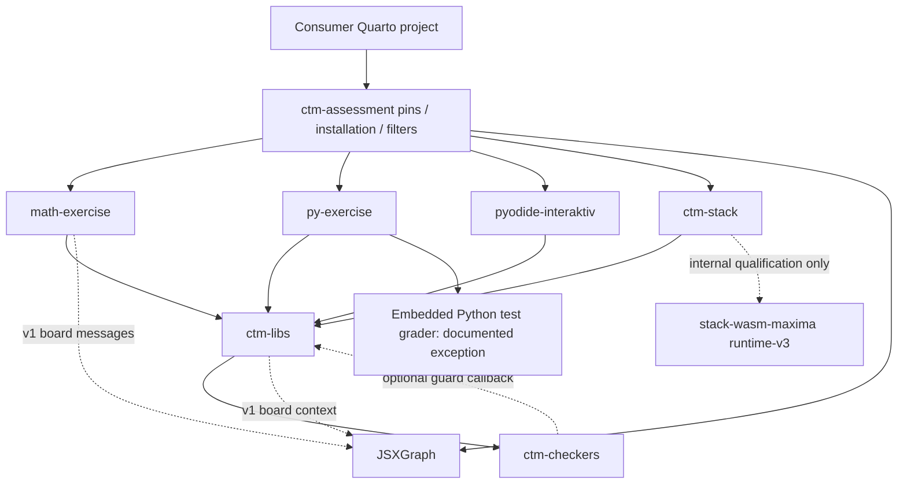

# Part B — Separation of code between packages

## Verdict and method

The main consolidation holds: shared settings, locale catalogues, Python bootstrap/worker, answer persistence, progress and copy/export live in ctm-libs; mathematical grading and STACK's SymPy grading live in ctm-checkers. Integrations still contain presentation, task rendering, editor setup and protocol clients. A documented exception keeps Python-exercise grading inside py-exercise. This does not satisfy the stronger target in this audit that **all** grading belongs in ctm-checkers; it is not an accidental reintroduction (the accepted step-2 amendments explicitly retain `MODULE_PY`: ctm-assessment `docs/consolidation/2026-10-step2.md:565`).

Evidence is from pinned Git blobs, not mutable working trees. In particular ctm-stack's worktree is newer than its pin: every stack ownership/duplication result uses `git show e8437f1:<path>`. The lexical interface inventory includes platform APIs and computed-name limitations; it is a navigation aid, not a claim that every use is a public contract. Source ownership is assigned by package/folder and known generators; it is not a copyright opinion.

## Ownership map and reproducible inventories

`inventory/ownership.tsv` and `inventory/ownership.json` contain one row per tracked `_extensions/` file in the component snapshots, plus source-panel filters and canonical bootstrap. Each row has repository, exact commit, path, owner, source/copy/generated classification, generator, bytes and SHA-256. `inventory/contracts.json` records literal browser globals and data attributes with source line references. Consumer repositories that do not track `_extensions/` have no shipped-file row; untracked installed folders are not attributed to their Git commit.

| Repository | Inventoried files, including source filters/bootstrap | Main owner / generator |
|---|---:|---|
| ctm-libs | 58 | Shared Lua/runtime/feedback/UI/locales; policies and embedded UI strings partly generated by `scripts/sync-feedback-defaults.py`; worker-core generated by `scripts/sync-worker-core.cjs` |
| ctm-checkers | 6 | Both wheels, JS wheel payloads and `checkers.json` generated from `src/` by `tools/build.py` |
| math-exercise | 15 | Component rendering, native-authoring adapters, math-similar/store glue; bootstrap copied from ctm-libs |
| py-exercise | 7 | Editor/execution/test presentation and embedded Python grader; bootstrap copied |
| ctm-stack | 19 | Card, SymPy adapter and internal native transport qualification sources; bootstrap copied |
| ctm-assessment | 10 | Package filters, author imports, tab IDs, board pins and offline styles |
| pyodide-interaktiv | 76 | IDE sources; generated ctm-libs copy and ai-feedback forwarder via **`scripts/sync-ctm-libs.py`**, not `tools/`; bootstrap copied |
| jsxgraph-quarto | 9 | JSXGraph filter, editor, static export tooling and bundled upstream JS/CSS |
| freehand_ai_assessment | 1 | Manually adapted math-exercise source-panel filter, no automated generator |
| **Total** | **201 / 3,841,527 bytes** | Includes full wheel and upstream browser-library bytes |

The full package additionally creates native authoring files under ctm-checkers using `tools/build_authoring.py` (ctm-assessment `scripts/setup-feedback-integration.py:207`). These are generated distribution products, not extra tracked source files. ctm-stack `native/browser-worker.js` is explicitly internal qualification code, absent from the published card resources (`_extensions/ctm-stack/native/README.md:75`); the pin does not expose the newer native card backend.

## Duplication appendix — October to this snapshot

The exact-duplicate inventory finds **54 SHA-256 groups**, dominated by pyodide-interaktiv's deliberate generated library copy. The normalized file comparison finds **4 near-duplicate pairs** at similarity >=82%; its comment/whitespace normalization is a heuristic and is not a complete function-level clone detector.

| Concern | Snapshot evidence and change since October | Assessment |
|---|---|---|
| Runtime / feedback loader copies in math and py | `feedback-loader.lua` and `shared/pyodide-runtime.js` are absent; builder `setup-feedback-integration.py:24,161,190` rejects their return | October duplication removed; do not re-report |
| Bootstrap | Identical SHA `8bf7da5740a0…` in ctm-libs/bootstrap, math, py, IDE, stack | Deliberate and enforced (`setup-feedback-integration.py:167`); one canonical implementation with distributed copies |
| Old source-panel filter | ctm-libs, py-exercise and IDE share old 58-line filter SHA `c37659469c88…`; math/umbrella have separate evolved implementations | Prior November L9 remains; consumer copy must be tracked separately |
| freehand source-panel filter | `_filters/example-source.lua:1` explicitly attributes its math-exercise origin; it adds page opt-in and removes policy panels, retains escaped `<pre><code>` source and test panels, supports only en/nb labels | New consumer-level adapted copy; excluded by the >=82% whole-file clone threshold because entire policy sections differ. Manual inspection required; keep attribution and centralize source-panel primitives |
| Native variants local review | math vs stack `variants-review.py` normalized similarity **96.99%** | Prior November M13 remains; shared review server belongs with native authoring in ctm-checkers |
| IDE shared library | Most files identical, but feedback-core similarity96.94%, worker wrapper97.35%, worker-core96.54%; `pyodide-sympy.json` missing from shipped older copy | New observable standalone/package capability gap, B2 |
| Matrix UI, locale resolver, math Python | Canonical homes are ctm-libs UI/catalogues and ctm-checkers; October vendored matrix/checker Python no longer appears in math | Consolidation succeeds |
| Small parallel concerns | Monaco loader py-exercise `py-exercise.js:30`; KaTeX setup math `math-exercise.js:59` and feedback `feedback-dom.js:200`; bridge clients math `math-exercise.js:689` and feedback `feedback-dom.js:398`; HTML escaping in component files | Prior M12's deferred shared-loader work remains; maintainability concern, not evidence of exploitation |

## Cross-package interface catalogue

The literal catalogue contains 270 global-name entries and 213 data-attribute-name entries counted per repository, including browser built-ins and copied libraries. The table below identifies the meaningful contract families. Component-local test hooks are not stable APIs.

| Contract / producer → consumer | Version and validation | Evidence / gap |
|---|---|---|
| Lua singleton `_G.__ctmLibs`, `ctm.path/fail/filters`; bootstrap → component filters | `ctm.api=3`; bootstrap checks minimum API; singleton compares version strings | ctm-libs `lua/ctm.lua:27,41`, `bootstrap/ctm-bootstrap.lua:49`; same version is not same bytes, B1 |
| `ctm.settings.{load,get,string,bool,number,choice,policies}` → components | Within Lua API3; typed checks, origin tracking, read-settings JSON | `lua/settings.lua:60,158,172,194,237`; settings sections enumerated at24 |
| `ctm.locale.{resolve,tag,text,use,language}`, `CTMLocales` → all components | Within API3, no separate JS version; namespace/language resolution and catalogue validation | `lua/locale.lua:18,69,87`, `locales/ctm-locale.js:33,140`; B3 on feedback's parallel resolver |
| Lua policy/feedback selection and `__aiFeedbackPolicies`, `__aiFeedbackConfig` → feedback widgets | Feedback request version1; Lua emits escaped JSON, JS typed normalization; policy strings resolved against definitions | `lua/policy.lua:9,15`; `lua/feedback.lua:388`; `feedback-core.js:177,223` |
| `AIFeedback` core → DOM → UI/integrations | Library version0.9.0, request schema1; `normalizeRequest` checks shape/text/image budget, core alone exports CommonJS | `feedback-core.js:6,177,419`; `feedback-dom.js:447`; `ai-feedback.js:4`; methods are feature-checked inconsistently; no independent DOM/UI API level |
| `MathExerciseRuntime` → math, Python, IDE, STACK | No exposed API version; Lua capability gates and library pins; serial `transaction`, guarded module install and `callCheckers` | `runtime/pyodide-runtime.js:484,533,620`; most methods assumed present after bootstrap |
| `CTMWorker`, `mainPyodide`, `qpyodideReady`, `qpyodideInstance`, `_qpyodideGetInstance`, `__qExercisePyodide` → shared runtime/IDE | Unversioned runtime/proxy protocol; worker envelope ID/command checks, init options, pending request map; published singleton | `runtime/pyodide-worker.js:882,1273`; order and proxy subset are contractual, not just names |
| `CTMCheckers`, `CTMCheckersStack` → runtime; `ctm.checkers` → Lua | Version0.12.0.dev0, API1.1; compatible major/minor at render time; wheel SHA256, install checks, manifest checks | ctm-libs `lua/checkers.lua:27,58`; checkers `ctm-checkers.js:39`; `docs/api.md:25` |
| Python `browser.call(name, caller)` → handlers | API1.1; fixed `CALLS` allowlist, JSON request; per-handler admission, guard restore | ctm-checkers `src/ctm_checkers/browser.py:25,59`; request does not itself carry schema/API version |
| `math_exercise.check` | `{student,correct,vars,mode,reject,tolerance,decplaces,sigfigs,form,partial_credit,form_credit}` → `{status,score}` / error | `checks.py:19`; `docs/api.md:155`; mostly handler checks/defaults rather than complete JSON-schema validation |
| `math_exercise.check_custom` | `{checker,vars,response,question_context?,givens?,fields?,generated?,learner?}` → normalized status, score, feedback, assessment | `custom.py:26,35,54,82`; checker is trusted author code, response data is not |
| `compute_key`, `admit_generated`, `bind_data` | Recipe / mathematical grammar; exact codec, admitted names/kinds and display context → key or bound context/LaTeX | `keys.py:27,88`; `generated.py:135,203`; additional operations still API1.1, retained API-level gap |
| `run_question` at build time | Options/base/variables/teacher/variant → checked fields/status/score | `authored.py:147,222,240,257`; native Python API, not a browser.call name |
| `CTMStore` / `ctm:result` → progress, variants, integrations | Store record v1; status restricted correct/partial/wrong/invalid, finite score0..1; source/variant identity restoration | `ui/ctm-store.js:247,312,333,465`; `ctm:result` event itself has no version |
| `CTMCopy`, `CTMExport`, `CTMVariants`, `CTMLayout`, `MatrixInput` | versions1,1,1 (ranking2),1,1.0.0 respectively; method/option checks; most callers rely on install pins | `ui/ctm-copy.js:56`, `ctm-export.js:101`, `variants.js:96`, `ctm-layout.js:98`, `ctm-matrix-input.js:232` |
| `CTMSettings`, `CTMNav`, `CTMReveal` | Unversioned JS globals; library dependency ordering; settings register/reveal target methods | `ui/ctm-settings.js:56`, `ctm-nav.js:485`, `ctm-reveal.js:112` |
| `CTM_ASSETS`, `CTMAssets` | Configuration v1; resolver selects bases/known assets | `lua/assets.lua:128`, `assets.js:5`; app and builder derive from version homes |
| JSXGraph `postMessage` → math/feedback | protocol `jsxgraph-quarto-assessment`, version1; source window, requestId, assessmentId, type and byte budgets checked | math `math-exercise.js:715`; feedback `feedback-dom.js:415`; duplicate clients differ in size envelope and image requirement intentionally |
| STACK `CTMStackAdapters` and descriptor → controller | Descriptor `{id,version,adapter,requires:{isolation}}`; methods start/request/stop/restart and isolation match validated | ctm-stack `ctm-stack.js:13,26,78`; response ok/error envelope validated; version is package version, not explicit adapter schema |
| Integration globals `MathExercise`, `MathSimilar`, `MathExerciseStore`, `MathExerciseBoards`, `PyExerciseFeedback`, `__mathExerciseConfig`, `__pyExerciseConfig`, `__pyExercises` | Component-local; boards version1; remaining globals unversioned | Defined at `math-exercise/math-exercise.js:1730`, `math-exercise/math-similar.js:1442`, `math-exercise/math-store.js:201`, `math-exercise/variants-board.js:108`, `py-exercise/py-exercise-feedback.js:48` under each repository’s `_extensions/`; Lua emits configs |
| `data-vars`, `data-mode`, `data-checker`, `data-givens`, `data-similar-data`, `data-context-refs`, field/matrix attributes | Escaped strings/JSON at Lua→DOM; downstream parse/type/admission checks; no HTML contract schema version | math-exercise.lua342,1001–1024; shared store data attributes `lua/store.lua:48`; exact names/uses in contracts.json |

### Load-order assumptions and dependency matrix

Legend: **D** declared dependency; **B** build/package only; **A** adapter/protocol; **E** documented exception. Row calls column.

| Caller → callee | assessment | libs | checkers | math | py | IDE | STACK | JSXGraph | Maxima |
|---|---|---|---|---|---|---|---|---|---|
| assessment builder/filter | — | B | B | B | B | B | B | B | — |
| libs | — | — | D | — | — | A legacy runtime names | — | A protocol | — |
| checkers | — | A `_ctm_guard` when in browser | — | — | — | — | — | — | — |
| math | A bootstrap presence | D | D via libs | — | — | — | — | A | — |
| py | A bootstrap presence | D | **E own grader** | — | — | A shared globals | — | — | — |
| IDE | optional package | D generated standalone copy | — | — | — | — | — | — | — |
| STACK | A bootstrap presence | D | D | — | — | — | — | — | A internal only at pin |
| JSXGraph | — | — | — | — | — | — | — | — | — |
| consumers | D | through package | through package | authored use | authored use | authored use | authored use | authored use | — |

The library→checker→library edge is an optional installed guard callback, not a source import cycle at build time. Legacy IDE runtime globals in ctm-libs invert naming ownership but are now produced by its own worker. Startup still requires assets/locales/runtime before component scripts, feedback-core before DOM before UI, and shared matrix/store/variants before component initialization. The package's dependency registration encodes order; browser globals do not independently negotiate incompatible versions. `ctm.checkers.use('stack')` orders base wheel payload before STACK payload; development wheel hash suffix avoids cache mixing (`lua/checkers.lua:133`).

## Version homes

| Dependency | Canonical application home | Enforcement and limitation |
|---|---|---|
| Pyodide0.28.3 | ctm-libs `runtime/pyodide-runtime.js:102` indexURL | `ctm_assets.validate_version_homes:689` checks runtime version/source digest against full lock |
| SymPy1.13.3 | Pyodide lock; generated `runtime/pyodide-sympy.json` | Generator `scripts/sync-pyodide-sympy.py`; host constraints should match; generated copy absent in pinned standalone IDE |
| KaTeX0.16.47, Monaco0.46.0, MathJax3.2.2 | ctm-libs `assets.json` | Asset lock validates versions and canonical table bytes; npm devDependencies are separate test tool versions |
| JSXGraph1.14.2, MathJax4.1.3 / font4.1.3 | assessment `jsxgraph-pins.yml` | Board versions checked separately by same validator. JSXGraph fork defaults duplicate versions for standalone use; those need agreement tests rather than pretending there is literally one declaration everywhere |
| Quarto1.8.27 | assessment `integration/feedback/repos.json`; component manifests require >=1.8.27 | Runtime validation exists; CI workflow tools may independently select versions |
| Node / Python | Workflow setup steps, component metadata and runtime requirements | No single package-wide version home or `validate_version_homes` coverage; validation applies to browser asset homes, not build tools |

`validate_version_homes` is a useful lock gate, not a repository-wide uniqueness checker. It builds expected versions from assets/runtime/board pins and rejects inconsistent lock provenance (`ctm_assets.py:689–703`). ctm-stack's fallback MathJax3.2.2 at its pinned `ctm-stack.lua:157` and JSXGraph standalone defaults remain independent declarations.

## Dead/divergent code, documentation and locales

No export is called dead solely because the lexical inventory lacks a literal reference: public APIs, string-driven locale keys and Python dispatch use dynamic names. In particular `browser.call` allowlist values and generated JS payloads are live; `ctm-stack/native/` qualification sources are live in internal tests/build tooling even though cards cannot select them at this pin.

Legacy `variables`, `test(check,symbols)` and native wrappers still have authoring users and compatibility tests; removal needs a migration decision. The standalone `ai-feedback` *alias* has gone from canonical ctm-libs, while the generated **forwarder** remains in IDE for old project installation migration. Those are distinct mechanisms. No unsupported inference of dead code is made.

The published API docs lag code: `ctm-libs/docs/api.md:49` still says `ctm.api=2`, whereas `lua/ctm.lua:41` declares3. Newly added compute_key/bind_data operations remain API1.1 (`ctm-checkers/src/ctm_checkers/__init__.py:8`). The exhaustive option-to-doc example render comparison requires Quarto workflow evidence; lexical matches alone cannot establish that a documented option works.

`python ctm-libs/scripts/check-locales.py` **passes**, with exact key/type/argument parity *within every supported catalogue language*. `sync-feedback-defaults.py --check` and `sync-worker-core.cjs --check` also pass.

| Catalogue | Supported languages | Keys |
|---|---|---:|
| common | en,de,nb |14|
| ctm-stack | en,nb,nn,de,sv,da |72|
| feedback | en,de,nb,es,nn |31|
| math-exercise | en,de,nb |57|
| py-exercise | en,de,nb |47|
| pyodide-interaktiv | en,de,sv,nb,da |68|
| ui | en,de,nb,nn |91|

Thus parity across **en,nb,nn,de,es in every component** does not exist: missing languages are deliberate namespace fallbacks, not missing keys within supported languages. Lua resolves component option → ctm-assessment.lang → page lang → en (`lua/locale.lua:69`); primary tags normalize no→nb and nn→nn,nb,en. JS CTMLocales matches this. Feedback's separate resolver still maps nn directly to nb, bypassing its own complete nn catalogue (B3). User-facing dynamically propagated Python/provider errors may remain English; catalogue parity does not translate exception text.

## Findings and retained issues

### B1 — Same-version library singleton bypasses mixed-installation protection

**Medium; verified; retained November M4/M5, not a new fixed-issue report.** ctm-libs `lua/ctm.lua:27–32,41`; bootstrap `ctm-bootstrap.lua:49`; math `math-exercise.lua:8`; py `py-exercise.lua:5`; stack pinned `ctm-stack.lua:2`.

`contract-probes.py` executes the real `ctm.lua` with a cached singleton at another directory, version0.9.0, API1. It returns that older singleton with exit0. The guard compares paths **and unequal version strings**, so independently changed0.9.0 trees evade it. math/py request API1; stack requests2 despite newer facilities. Impact: mixed installs can run stale library code or fail on missing methods. Fix: bind a generated content/contract identity and request actual required API; bump releases/API when adding contracts. A Lua-only fix need not change any of the eight selected application files. Nevertheless, repinning the changed ctm-libs commit moves its exact application_ref, so the P13 lock/receipt must be regenerated and reviewed even if runtime bytes are identical.

### B2 — Standalone IDE ships stale shared-provider and Stop implementations

**Medium; verified bytes/check failure; end-user WebKit behavior plausible until browser reproduction.** pyodide-interaktiv `.github/ctm-libs-source.json:3` pins33fd5a5 instead of package b1e7ec8; `scripts/sync-ctm-libs.py:16,65`; shipped `feedback/feedback-core.js:283,321`; shared canonical worker probe `ctm-libs/runtime/pyodide-worker-core.js:65`.

Pinned standalone IDE's library differs in feedback-core.js, pyodide-worker.js, worker-core.js and lacks `runtime/pyodide-sympy.json`. `python <IDE snapshot>/scripts/sync-ctm-libs.py /workspace/ctm-libs --check` fails listing all four and source-pin mismatch. Checking against a temporary local clone at its **own** recorded33fd5a5 source **passes**: these are correctly generated older copies, not corrupt hand edits. Code comparison shows the standalone copy lacks SSE generation, the single-leading-system corrective retry and elapsed network diagnostics, plus WebKit's revoked-blob Stop probe. The umbrella excludes shipped foreign copies (`setup-feedback-integration.py:482`), so this affects standalone installs, and mixed installations through B1; it does not prove the built package uses stale bytes. Fix: regenerate IDE copies and pin together; add umbrella/standalone source-pin agreement check at release with an explicit allowed-lag development policy. Runtime update requires checking P13 lock ownership before application runtime changes are admitted. Prior general sync-risk findings anticipated this class; this is a newly measured concrete byte/capability divergence.

### B3 — Feedback widget bypasses Nynorsk catalogue

**Low; verified; retained November L7.** ctm-libs `feedback/ai-feedback.js:10`; `locales/ctm-locale.js:33`; `locales/feedback.js:148`.

`node locale-probe.cjs /workspace/ctm-libs` on `<html lang=nn>` prints commonResolver=`KI-innstillingar`, widget=`Innstillinger for KI`. Shared/server UI and feedback settings disagree; complete nn strings are unreachable from the widget. Fix: share CTMLocales resolution, or mirror its fallback chain in the self-contained feedback bundle. No grading or selected P13 runtime-byte impact; repinning the changed ctm-libs commit still moves its exact application_ref and needs the matching P13 receipt review.

### B4 — Native review server remains duplicated

**Low; verified duplication; retained November M13.** math `_extensions/math-exercise/variants-review.py:29` and stack `_extensions/ctm-stack/variants-review.py:29`, class Review. Inventory normalized similarity96.99%. Impact: security/preview/lifecycle changes need two implementations and tests; no demonstrated exploit follows from similarity alone. Fix: move shared review server into native ctm-checkers authoring distribution, keep component source/preview callbacks. No P13 application lock dependency.

### B5 — Python-exercise grading remains outside the grading library

**Info; verified architecture exception, not a newly introduced bug.** py-exercise `py-exercise.js:84,211,239,263`; accepted step2 `2026-10-step2.md:565`. `contract-probes.py` extracts and runs MODULE_PY; x=2 with assert x==2 / assert x==3 returns pass/fail from the integration alone, without ctm-checkers. Its AST restrictions, individual-test semantics and encode operation therefore evolve separately from the grading library's releases. If the audit's stronger intended architecture remains the goal, extract a versioned Python-exercise grader with parity goldens before changing behavior. Keep stdout/plots and worker callbacks as runtime adapters. Requires parity coverage; no reason to touch P13 locks for pure Python module extraction unless wheel/payload ownership is included by the approved asset process.

## Rerun and limitations

Run `python code/architecture/inventory.py architecture-snapshots.json inventory`, `python code/architecture/contracts.py architecture-snapshots.json inventory/contracts.json`, `python code/architecture/contract-probes.py /workspace`, and `node code/architecture/locale-probe.cjs /workspace/ctm-libs`. Manifest paths must point to Git object stores containing the recorded commits. Inventory reads only Git blobs and writes only the designated output directory. Freehand is included at2803b6b6ab3b9a936d03a7985693a97763cf7f4f. These checks do not replace rendered browser interaction tests; no claim of exhaustive dead-code proof, complete function-level duplicate detection, or undocumented-option absence is made.
