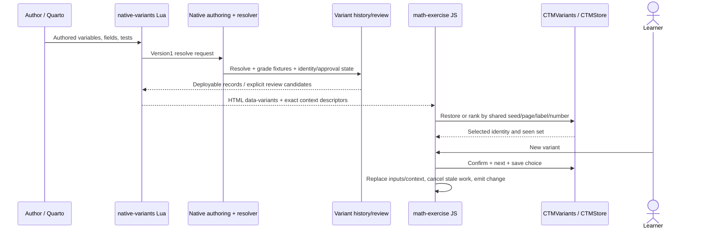

# Math correctness and workflows C3, C6, C7

Scope: math-exercise `39df17ee28789e7d8d5d8e0abc01dcb967fc8858`, ctm-checkers
`4cff6aa604fb04de838e7c479d38f14ad9e21c57`, ctm-libs
`b1e7ec80b198eacd04793fd1cec2adb776555b73`, and the root auditor's current
freehand snapshot `2803b6b6ab3b9a936d03a7985693a97763cf7f4f`. Source trees were read-only. All provider
outputs below are synthetic; no provider or API key was used.

## Findings to merge into the main register

### GR-1 — Inclusive numeric tolerance rejects exact boundary answers

**Critical under the task's explicit grade-corrupting-in-normal-use rubric;
verified.** Scope is numeric grading at a floating-point tolerance boundary,
not arbitrary control of scores. ctm-checkers
`src/ctm_checkers/math_exercise/checks.py:19` compares binary floating-point
subtraction directly with the tolerance (`:27`), after converting mathematical
answers to complex binary floats (`:71`). `numeric.py:30` also parses absolute
and percentage tolerances as binary floats.

Reproduction: run `code/grading/grading_probe.py` with SymPy 1.13.3. Numeric
`student="1.1", correct="1", tolerance="0.1"` returns `wrong,0`; `0.9`
returns `correct,1`. The same asymmetry occurs at `10%`. Binary subtraction
produces `0.10000000000000009` at the upper boundary. Six of twenty exact
absolute-0.1 boundaries around integer keys 1..10 were rejected. A real learner
answer can therefore lose credit despite satisfying the documented inclusive
tolerance. This is distinct from October F-69's repaired half-up rounding;
`decplaces` and `sigfigs` take separate code branches and their rounding fix
does not repair `abs(sv-cv) <= tolerance`.

Replayed the same requests using npm Pyodide 0.28.3 and SymPy 1.13.3: reproduced
for hash seeds 0, 1, 42, with no native/browser discrepancy. Deterministic parity
preserves this defect. Proposed fix: compare exact finite parsed numeric
expressions against exact decimal/percentage tolerances, or explicitly define
and test a narrowly bounded ULP allowance. Include upper/lower boundaries,
negative references, percent zero references and immediately-outside values.
P13 application binding must be reassessed when releasing changed checker
wheels; no lock was changed here.

### GR-2 — Freehand derivative checker gives full credit to a non-derivative

**Critical under the task's exploitable/grade-corrupting rubric; verified;
consumer-only.** freehand `_includes/logarithms/problems.md:99` samples a
learner expression at ten hard-coded points, then returns true at `:112` and
full credit at `:127`. It does not prove equality for rational functions.

Reproduction: `code/grading/freehand_probe.py` extracts and runs the exact
authored checker, forms `cancel(target + product(x-p for p in points))`, and
submits the resulting single reduced fraction. The actual checker returns
`correct,1.0,"Correct, and simplified."`. The expression differs from the
derivative at x=4 by `-27374193/500`. This is a grading false positive reachable
using ordinary answer text, with no Python injection or runtime tampering.

Proposed fix: for rational target/response pairs, first require
`cancel(f-target) == 0`, and then apply the intended form tests. For functions
without a decidable exact test, classify unsupported cases explicitly or use
fresh random samples as a probabilistic check with bounds; fixed publicly
shipped points must not establish correctness. Add this non-equivalent
polynomial perturbation as a regression. This consumer checker change does not
require editing the current umbrella P13 asset lock.

### GR-3 — Exact tangent task accepts an exact but wrong intercept

**Medium; verified; consumer-only.** freehand
`_includes/logarithms/problems.md:195` uses a `1e-6` relative numeric check for
slope and point, then `:200` distinguishes exactness only by presence of
`Float`. `2*x-E+1/10000000` contains no Float, is not the tangent, and receives
full credit. This is much narrower than GR-2: it accepts a small exact
perturbation inside the numerical tolerance. The problem explicitly requests
exact values.

Reproduction: `code/grading/freehand_probe.py`, `exact_offset` result. Fix:
prove exact slope/intercept agreement for exact inputs; reserve numerical
closeness for the existing partial-credit feedback about approximate answers.
No P13 lock change is needed for this consumer-only source correction.

### GR-4 — Restored non-custom practice keys keep a forged computed badge

**Medium; verified; local generated practice only.** math-exercise
`_extensions/math-exercise/math-similar.js:402` validates restored key type and
`:406` validates only that `computed` is boolean. `restore` at `:1390` mounts
it without rerunning `compute_key`. `mount:1159` puts that key into the input's
`data-answer`. Editing saved key 3 to 9 while preserving `computed:true`
restores successfully. Reproduction: public-API jsdom harness
`code/grading/similar_probe.cjs`, `restoredNoncustomTamper`.

The input is same-origin local storage, so this is not a separate cross-origin
attack. Its practical effect is false grading/bad trust labels after storage
tampering or another page on the same origin changes a record. It does not
alter the original exercise's grade/progress. Fix: recompute recipe-backed keys
and compare against stored keys before enabling Check; restored AI-only keys
must retain an explicit unverified label. For custom `similar-data`, the newer
`boundContext:506` already rebinds data and compares stored LaTeX; do not remove
that protection. Application JS changes require assessment against P13 review
coverage before release, although ordinary exams disable similar practice.

## Verification and raw-measurement summary

| Execution | Result |
|---|---|
| Pinned ctm-checkers `tests/test_generated_keys.py` with CPython 3.12/SymPy 1.13.3 | 110 passed, 0 failed, 0 skipped |
| Seeded generated polynomial identities and +1 non-identities | 200/200 as expected |
| Exact freehand 1b, 3b, 3c checker source; 30 equivalent spellings and 30 wrong shifts each | 180/180 as expected, plus GR-2/GR-3 counterexamples |
| CPython/Pyodide comparison, same 204 requests, hash seeds 0,1,42 | 612/612 identical; includes the GR-1 failure |
| Actual `MathSimilar.attach` and real math renderer, synthetic provider, CPython browser dispatch | recipe/question mismatch admitted; edited restored key retained; late candidate after variant-change rejected; edited custom context ignored; mismatched saved custom display disables Check |

The property corpus is deliberately bounded: polynomial/rational identities and
the three exact authored freehand checkers. It does not prove arbitrary
transcendental equivalence, domain-sensitive equality, all matrices/graphs,
STACK, browser worker restart, or the complete authored parity corpus. Node
Pyodide tests use pure Python packages copied from the installed PyPI cache;
they measure WASM grading semantics rather than browser worker/network behavior.

Local three-boot measurements (one host; no browser/CDN) were:

| Operation | Repetitions | Minimum / median / maximum |
|---|---:|---|
| npm Pyodide 0.28.3 bootstrap | 3 | 749.6 / 755.2 / 895.5 ms |
| SymPy 1.13.3 + checker import after local archive unpack | 3 | 1578.0 / 1592.1 / 1661.7 ms |
| 204-request grading batch | 3 | 1834.6 / 1839.6 / 1888.8 ms |
| `parse_math` balanced 120-term expression, near 512-node limit | 10 | 0.342 / 0.353 / 0.779 ms |
| `bind_data`, two givens including ln and Euler e | 10 | 0.221 / 0.258 / 1.314 ms |

These are descriptive repeated timings, not claims about laptops or first page
load. Checker wheel installation and real worker restart were not measured by these
probes. The additional panel-memory probe below supplies bounded JS-heap
measurements; full browser/worker memory remains unmeasured. Broad suites and browser campaign results
belong in the master report.

## C3 — Learner Check in math-exercise

Call chain at the snapshot:

1. `math-exercise/math-exercise.lua:833` obtains native/shared dependencies;
   `CodeBlock` parses `#|` options (`:216`), creates fixed/dynamic input markers,
   and emits escaped `data-vars`, field and policy attributes (`:968`, `:1001`).
2. `math-exercise/math-exercise.js:1051 setupCell` reads those attributes,
   registers handlers and isolates the parent question's inputs from generated
   descendants. `runCheck:1372` snapshots input/variant/runtime epoch, disables
   buttons and offers timed Stop when loading/checking is slow.
3. Fixed-field `checkField:884` copies input/options; `checkFieldNow:886` builds
   `{student,correct,vars,mode,reject,tolerance,decplaces,sigfigs,form,
   partial_credit,form_credit,generated,learner}`. Custom path
   `checkCustomNow:962` builds `{checker,vars,response,question_context|givens}`.
   Matrix responses include shape/raw input and are decoded in custom.py.
4. `runOnCurrentRuntime:921` obtains runtime and packages;
   `callCheckers:875` adds `math_exercise.` and delegates to
   `ctm-libs/runtime/pyodide-runtime.js:500 callCheckers`. Per-interpreter
   transactions queue installation, request globals, browser call and cleanup.
   Worker transport is the shared runtime's Pyodide facade and
   `runtime/pyodide-worker.js`, not a math-specific worker implementation.
5. `ctm-checkers/browser.py:59 call` consumes `_ctm_request`, selects only an
   entry of `CALLS:26`, applies `inputs.admit`, runs the handler and restores the
   installed guard. `math_exercise/checks.py:31 check` handles built-ins;
   `custom.py:26 check_custom` decodes exact context/givens and invokes trusted
   authored checker code. `numeric.py:16/24/30` supplies rounding/tolerance.
6. JS rejects stale input/variant/Stop results (`:1431`, `:1461`), escapes custom
   feedback text, renders status and calls `publishStoredResult:1496`.
   `math-store.js:185 result` delegates to
   `ctm-libs/ui/ctm-store.js:312 result`, which validates status/score, saves
   and emits `ctm:result:333`; `ctm-progress.js:182` consumes it for progress.

```mermaid
sequenceDiagram
  actor L as Learner
  participant M as math-exercise JS
  participant R as ctm-libs runtime/worker
  participant B as ctm_checkers.browser
  participant C as Built-in/custom checker
  participant S as CTMStore/progress
  L->>M: Check / Enter (raw answer)
  M->>M: Snapshot input, variant, Stop epoch
  M->>R: callCheckers(name, request)
  R->>R: Queue install + request transaction
  R->>B: call(allow-listed name, JSON)
  B->>B: Consume request, learner admission, guard
  B->>C: Parsed expression / response + exact context
  C-->>M: JSON status, score, optional assessment
  M->>M: Discard stale result; render escaped feedback
  M->>S: Completed result only
  S-->>L: Saved result / progress update
```

| Boundary/data | Validation |
|---|---|
| Authored `#|` vars/options/context to DOM | Lua escapes attributes; native options validated before transport |
| Learner text/matrix to grader | Browser dispatch admission; matrix rows×cols validated in custom.py; generated learner positive token filter |
| Shared JS to worker/Python | JSON serialization, per-interpreter queue/epoch, allow-listed browser handler names |
| Exact question context to custom checker | Versioned codec `decode_context`; symbol assumptions and field count checked |
| Verdict to persisted result/events | Status allow-list and finite score0..1 in CTMStore; stale checks dropped |

Numeric precision precedence is decimal places, then significant figures, then
absolute/percentage tolerance, then default relative `1e-8*max(1,abs(key))`.
Rounding uses 15 significant decimal digits and half away from zero. Percent
tolerance is relative to abs(correct), including zero radius for key zero.
GR-1 applies to the tolerance branch. `exact`/form/reject checks are separate
semantic constraints, not a stronger numeric precision setting.

Failure UX: empty answers show an empty-response message; parse/custom failures
show a friendly escaped error; completed wrong/partial/correct results persist.
Loading/check cancellation and infrastructure exceptions do not overwrite a
previous completed score (`math-exercise.js:1482`). Slow loading offers Stop
under runtime load limit; slow Check uses its own timer. Variant/input changes
invalidate pending results through snapshot comparison.

Storage: `ctm|1|encode(course)|encode(page)|encode(exercise-id)` in CTMStore
(`ctm-store.js:85`); source hash, exact variant identity/seen choices, component
inputs, timestamp and last result form the envelope. User preferences/seed live
under course-prefixed `~prefs`/`~seed`. `math-store.js` owns input adaptation,
not a second storage implementation. Local result events are client state, not
an authenticated gradebook.

## C6 — Similar practice

Call chain:

1. `math-exercise.lua:968` validates authored `givens`/`similar-data`; generated
   cells cannot recursively generate. `math-exercise.js:1622` calls
   `MathSimilar.attach` with renderer/checker/runtime/store callbacks.
2. `math-similar.js:125 attach` captures authored contracts and builds controls.
   `generate:899` resolves author generation policy (`messages:775`), task,
   contexts and schema. Generator `client.complete(...,{generation:true})`
   passes bounded synthetic/model JSON to `parseCandidate:678` and `valid:296`.
3. Normalizations: non-custom supported model mode is reset to original mode;
   vars arrays become strings/missing vars inherit; custom vars/checker inherit
   author contract; `bareAnswer:670` removes one simple lhs assignment or
   converts finite JSON number to string. `normalizeMatrix:604` repairs only a
   complete row-major sequence with matching recipe selectors.
4. `admit:702` snapshots original grading options. For declared givens,
   `bindGivens:477` calls Python `generated.py:203 bind_data`; exact variables
   and LaTeX are returned; every declared given must appear as a `{{name}}`.
5. Recipe-backed scalar fields call `keys.py:27 compute_key` (fixed operation
   allow-list; parsed expression/variable/order/selector limits); model answer
   must match the computed key under the authored field's numeric precision.
   All candidates must pass actual built-in/custom assessment (`:754`).
6. If any field lacks a computed recipe, `solve:550` uses `F.getClient()` (the
   ordinary feedback model) with no key in its fresh request; answers must pass
   the same checker. This is independent context, not necessarily independent
   provider/model weights. All-computed candidates skip this solve.
7. Generation rechecks cancellation/snapshot and uniqueness, then `mount:1159`
   creates a bounded practice record. At most10 records, 14KB spec,18KB restored
   record; `math-store.js:48` trims oldest to fit a63KB parent envelope.
8. `restore:1390` validates saved records and mounts. Custom declared givens
   require `boundContext:506` rebind and exact display comparison before Check.
   `flag:1120` independently solves/rechecks; disagreement changes displayed
   confidence text, preserves the original key, offers regeneration.

```mermaid
sequenceDiagram
  actor L as Learner
  participant M as MathSimilar
  participant G as Generator client
  participant P as ctm-checkers
  participant F as Feedback solver
  participant S as Parent store record
  L->>M: Easier / Same / Harder
  M->>G: Policy + task + context + data contract
  G-->>M: Candidate JSON
  M->>M: Normalize; schema/slots/size/mode checks
  opt Declared custom givens
    M->>P: bind_data(original, names, model data)
    P-->>M: Exact context + LaTeX
  end
  M->>P: compute_key recipes; assess supplied answer
  opt At least one uncomputed field
    M->>F: Solve displayed question without key
    F-->>M: Answer array
    M->>P: Assess independent solve
  end
  M->>M: Check cancellation, original snapshot, duplicates
  M->>S: Mount and save nested generated record
  L->>M: Later restore / Check / flag
  M->>P: Rebind custom givens; compare saved display
  M->>F: Optional independent recheck after flag
```

| Boundary/data | Validation |
|---|---|
| Model question/solution/change | Strings/size/schema; normal escaped renderer, never authored raw-HTML path |
| Model vars/mode/checker | Variable grammar; inherited original grading mode/options; custom checker id must be original |
| Model givens | Exactly declared names; exact parse grammar; original number/expression kind; returned bound LaTeX substituted into question |
| Model recipe/key | Fixed op/arg/selector schema; bounded AST maths; computed/model answer agreement under actual precision |
| Solver answers | JSON count/length + mathematical admission + original trusted checker |
| Stored practice | Schema, sizes, boolean trust flag; custom rebind/display comparison; non-custom recipe/key not recomputed (GR-4) |
| Generated result/progress | Child `_generatedStore` stores nested practice result; no separate `ctm:result`/authored progress |

Can a wrong key be admitted? **Yes.** Public-API harness supplies question
"What is 2+2?", answer3 and `{op:"value",expr:"3"}`. It is admitted with
`computed:true` and one generator call. Recipe agreement proves arithmetic,
not the relationship of recipe to prose. This limit is explicitly documented
in `ctm-assessment/docs/similar-problems.md:9` and `:106`; it is an acknowledged
design limit, not a new repaired-issue regression. A mathematically right answer
4 is then wrong against that practice key. A second model agreeing can also be
wrong. Practice badges should explain this limit; stronger admission would use
author-declared structured operation templates rather than free prose.

Does #45 normalization weaken contracts? The inspected mode/vars/checker
defaults preserve original contracts and do not select model-supplied code.
`bareAnswer` deliberately discards one lhs assignment, so x=answer is treated
as the rhs even if the lhs is semantically inappropriate; the grader still
assesses that rhs against the fixed key/checker. This convenience does not prove
the generated prose/field correspondence. No additional injection or authored
grade change was reproduced from those defaults. Matrix repair is guarded by
complete selectors, exact field order and shape/field validation.

Failure UX: up to two candidate attempts, corrective reason fed back as data;
no card mounts before admission. Afterwards a generic localized generation
failure plus an expandable actual reason appears; configuration errors offer
settings. Python errors are reduced to their final reason for repair. Abort,
settings change and variant-change cancel in-flight generation. The harness
confirmed a late synthetic response after variant-change never entered store.
The public-API harness also replaced a saved custom context with junk and confirmed that Check received the fresh rebound context. Changing the saved display while leaving givens intact disabled that practice Check as outdated.
Flag/recheck never overwrites the original exercise result or recipe key.

Storage is `inputs.generated[]` inside the original CTMStore record, not a new
global key: numbered record, creation/direction, spec, answers, last result and
local flag/recheck state. Self-contained practice survives original revision
changes, with source checks disabling outdated custom checkers. Export includes
question/answers/generated trust metadata, not an automatic report to others.

## C7 — Variants

Call chain:

1. `math-exercise.lua:833/858` routes authored `variables` to
   `native-variants.lua:63 generate`; this uses shared approval/render settings,
   constructs version1 resolve request and invokes `question-variants.py`.
2. `question-variants.py:10` reexecutes under isolated Python; `_verify_native:32`
   checks installed native authoring file-set/hashes/path confinement. Its
   wrapper locates native ctm-variants; `variant_resolver.py:141 resolver` owns
   component markers/fields/teacher projection. Native authoring generates,
   grades fixtures, constructs exact context identities and applies history.
3. `native-variants.lua:90` requires version1 native response; deployable IDs
   constrain ordinary output. Review mode deliberately includes review
   candidates and `math-exercise.lua:1087` emits the unapproved banner.
4. `variants-review.py:29 Review` exposes a random-token loopback UI, binds
   candidate/source/history hashes and delegates mutations to native wrapper.
   `:398 valid` checks Host/Origin/route; stale sources/previews are rejected.
   `variants-board.js` builds observations and review actions; an HTML banner is
   a review-state indicator, not a network access-control boundary.
5. `math-exercise.js:1125 makeChooser` calls ctm-libs
   `ui/variants.js:24 create`; version1/rankingVersion2 validate numbered or
   explicitly allowed proposal identities. Shared seed+page+label+number feed
   deterministic rendezvous ranking; stored n/id/hash/seen restore choices.
6. New variant (`math-exercise.js:1580`) confirms discarding filled original
   answers, gets chooser.next, then `selectTask:1539` resets feedback and inputs,
   updates exact questionContext and emits variant-change/variant-accepted.
   Running math Checks compare local snapshots; MathSimilar aborts late
   candidates on variant-change; feedback reset hooks clear old hints/images.



| Boundary/data | Validation |
|---|---|
| Author Python/render machine | Trusted author code; isolated native wrapper + verified installed manifest, not a learner sandbox |
| Native response/Lua/HTML | Version1, deployable IDs, exact context codec preserving null; ordinary render refuses no deployable record |
| Review browser/native mutation | Loopback token, exact origin/host/route and source/candidate/history freshness |
| Learner selection/storage | Unique positive numbers, nonempty id/hash; deterministic ranking is selection, not security |
| Variant/context to grader | Exact context codec, matching fields, source/variant hashes; old answer/result marked changed/withdrawn |

Failure UX: malformed author/native options stop render with the exercise/file
reason; no deployable variants stops render; review-only/unapproved material is
visibly marked. Runtime missing CTMVariants/CTMStore fails setup with the shared
dependency message; withdrawn/changed saved choices are shown as stale with old
answers available for inspection. Input edits, Stop and variant changes discard
stale grading. Legacy handwritten pools keep `math-pool|pathname|label` and
`|id` session keys only when shared chooser is absent; native shared choices
use CTMStore's course/page/exercise envelope and course learner seed.

Variant authoring safety and approval-chain security require the Part A/C1/C2
reviews as well. The code read here does not justify calling arbitrary trusted
author code safe for untrusted learners. No additional variant grading defect
was reproduced by this bounded review.

## Focus D1, D2, D7 conclusions

| Model output | Validation and worst-case effect |
|---|---|
| Ordinary feedback prose | Rendered text/Markdown by feedback library; no grade setter in this math adapter |
| Generated question, solution, change | Bounded escaped prose; may misstate the mathematical task; persisted only in practice |
| Generated answer and recipe | Mathematical grammar + computed agreement; wrong recipe/question relation can create wrong practice key |
| Generated givens / LaTeX | Exact parser + author-opened names/kinds; fresh context binding, every named given displayed |
| Solver/recheck answer | Bounded JSON and actual checker; agreement is not proof; disagreement updates local disputed label |
| Authored grade/progress | Only actual checker result enters original CTMStore result path; generated children have nested store hooks |

Verdict D1: AI is not a trustworthy mathematical authority. Separation from
authored progress is in good shape; arbitrary model prose cannot be certified by
recipe arithmetic. GR-4 shows a local restored-key trust gap.

Verdict D2: Native and WASM semantics agree on the measured corpus and three
hash seeds; agreement alone is not correctness. GR-1 is a shared deterministic
numeric error; GR-2/GR-3 are consumer checker errors. The `.github/workflows/parity.yml:88`
campaign compares base/head on the same dependency versions, so unchanged wrong
grades produce green parity. Its corpus needs independent mathematical oracles,
boundary expectations and property/counterexample cases, alongside regressions.
The synthetic corpus here does not replace all authored matrix/graph/STACK cases.

Verdict D7: On this local WASM path imports dominate the tiny bounded parse/bind
operations. Reuse the shared interpreter/packages and measure browser worker
network startup separately before recommending eager preload changes. The additional bounded panel-memory probe below covers100 generations; no
browser/worker aggregate-memory or Stop/restart performance claim is made from
these Node measurements.

## Rerun and rejected hypotheses

Run `grading_probe.py --zip /tmp/ctm-pure.zip` with the pinned checkers source and
SymPy1.13.3; feed its JSON to `pyodide_probe.cjs PYODIDE_DIR /tmp/ctm-pure.zip
INPUT_JSON`. Run `freehand_probe.py FREEHAND_ROOT MATH_ROOT`; run
`similar_probe.cjs WORKSPACE PYTHON`. All outputs are JSON and should stay in
temporary files; the master report should retain only summaries.

Rejected or qualified hypotheses: #45 defaults did not switch authored grading
modes/checker bytes; #46 ln/e given binding returned exact E and expected ln
LaTeX; generated rows did not enter the original result event path; late
generation after variant-change did not mount; custom declared-givens restore
does rebind and compare display; recipe question mismatch is an explicitly
documented trust limit, not a newly fixed regression. October decimal rounding
was not re-reported as broken; GR-1 addresses its distinct tolerance branch.

## Completed official math-exercise parity workflow

The `.github/workflows/parity.yml` path was executed locally after the bounded
property probes. This is a real PR45 base/head comparison, not two copies of the
same math tree: base `17f1acefeca8a8da7128ffe73301347256e226d8` (PR45 merge's
first parent), head `39df17ee28789e7d8d5d8e0abc01dcb967fc8858`. Both used the
audited umbrella combination: ctm-libs b1e7ec8, ctm-checkers4cff6aa and JSXGraph
49a1c7d. This tests that combination, rather than reconstructing historical CI's
older `.github/pins.json` dependencies. Quarto1.8.27 rendered all12 project pages
in each scratch tree. The native helper resolved6 authored recipes containing
17 exact candidates without changing source/history.

The unmodified official `integration/pyodide-parity/run.cjs`, `worker.cjs`, case
collector, authored runner and comparison logic were copied to scratch and run:

```sh
PYODIDE_PARITY_WHEELS=/tmp/ctm-audit-math-parity/wheels \
CTM_PARITY_PYTHON=/workspace/.cloud-setup/venv/bin/python \
node /tmp/ctm-audit-math-parity/harness/run.cjs \
  --builds base=/tmp/ctm-audit-math-parity/base,head=/tmp/ctm-audit-math-parity/head \
  --site math-exercise=_site --sources math-exercise=. \
  --extensions _extensions --timeout 60 \
  --out /tmp/ctm-audit-math-parity/result-complete
```

**Result: exit0; zero differences, zero expected differences, zero missing
results, zero harness errors, zero case timeouts, zero failed authored groups,
zero wrong teacher expectations, zero answer keys failing their expected
correct verdict.** Every1668-response case list was fully graded in both
builds; each result JSONL contains1668 page responses,40 authored groups and one
completion marker. The report's elapsed runtime was1.62min. Each worker was
restarted once after the locally shortened60s inactivity threshold, then
resumed from completed records; this did not discard a case. The reusable
script retains the upstream240s default instead.

| Official corpus item | Count per build |
|---|---:|
| Nonempty rendered exercise pages (plus exercise-free index) | 11 |
| Exercises / concrete exercise variants | 105 /119 |
| Key responses / perturbations | 86 /590 |
| Numeric boundary / October challenge responses | 48 /111 |
| General probes / learned authored responses / explicit teacher answers | 645 /186 /2 |
| Authored source files / authored question groups | 14 /40 |
| Native exact candidates with teacher answers rechecked in Pyodide | 17 |
| Declarative authored tests across those native candidates | 58 |
| Custom checker cells / diagram response cells | 35 /15 |
| Standalone legacy variant fixtures / STACK / Python programs | 0 /0 /0 |
| Entirely ungraded exercise cells | 0 |
| Authored responses excluded because their shape cannot be sent by the page | 2 |

All seven grading modes were represented: equivalent48cells, numeric10,
exact3, string3, string_ci3, set3, custom35. Variant response cases included
single1469, pool193 and generated6. Every custom cell reached a correct verdict;
27 reached partial and34 wrong. The two excluded authored responses belong to
`dynamic-zero-columns` and `dynamic-zero-rows`: their synthetic1×1 responses
violate the authored permitted dimensions; their other valid responses were
still graded. This is explicit exclusion, not missing-result success.

Coverage limits: no STACK, py-exercise programs, actual JSXGraph interaction,
AI similar-problem generation/admission, streaming provider behavior, browser
worker Stop, or accessibility is exercised by this math-only parity campaign.
The separate similar/property/browser harnesses are still necessary. Stable
wrong grades such as GR-1 are equal on both sides and therefore pass parity.

Runtime provenance: npm Pyodide0.28.3; SymPy1.13.3, mpmath1.3.0 and
NetworkX3.4.2 from the already-installed cached PyPI distributions, locally
repacked into pure wheels. Their hashes were explicitly patched only in the
scratch runtime's `pyodide-lock.json`. NetworkX optional plotting/NumPy package
dependencies were omitted from that local lock; the tested graph/checker code
uses pure Python. No shipped lock, checker wheel or application source was
changed. Downloaded upstream PyPI wheels became available later; this completed
valid campaign was not repeated solely to change archive packaging. The
reusable script accepts those wheels with `--wheels` for future reruns. The
report's runtime-label fields were null, so version evidence is the loaded npm
package/local lock and the separate direct Pyodide version probe, rather than a
claimed populated label in the official report.

Reproduce from local pinned clones with `code/grading/run_math_parity.py`, using
SymPy1.13.3 Python, `--quarto QUARTO_BIN`, `--jsxgraph PINNED_EXTENSION`, and a new
`--output` directory. The script records component snapshots and local wheel
provenance, builds both trees, resolves native receipts and invokes the official
comparison. It uses sequential renders and an isolated writable cache. One
initial concurrent render hit a Quarto Deno-cache removal race and left an
incomplete base build; the parity harness correctly rejected1554 head-only
cases. That invalid comparison was discarded, the base was fully rendered,
and the complete campaign above passed. This was an environment/setup failure,
not a product grading finding.


## Additional D7 measurement: 100 generated cards, three repetitions

Run the public-API lifecycle harness with forced collection:

```sh
node --expose-gc code/grading/similar_probe.cjs WORKSPACE PYTHON --memory
```

Node24.19.0/jsdom exercised the actual MathSimilar controls, schema admission,
real math renderer, mount, automatic oldest-record eviction and clear. Each
repetition generated100 distinct synthetic questions. The provider and
compute_key/check callbacks were deterministic substitutes; broader per-card
math/feedback setup was a no-op. This isolates panel/record/DOM retention, not
Pyodide, provider latency, actual browser UI/feedback listeners or native/process
resident memory. HeapUsed was sampled after two explicit GC calls with an event
turn between them.

| Repetition | Baseline MiB | After10 MiB | After100 MiB | After clear MiB | Warm10→100 delta MiB | Generation elapsed | Clear elapsed |
|---|---:|---:|---:|---:|---:|---:|---:|
| 1 | 21.67 | 23.86 | 24.50 | 23.46 | 0.64 | 2.118s | 0.779ms |
| 2 | 24.58 | 25.98 | 24.53 | 23.50 | -1.45 | 2.112s | 0.794ms |
| 3 | 24.76 | 24.64 | 24.84 | 23.83 | 0.20 | 2.106s | 0.745ms |

Every step respected the ten-record cap. After10 and after100, all three runs
had exactly10 retained records,10 mounted practice cards and215 descendants of
the parent cell. Clear returned them to0 records,0 practice cards and14 scaffold
descendants. Each run made100 synthetic provider calls and200 grading callbacks.
The approximately2.1s elapsed per100 generations includes a20ms completion poll
per generation; it is not a real provider or CPython grading latency measurement.

No monotonic heap increase across warm10→100 was reproduced: the observed
deltas changed sign and were small relative to jsdom/runtime baseline variation.
Clear reclaimed about1MiB relative to after100 in each run. Residual heap above
the first baseline is not proof of an application leak: it includes runtime/JIT
and jsdom caches, and subsequent repetitions had negative clear-to-baseline
deltas. This bounded evidence confirms the explicit record/DOM cap and clear
lifecycle; it does not establish leak-free multi-hour browser sessions. No new
finding is raised from these measurements. Raw JSON remains in
`/tmp/ctm-similar-memory.json`, outside the report repository.
