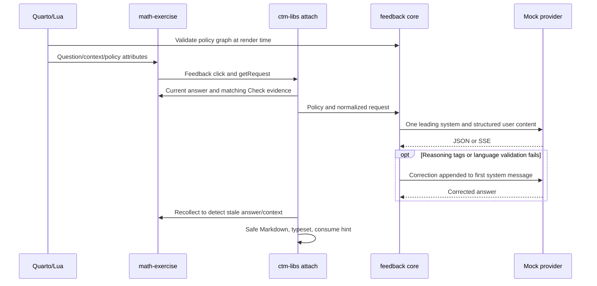
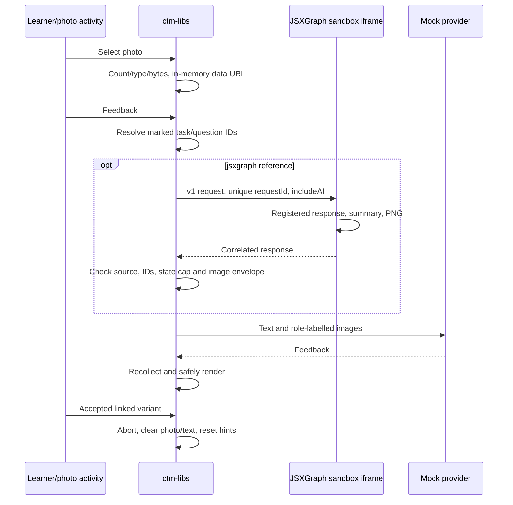

# C4–C5, D3 provider compatibility and D4 origin isolation

Evidence: ctm-libs `b1e7ec80b198eacd04793fd1cec2adb776555b73`, math-exercise `39df17ee28789e7d8d5d8e0abc01dcb967fc8858`, JSXGraph `49a1c7d575e08b2133e39098e8f9deda61567287`; consumer commits in main snapshot table. All client/library paths below are relative to `_extensions/ctm-libs/` and math paths to `_extensions/math-exercise/` unless stated. Mock-provider experiments are not evidence about actual deployed provider services. No real key/model was used.

## C4. Typed-answer feedback

**Call chain.** Render: ctm-libs `lua/feedback.lua:347 prepare` → `lua/settings.lua:85` invokes `read-settings.ts:302 policies` → `feedback/feedback-core.js:40 policyConfiguration` / `:100 resolvePolicy` validates policy schema/graph → `lua/policy.lua:9 emit` / `:15 selection` → `lua/feedback.lua:377` dependencies and `:388 __aiFeedbackConfig`. Component Lua emits question/context/policy data attributes. Page: math-exercise `math-exercise.js:1675` installs adapter → `:1685 getRequest` → `:988 questionText` delegates ctm-libs `feedback/feedback-dom.js:348 questionText` / `:339 sourceText` / `:219 contextText`; math `:993 resolveContexts` delegates `feedback/feedback-dom.js:441 contextMaterials`. Adapter adds current responses and only matching-snapshot Check evidence (`math-exercise.js:1697`). ctm-libs `feedback/ai-feedback.js:139 attach.run` → `:150 collect` → `feedback/feedback-core.js:138 applyPolicy` → `feedback/ai-feedback.js:167 client.request` → `feedback/feedback-core.js:410 request` / `:234 buildMessages` / `:175 normalizeRequest` → `:295 complete` / `:348 once` → configured `/chat/completions` → optional `:321 readStream` and corrective retry → `feedback/ai-feedback.js:170` recollect/stale check → `:192 renderMarkdown` → `feedback/feedback-dom.js:200 typesetFeedback` → `feedback/ai-feedback.js:199` hint counter update. No worker/Python grading runs in this flow; prior Check supplies private assessment evidence.

| Boundary/data | Validation |
|---|---|
| Policy YAML → render/browser | Same JS schema at both ends; unknown keys, missing names, cycles, bad booleans and steps rejected (`feedback/feedback-core.js:17–98`; `read-settings.ts:371`) |
| Question/context DOM → materials | Source extraction excludes UI/hidden/internal data; auto section prose, explicit marked IDs, none empty; duplicate/missing/unmarked/empty/over-6,000-character explicit contexts warn and skip (`feedback/feedback-dom.js:359`) |
| Request → provider | v1, unique response IDs, enumerated profiles/formats/roles, structured nonimage text ≤100,000 characters (`feedback/feedback-core.js:175–232`) |
| Learner text → policy | JSON user data; no interpolation into system policy (`feedback/feedback-core.js:237–253`) |
| Provider → display | Content extraction, empty/explicit-length/reasoning checks, limited script-based language check for math en/de/nb; escaped Markdown and KaTeX trust:false (`feedback/feedback-core.js:381–415`; `feedback/feedback-dom.js:200`) |
| Pending reply → live state | Recollect request signature; changed answer/context, cancellation and accepted variant suppress stale reply (`feedback/ai-feedback.js:162–172`, `:210`) |

**Policy/counters.** `feedback-defaults.yml` is generated into `feedback/feedback-core.js:12`. Policy files accumulate project/profile/metadata/page levels; nearest selection wins. Resolution: shipped defaults/integration → adapter legacy defaults → project/page selection → matching exercise policy → explicit selected policy (`feedback/feedback-core.js:100–127`); step overlays limits, prompt and allow-full-solution. Session hint keys `ai-feedback-hints-v2|<pathname>|<id>` and `|policy` record progress/fingerprint. Displayed replies **and copy prompts** consume hints; changed policy resets. This is tutoring progression, not secrecy authorization.

**Failures.** INVALID_REQUEST/CONFIGURATION/HTTP/IMAGE_UNSUPPORTED/EMPTY/TRUNCATED/REASONING/VALIDATION/TIMEOUT/ABORTED remain distinct. Configuration adds settings button; error messages are generally English even with translated controls (`feedback/ai-feedback.js:203–207`). Browser-hidden CORS/proxy failures become NETWORK with elapsed time/browser reason, not a guessed HTTP status. Missing prose context warns/skips; graphical context errors abort visibly. Math graph adapter explicitly permits text-only image fallback (`math-exercise.js:1683`); ordinary photo activity does not.

## C5. Photo feedback and diagram context

**Consumer fixture.** freehand `pages/handwriting-ai.qmd:10–19` loads practice/tutor/tasks policies and selects handwriting/physics-generation policies. `_includes/handwriting/problem-1.md:11–22` combines numeric 2% Check and a **distinct** photo activity with response-role image, `context="v25-oppg1,v25-1a-svar-question"`, linked reset-on-variant. Photo does not become numeric checker input. Logarithms has its own policies (`pages/logarithms-ai.qmd:10–19`).

**Call chain.** ctm-libs `lua/feedback.lua:238` activity JSON → `feedback/ai-feedback.js:218 initActivity` → `:227` picker → `:217 readFile` → `:248 getRequest` → `feedback/feedback-dom.js:359 collectExplicitContexts` for task/question IDs → `feedback/ai-feedback.js:150 collect` → `feedback/feedback-dom.js:398 collectVisualContexts` for `jsxgraph:<id>` → JSXGraph `lua/jsxgraph.lua:765` emitted message receiver → `:790` registered response, `:795` summary, `:805` SVG→PNG → `:811` response → ctm-libs `feedback/feedback-dom.js:414` source/correlation/size checks → `feedback/feedback-core.js:192` image normalization → C4 provider/render path. `feedback/ai-feedback.js:265` matching accepted variant aborts, clears text/images and resets hints.

| Boundary/data | Validation |
|---|---|
| Files → activity memory | ≤3 PNG/JPEG/WebP; ≤8 MiB each / 12 MiB total; selection-version guard for late FileReader (`feedback/ai-feedback.js:234`) |
| Image → provider body | PNG/JPEG/WebP base64 shape/length; ≤3 images and 16 MiB encoded aggregate; source/response/context roles (`feedback/feedback-core.js:192–202`) |
| Parent ↔ iframe | Protocol jsxgraph-quarto-assessment v1; iframe checks parent source/protocol/version/assessment; parent exact iframe source, request/assessment IDs, 5 s timeout, state+summary ≤1 MiB (`feedback/feedback-dom.js:403–431`; JSXGraph `lua/jsxgraph.lua:765–811`) |
| Diagram summary → feedback | JSON/string data; iframe copies through JSON serialization; not executed |
| Feedback → grade/store | No checker or ctm:result call in attach; no photo persistence |

**Consumer-only loader.** freehand `assets/handskrift/fyll-inn.js:148–190` fetches sample PNGs and fills normal file input via DataTransfer/change. `:160–162` emits accepted variant to reset prior hints/images; `:175–177` fills ordinary numeric inputs with normal events. Its prompt sandbox `:267–278` replaces page policy layers after resolvePolicy validation and intentionally permits local policy edits. It is outside CTM package. Consumer image/JSON/YAML fetches are additional network traffic; no provider key sent in them.

Wrong type/size yields translated picker error; absent text context warns/skips; absent/unregistered board, failed export, oversized state, timeout or required-image rejection abort visibly. Uploaded photos stay in memory. Copy mode displays previews/download links and asks for original image attachment (`feedback/ai-feedback.js:177–189`). Reference criteria and chosen photos/contexts leave the browser for selected provider.

## D3. Provider matrix and errors

Run `node code/provider/provider-matrix.cjs /path/to/ctm-libs --real-cuts` and `python code/provider/browser-provider.py /path/to/ctm-libs`. The first starts loopback-only JSON/SSE mock HTTP server; second uses Chromium and distinct loopback origins for true browser CORS. Network permission must allow listening. No production requests/keys. Omitting real-cuts runs quick matrix; real cuts run 30/60/100-second cases in parallel. Raw logs remain /tmp.

| Case | Observed |
|---|---|
| OpenAI JSON / OpenAI-LiteLLM-shaped SSE | Success, one request |
| Qwen/vLLM one-leading-system restriction, correction | Success, two requests, correction appended to first system |
| max_tokens rejected naming field | max_completion_tokens retry succeeds |
| stream:true rejected | Nonstream retry succeeds; stream capability cached when error mentions stream |
| Kimi thinking rejected | Optional body removed, succeeds/cache |
| Ordinary think tags / generation think tags | Ordinary corrective retry; generation strips closed tags |
| reasoning_content separate field | Private reasoning not extracted |
| HTTP400 | HTTP, API 400: invalid mock request |
| CORS-less504 in Node | HTTP; Node has no browser CORS |
| CORS-less504 in Chromium | NETWORK, after 0 s: Failed to fetch, connection/CORS guidance |
| Midstream socket destroy | NETWORK, elapsed/browser transport reason; partial not displayed |
| Clean EOF no finish/DONE | **Partial accepted as success** (P02) |
| SSE error chunk | HTTP with provider error |
| Malformed event then valid | Malformed ignored; valid text accepted |
| Data after DONE | **Appended to answer** (P02) |
| 2 MiB content event | **Accepted without output cap** (P01) |
| Slow first token, 80 ms | Success in 82–84 ms |
| Heartbeat20 ms, controlled inactivity timer50 ms | Still running at220 ms; caller ABORTED, no TIMEOUT (P01) |
| Real30/60/100 s disconnect | NETWORK after30.006/60.003/100.006 s, elapsed text names30/60/100 seconds |

Ordinary default60 s, generation300 s; stream only budgets **over**60 s (`feedback/feedback-core.js:306`, `:357`). Each retry gets new budget. All received bytes, including comments/malformed events, renew it. Heartbeat test scales only configured timer, exercises identical real HTTP parser, does not claim300 s endurance. Actual provider quality/OCR/Qwen tokenization/SEB networking untested.

Recommend shared structured codes plus phase (context/input/connect/headers/body/validation/render), visible status, elapsed, retry flag and correlation ID; localized learner summary, teacher diagnostics. Add STREAM_INCOMPLETE and OUTPUT_LIMIT; separate total and idle timeouts. Do not infer hidden status from CORS NETWORK.

## Findings

### P01 Unbounded streams and no total deadline — medium, verified

ctm-libs `_extensions/ctm-libs/feedback/feedback-core.js:321`, `:333`, `:339–343`, timers`:306–308`. Arbitrary output/line buffers grow, and every chunk rearms only timer. Endless keepalive comments/malformed events can retain request/disabled UI forever; large text grows memory and render/typeset cost. max_tokens request is not an enforcement boundary against broken/adversarial provider. Reproduce harness `2MiB response accepted` returning2,097,152 chars and heartbeat over4× actual configured timer, then manual abort. Grade impact **not reproduced**. Fix byte/line/text caps before append, absolute deadline plus meaningful-progress idle timer; cancel reader on limit/terminal/error. Feedback-core outside current application lock list; see C10 before treating exclusion as safe.

### P02 SSE terminal/EOF handling — low, verified

ctm-libs `_extensions/ctm-libs/feedback/feedback-core.js:328` ignores DONE without reader stop; `:337–346` accepts EOF; `:382` rejects only explicit length. Harness returns incomplete answer as success and appends EXTRA AFTER DONE. An orderly proxy EOF can display clipped feedback as complete and consume hint. Fix terminal state machine/cancel on DONE or accepted finish, reject premature EOF as STREAM_INCOMPLETE; explicit provider adapters for divergent protocol. No wrong-grade claim.

## D4. Storage and origin isolation

| Store/channel/cache | Scope/source |
|---|---|
| ai-feedback-config-v1 | Origin local default or tab session; API key/base/model/generator (`feedback/ai-feedback.js:6`,`:15–24`) |
| ai-feedback-capabilities-v1 | Same chosen storage; base+model(+stream),30-day TTL (`feedback/feedback-core.js:271–293`) |
| ai-feedback-hints-v2\|pathname\|id and \|policy | Session path/activity progression/fingerprint (`feedback/ai-feedback.js:121–135`,`:199`) |
| ctm\|1\|course\|page\|id | Answers, generated practice, variant state,64 KiB and identity validation; course defaults Quarto root (`ui/ctm-store.js:75–101`) |
| ctm\|1\|course\|~prefs/~seed/~clear | Saving preference, random learner seed, clear notification; seed session when save off (`ctm-store.js:85–95`,`:189–205`) |
| BroadcastChannel ctm\|1\|course\|clear | Course tabs, storage-event fallback (`ctm-store.js:93–97`) |
| ctm\|1\|course\|~mode | Session lecture/reveal (`ui/ctm-reveal.js:7`,`:59–67`) |
| math-pool\|pathname\|label and \|id | Fallback session variant selection (`math-exercise.js:1176–1190`,`:1151`) |
| qpyodide:local-storage-manual-mode | Origin local preference at pinned IDE (`qpyodide-storage.js:5`,`:167`) |
| qpyodide:code:[epoch:]pathname:identity | Legacy migration read/remove after durable save, not second active store (pinned IDE `qpyodide-storage.js:33–43`) |
| qpyodide:local-storage-user-disabled | Legacy one-time course migration (`ctm-store.js:89–91`) |
| qpyodide-coi-reload-pending | Session **not path scoped** (`runtime/coi-serviceworker.js:74`) |
| qpyodide-coi-unavailable-origin | Persistent origin flag suppresses other sites; cleared on successful isolation (`coi-serviceworker.js:75`,`:112–155`) |
| CacheStorage ctm-pyodide-wheels | Origin-wide, full URL lookup, runtime verifies digest at consumption (`runtime/pyodide-worker-core.js:457–495`) |
| COI service worker | Default directory scope from current script URL (`coi-serviceworker.js:144–146`); fetch/rewrite COOP/COEP, no own offline response cache; no-cors credentials omit (`:43–67`) |
| Freehand handskrift-sandkasse-v1\|language[\|storage-key] | Consumer sandbox; handwriting lacks site/path key, same-language sibling collision (`assets/handskrift/fyll-inn.js:50`,`:259–260`) |
| Freehand handskrift-sprak-v1\|pathname | Consumer activity-language preference (`fyll-inn.js:51`,`:132`,`:207`) |

**Verified design limitation, not new XSS:** Chromium saved dummy key under /ctm-demo/page.html then /freehand/page.html same origin read it via loadConfig. Any same-origin sibling can read/alter all storage and provider config regardless of namespacing. Session reduces retention/tab scope, not same-tab navigation exposure. Directly applies to sibling aacchhee.github.io project sites. Course/path namespacing prevents accidental collisions, not confidentiality or trustworthy grades against same-origin script. Already documented (`ctm-libs/docs/installation.md:112`), retained because user asks explicit assessment.

Use dedicated origins for mutually untrusted sites/exam sessions and personal-key storage; prefer memory/session on shared computers. Namespace operationally with site/course/page/component/record IDs, migrate only known legacy keys after successful writes and preserve future versions. Add expiry/shared-device cleanup and scope COI failures by registration URL with TTL/retry. Namespacing cannot be a security boundary.

## Prompt injection, private reference content and integrity

System treats typed/photo instructions as untrusted data, distinguishes context vs response image. This cannot enforce semantic hint compliance. Chromium attach test supplied mock full solution at hint1: displayed `Hint1 The complete solution is x=42.` with **zero ctm:result events**. Proves no client semantic output guard, not real-model prompt injection success. Actual OCR/model injection **unverified**, task forbids real provider. Hint permissions guide teaching; do not use them to hide secrets. Consumer prompt sandbox permits learner-local prompt edits intentionally.

Authored reference answers enter system criteria (`feedback/feedback-core.js:143–145`,`:241`), are sent to provider and published in HTML. ctm-demo `feedback/handwriting/tasks.yml:7–9` warns expressly. Task/context/evidence similarly transmitted. Copy-prompt uses same allowlist, includes criteria but no config/API key/base64 (`feedback/feedback-core.js:255–259`); dummy-key browser check passes. /models fetch sends bearer to selected HTTP(S) base,15 s timeout, no URL userinfo/query/fragment (`feedback/ai-feedback.js:77–92`). Completions same URL constraints (`feedback/feedback-core.js:273–278`). HTTP/private-network base allowed: browser CORS/mixed-content/private-network policy applies, not server SSRF. A malicious user-selected provider receives supplied key/work by design; no endpoint allowlist.

## Rejected claims, verification limits, work plan

- Prior November floating feedback KaTeX fixed: CTMAssets resolution and trust:false (`feedback/feedback-dom.js:192–217`), own regression passes.
- API key in copy prompt and separate reasoning_content leak **not reproduced**.
- Diagram source/ID checks look correct; no independent rendered-board spoof fuzz here.
- Feedback changing grade **not reproduced** (zero result events); generated admission/grades belong C6/D1.
- Targeted own suites: `node tests/core.test.cjs`15 pass/0fail/0skip; `node tests/dom.test.cjs`29/0/0; `node tests/feedback-variant-reset.test.cjs`3/0/1 (child probe claims Quarto unavailable even explicit QUARTO_BIN, so not rendered coverage). Parent owns broad table.

| Work | Size | Dependencies/P13 |
|---|---|---|
| P01 caps and absolute/progress deadline | <1day | Shared-client mock regressions; feedback-core lock-coverage issue in C10 |
| P02 terminal state/EOF taxonomy | <1day | Same fixtures, no runtime bytes |
| Structured localized errors | Medium | Shared schema all integrations |
| Site-ID storage migration | Medium | Identity decision; runtime COI/cache edits require P13/AC review |
| Separate hosting origins | Structural | Hosting/credential architecture, renewed exam deployment evidence |

## Additional own math browser suites

System Chromium ran unchanged own Playwright assertions against the complete pinned example-site render. Asset modules **2pass/0fail/0skip**; similar-problems **53/0/0**, including real browser Pyodide computed grading and bound-givens/restoration cases; example-math **14/0/0** (all12pages/everypooldraw and2source/policy disclosures). Initial similar suite used local PyPI SymPy1.13.3/mpmath1.3.0 with private scratch lock hashes; example/graphical rerun used integrity-verified exact npm/CDN mirrors and canonical Pyodide closure/original lock. Source assertion files were unchanged.

Graphical-answer suite: **0pass/1environmenttimeout/0explicit skips/3notrun** under failfast; Playwright JSON calls the3notrun “skipped.” The first case waits180seconds for JXG because managed system Chromium blocks data: iframe URLs: `/etc/chromium/policies/managed/urls.json` blocksall and allows HTTP/HTTPS/WSS but notdata. Independent frame inspection shows `chrome-error://chromewebdata/` with “Your organization doesn’t allow you to view this site.” No policy bypass attempted. This is unavailable browser coverage, not evidence of a product defect. Aggregate distinct own browser cases: **69pass,1environmentfailure,3notrun**. Raw evidence outside report repository; summarized counts in browser-suite-results.json and reproduction config in code/provider/math-playwright.config.mjs.
