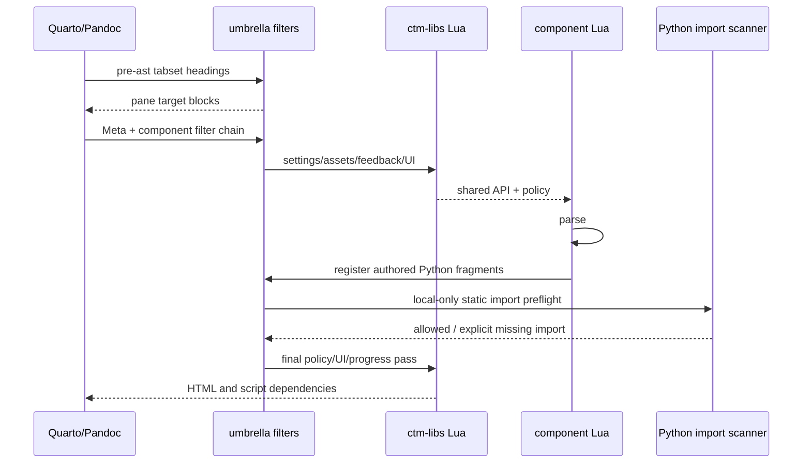

# C1, C2, C10 and release/offline review

All assessment locations refer to `cf1ca2a9abdb3647b04b8fd298d2b123002ebcaf`; library locations to `b1e7ec80b198eacd04793fd1cec2adb776555b73`. Earlier audit and consolidation claims were used as leads, then checked against source and targeted executions. No pins, locks or receipts changed.

## Executed evidence

| Command in ctm-assessment | Pass | Fail | Skip | Notes |
|---|---:|---:|---:|---|
| `python -m unittest discover -s tests -p test_p13_assets.py -v` | 4 | 0 | 0 | Includes altered worker, gzip and stale provenance negatives |
| `python -m unittest discover -s tests -p test_install_project.py -v` | 17 | 0 | 0 | Atomic rollback/review-ref parsing |
| `python -m unittest discover -s tests -p test_serve_offline.py -v` | 18 | 0 | 0 | Real HTTP server, ranges, encoding, ETags, traversal |
| `CTM_ASSETS_LIBS_SOURCE=/workspace/ctm-libs node --test tests/author-imports-render.test.cjs tests/assets-hook-render.test.cjs` | 6 | 0 | 0 | Real Quarto 1.8.27; six positive/negative render tests |
| `python code/release/boundary-probes.py --root /path/to/ctm-assessment` | 4 probes | 0 | 0 | Cache, deployed-script inventory, subdirectory asset classification |

Runtime preparation used `/workspace/.cloud-setup/activate.sh`. Default execution sandbox rejects sockets and gives Node `spawnSync` an EPERM despite a successful child result; network-enabled execution removed these environment errors. Initial sandbox failures are not product defects. Raw logs remain in `/tmp/audit-*.log`.

## C1. Render pipeline

**Call chain.** The project declares `tab-ids.lua` at `pre-ast` (`_extensions/ctm-assessment/tab-ids.lua:11-24`); `tabset()` moves heading IDs/attributes to first blocks of panes, excluding reserved cross-reference and pane IDs. Project filters then run in their declared order. The umbrella `_extension.yml:8-17` orders `ctm-assessment.lua` → ctm-libs → JSXGraph → math → STACK → Python exercises → IDE → author-imports-end → ctm-libs-end. `ctm-assessment.lua:44` `Meta()` creates a fresh author-import collector, supplies only missing JSXGraph pins, and emits the opaque MathJax preloader/parent capability. Library `lua/ctm.lua:64` `filters()` loads settings and assets, marks callouts, runs UI passes and feedback preparation. `lua/ui.lua:256-319,348` emits markdown-lint warnings, including missing tab pre-pass. Each component detects its cells, requires canonical dependencies, resolves settings/policy and emits escaped attributes. In math, `math-exercise.lua:228` `parseOptions()` → `:828` `buildExercise()` → `:998-1026` data attributes → `:1229` document walk; `ensureSetup():189` registers cacheable runtime, checker, matrix and component dependencies once. Python `py-exercise.lua:236` `CodeBlock()` parses actual starter/tests and emits exercise records. `author-imports.lua:6` `add()` records actual source; `:14` `finish()` in local-assets mode calls `author-imports.py` to statically check imports against the private index and installed subset without executing fragments. `ctm-libs-end.lua:14` flushes policy errors/messages, finalizes UI and progress.



| Boundary | Data | Validation |
|---|---|---|
| Author → Lua | Markdown, cell `#|` options and metadata | Component parsing; enums/bools where implemented; invalid givens/similar-data/dynamic matrix/duplicate IDs assert. Not every free-form option is a schema-validated enum: e.g. math `mode` is forwarded at `:871,1004`. |
| Umbrella → library | API globals, source paths, JSXGraph defaults | Canonical bootstrap/API checks; defaults provenance marker recreated at `ctm-assessment.lua:49-50` rather than accepted from author metadata |
| Components → browser | data-vars, checker, givens, context refs, variants, policy JSON | JSON encoding plus HTML attribute escaping; browser/checker independently parse later |
| Author Python → build scanner | Actual source, packages, origin | AST/static import analysis; local files resolved; absent/unmapped imports fail with origin; code is not run |
| Build → learner | HTML and dependency URLs | Dependencies deduplicated by name; local asset rewrite checks provenance/version homes |

**Failures and storage.** Render errors name missing shared APIs/components, invalid options or imports. Markdown lint warns rather than rejects author HTML. No learner storage is written at render time; generated cell descriptors later drive the canonical browser store. The six executed render cases confirmed local import failure, private-index failure, CDN scanner bypass, genuine pin rewriting and rejection of authored/forged defaults. The additional combined EN/NB fixture rendered cleanly with real Quarto: numeric math/tolerance, Python Check, text feedback, JSXGraph and a four-tab panel. Both pages retained four moved tab targets and one board iframe; HTML sizes were 70,536 and 70,621 bytes. `code/release/render-combined.py` recreates the scratch fixture. This establishes render integration, not a successful network/Pyodide browser run.

## C2. Install, update, release

**Call chain.** A consumer's `quarto-extensions.yml` identifies the umbrella ref (read by course tooling; `scripts/build-course.py:35` `pinned()`). The selected checkout's `install-project.py:182` `main()` validates release/ref options and invokes `setup-feedback-integration.py --package-only`. The builder `main():288` loads `integration/feedback/repos.json`, enforces minimum Quarto, resolves local/review/default sources (`:392-409`), and `snapshot():72` downloads commit archives or reuses its cache. It copies only owned extension folders (`:441-449`), generates native authoring (`produce_native_authoring():208`), checks shared files and one-home rules, adds licences, rejects foreign nested extensions except declared shipped copies, then writes repository metadata and per-file hashes (`:492-501`) and a tarball. Installer `replace_extensions():145` moves owned folders aside, runs `quarto add`, calls `first_mismatch():124` and restores old folders on any failure; `main():218` copies the record to `.private-extensions/resolved-repos.json`.

`--update-pins` resolves branch tips, rejects backward/sideways moves, writes repos.json and stops (`:330-352`); it does not run tests or update the P13 receipt. `--check-pins` checks branch ancestry (`:310-329`), not semantic compatibility. `--source` explicitly records actual HEAD and dirty paths (`:398-409`) and sets `pinned:false`; review refs likewise set `pinned:false`. `release-check.py:49` checks tag/version equality, full SHAs and a matching changelog section. `.github/workflows/release.yml` then runs package tests/browser tests and checks the resolved record before publishing; no release was performed in this audit.

```mermaid
sequenceDiagram
  participant C as consumer config
  participant I as install-project.py
  participant B as setup-feedback-integration.py
  participant G as pinned source/cache
  participant Q as quarto add
  C->>I: chosen umbrella checkout + options
  I->>B: --package-only / exact review refs
  B->>G: resolve commits; read extension trees
  G-->>B: source bytes
  B->>B: ownership/bootstrap/native-authoring checks
  B-->>I: distribution + resolved record + hashes
  I->>I: back up owned extension folders
  I->>Q: install distribution
  Q-->>I: installed files
  I->>I: hash expected files; restore on failure
  I-->>C: private resolved-repos.json
```

| Boundary | Validation | Limit |
|---|---|---|
| Config/ref → immutable pins | Full SHA checks for review/release; ancestry checks for pin moves | Branch `main` consumers still float across installs; ancestry does not prove compatible behavior |
| Archive/cache → claimed Git commit | HTTPS commit URL on fresh download; cache commit marker on reuse | R-01 below: cached bytes are not revalidated against Git |
| Components → assembled package | Explicit ownership; canonical bootstrap hash; no retired foreign copies; build/checker home checks | Semantic contracts still require integration tests |
| Package → installed course | Per-file SHA256 comparison and rollback | Record is local provenance metadata, not a signed attestation; post-install edits are not continually checked |

**Can versions mix?** Default fresh install resolves one complete pinned set, and failed `quarto add` restores old owned folders (17 tests pass). Explicit `--source`/review overrides intentionally produce mixed review sets, visibly recorded. Reused modified source cache can silently differ from the pinned set (R-01). Direct Quarto additions and later manual changes can create an installation different from its record; render/bootstrap checks catch only some mixtures. `.private-extensions/resolved-repos.json` records chosen commits, overrides, dirty local sources, Quarto and installed-file hashes at install time; it does not prove cached files actually came from those commits or certify compatibility.

**Failure UX/storage.** Bad refs/unknown names produce explicit install errors; bad installed hash names the first differing file, then restore succeeds or backup location is reported. Persistent build cache is `<workspace>/src/<repo>-<sha12>`, record lives at `.private-extensions/resolved-repos.json`; the runtime does not use the record as grade authority.

## C10. Offline exam ZIP / P13

**Call chain.** `review-p13-assets.py:16` `main()` verifies frozen approved vendor baseline hash, independently reviewed subset/index receipts, and permits only current runtime provenance before `p13_assets.bind_application():37` adds exact application source records. It emits an explicitly UNAPPROVED proposed lock/diff/summary; no approval receipt is edited by that script. `build-p13-assets.py:15` regenerates vendor locks/import index, verifies subset hashes, binds current exact ctm-libs/IDE heads and then verifies the whole lock against `integration/p13-complete-assets.json` (`:59-66`). `exam-site-zip.yml:40-49` checks receipt `application_refs` against repos.json, downloads vendor artifact from fixed run ID, verifies canonical lock digest and every carried byte, builds the pinned consumer and invokes `install-p13-site-assets.py:14-32`: receipt hash → canonical lock → version homes → application worker hashes → carried bundle/index → offline/exam profiles. Quarto renders. `p13_assets.verify_deployment():88` verifies vendor bundle and every occurrence of eight application filenames plus optional `.gz`; the workflow zips, extracts, verifies again, serves actual extracted files with `serve-offline.py`/the byte-preserving JS acceptance server, then exercises isolated root/subdirectory and plain LAN execution, Stop, NumPy and browser profiles before accepted-ZIP upload.

```mermaid
sequenceDiagram
  participant R as lock review
  participant AC as Human review convention
  participant B as asset builder
  participant P as project installer/Quarto
  participant V as deployed ZIP verifier
  participant E as browser engine gates
  R->>R: vendor hashes + current pinned worker sources
  R-->>AC: UNAPPROVED full lock/diff/hash
  AC-->>B: reviewed receipt checked into source
  B->>B: reproduce complete lock; verify receipt
  B->>P: verified carried bytes + private import index
  P->>P: verify installed workers; render offline,exam
  P->>V: actual deployment → ZIP → extracted deployment
  V->>V: verify vendor inventory + 8 worker/plugin/frontend names
  V->>E: byte-preserving root/subdirectory servers
  E-->>E: offline network-refusal + engine-specific Run/Stop/restore
```

| Boundary | Validation | Remaining limit |
|---|---|---|
| Other-run artifact → builder | Fixed run ID plus explicit SHA256 and complete byte inventory | Artifact availability/retention is operational dependency; changing run ID cannot silently change accepted bytes without changing digest |
| Proposed lock → approval | Reviewed digest stored in repository, exact refs compared | No cryptographic AC signature or Actions actor/environment check; authority relies on repository review/merge policy |
| Git checkout → application lock | HEAD exact full SHA, each selected file equals Git blob and is not symlink | Only the eight SOURCES application files are included; lock is not a hash of whole rendered website |
| Carried bundle → installed project | Canonical lock and bundle/index/version verification | Runtime JS outside worker inventory has no deployed-file check (R-02) |
| Render → ZIP/extract | Worker names checked at every actual occurrence, gzip checked, no source/private files allowed | HTML/other scripts outside application list remain out of scope of deployment lock |
| Host → browser | COOP/COEP/CORP headers, asset CORS, no-cache vs immutable, MIME/ranges | Nested asset path classification misses prefix (R-03); actual SEB/IT/TLS/capacity still manual |

**Specific feedback-core question.** A normal *committed* feedback-core.js update changes the ctm-libs commit. The receipt stores that full commit in `application_refs`, and the workflow compares it with repos.json before the build; changing the pin without updating the matching receipt fails. The inspected October 29 receipt deliberately reapproved b1e7ec8 despite no worker-byte changes. Therefore the proposition that an ordinary pinned feedback-core commit automatically bypasses the receipt is **rejected**. A *post-render* edit to deployed feedback-core is accepted by `verify_deployment`; the executable inventory is intentionally narrower than the website (R-02). Do not conflate these two claims.

**Offline/SEB/storage.** `ctm_assets.py:709` creates offline assets + exam profiles with AI disabled, save answers/export enabled and storage key `<course-key>-exam`. Profiles are created only if absent (`:729-730`), so existing author profile overrides need independent review. Plain LAN is insecure context: shared input/interrupt buffers unavailable; terminate/restart remains the Stop path. `coi-serviceworker.js:43-70` rewrites isolation headers on fetched responses; it does not use CacheStorage or persist offline bodies. Its scope follows its registration URL, not arbitrary origin-wide cache control. Browser HTTP caches and saved answers survive sessions; fresh profiles/session keys/IT clearing policy are needed to prevent answer carryover on shared machines. These checks cannot certify actual devtools-less SEB, clipboard/upload/download policy, trusted certificates or host throughput; no actual SEB binary was run. P13 currently covers Python IDE and shared math/Python worker; Maxima/STACK vendor inclusion remains explicit phase 2, not a failed phase-1 requirement.

## Findings (local IDs for synthesis)

### R-01 — Source cache is trusted by commit marker, allowing falsely pinned bytes

**Medium; verified.** `ctm-assessment/scripts/setup-feedback-integration.py:77-78` returns cached source solely when `.integration-source.json.commit` matches. `:408-409` records `pinned:true`, `dirty_files:[]` for this nonlocal source; `:448-449` hashes whatever bytes it just copied. `boundary-probes.py` creates a temporary ctm-libs snapshot cache with matching marker and changed feedback-core.js; actual `snapshot()` returns it without download or Git verification. No audited files change. **Impact:** accidental/manual edits or poisoning of a reused build workspace survive later install/release preparation while metadata attributes the changed code to a clean pin; the subsequent file hashes agree with the poisoned package. This does not establish a remote unauthenticated exploit, and source repository attackers already control code. **Fix:** validate a cached archive/tree against an independently obtained immutable Git tree/content inventory (or always recreate source from verified archive); refuse locally changed cached sources or mark them unpinned. Avoid storing a mutable trust reference beside the data it vouches for. No P13 receipt changes needed for installer fix.

### R-02 — P13 deployment integrity inventory excludes ordinary scripts/HTML

**Low; verified scope gap, not ordinary commit bypass.** `ctm-assessment/scripts/p13_assets.py:17-31,98-101` limits application enforcement to eight filenames. Harness copies a valid synthetic deployment, adds/changes `site_libs/feedback-core.js`, and `verify_deployment()` succeeds. **Impact:** deployed/ZIP mutations outside vendor assets and selected worker/frontend files are not detected by this verifier, despite broad reading of "complete application" assurance. Receipt refs still gate committed ctm-libs changes. **Fix:** generate a separate manifest for the complete rendered deployment and check before/after ZIP extraction, or explicitly state the narrower assurance. Include the manifest digest in approval when full-site approval is intended. Extending the P13 lock inventory touches its receipt and requires AC review.

### R-03 — Offline server drops asset CORS/cache headers under hosting prefixes

**Medium; verified path/header condition, browser-board failure plausible.** `ctm-assessment/scripts/serve-offline.py:87-90` recognizes only URLs starting `/_ctm-assets/`; `end_headers():81-84` consequently omits `Access-Control-Allow-Origin:*` and applies no-cache to `/dept/python/_ctm-assets/...`. The harness runs the actual classifier for both paths. The server documentation explicitly needs CORS for opaque board frames. **Impact:** subdirectory Python-only gates cannot establish that local MathJax speech-data fetches from opaque board frames work; those CORS fetches are expected to fail, and assets lose immutable caching. The production dry-run server can serve a containing multi-course root. **Fix:** classify the resolved resource relative to a configured course base/prefix, or explicitly support one site root only and require mount configuration to strip prefix. Add HTTP header + opaque-frame board tests under `/dept/python/`. No worker lock/receipt change required for server fix.

## Release robustness verdict (D6 / CI security)

No `pull_request_target` use was found in umbrella workflows. Exam and lock-review jobs explicitly have `contents:read, actions:read`, exact component refs and `persist-credentials:false`; cross-run baseline downloads are hash/inventory verified. Third-party Actions are still tag-pinned (`actions/checkout@v7`, setup-python/node@v7, quarto setup@v2, download-artifact@v7), so mutable-tag supply-chain risk remains (plausible; no compromise reproduced). Cached vendor downloads must pass expected digests; source snapshot cache R-01 is a different unchecked boundary.

Prior November M0 is partly repaired: `examples-pages.yml:49-50,73-74,99,105` detects pin/builder/test-package PR edits and runs combined `--test`, but real browser integration is still manual-dispatch-only. Prior H3 now has `tools/ci/check-component-pins.py` and nightly warning output; its default returns 0 and the nightly caller does not use `--strict`, so this is detection, not enforcement. Do not claim no script exists. `release-check.py` remains a metadata preflight, not a semantic/AC-approval gate. It checks full SHA syntax, not repository existence or passing CI. `--update-pins` does not atomically synchronize component CI pins or P13 receipts; downstream strict receipt mismatch is correctly fail-closed. The long-lived IDE feature branch is pinned immutably, so branch movement does not change an existing release, but it complicates default standalone install/discovery and merge/release provenance.

The "AC-approved" field is a repository digest/ref gate, not actor authentication: someone authorized to edit/merge pins, receipt and workflow can satisfy/alter it without an AC signature. That is a governance limitation under trusted-author assumptions, not demonstrated learner exploitation. Protect receipt/lock/workflow paths through CODEOWNERS + required independent AC review or verify an AC-signed attestation in an unmodifiable required check. Live GitHub protection configuration was not verified by this subtask; the coordinating audit separately observed main protected:false, recorded in GOV-1.

Recommended automation: PR on dependency-tip movement carrying generated CI pins and umbrella pins, required source-contract checks, targeted browser smoke on every repin, full campaigns only at release candidate, digest-bound lock diff requiring AC for worker/runtime changes. Consumers on immutable semester refs should receive advisory update PRs with affected findings and tests; a nightly warning alone does not tell them a fix is available. Existing release tag/version checks and install rollback are good foundations.

## Rejected or limited claims

- Installation failure permanently removes prior extensions: **already fixed**, 17 installer tests pass including rollback.
- Any change to feedback-core bypasses P13 approval: **false for normal committed pin moves**, exact application_refs gate shown above.
- Changing the downloaded cross-run vendor artifact silently passes: **not shown**, frozen digest and byte checks reject it.
- Every render-time authored Python fragment executes in import scanning: **false**, actual fragments with a deliberate `raise` rendered successfully under the six-test suite.
- Author metadata can forge the umbrella-default provenance marker to smuggle remote asset URLs into local mode: **rejected**, actual hook rewrites marker and tests reject forged/authored URLs.
- P13 requires Maxima in the current ZIP: **out of phase-1 scope** per recorded design; do not fail it for phase-2 work.
- Host/SEB readiness follows from passing unit tests: **unverified**, real lockdown/TLS/clipboard/capacity gates remain external.

### R-04 — `--release` verifies a version string, not the release checkout

**Medium; verified guard behavior.** `ctm-assessment/scripts/install-project.py:66-79` documents and presents `--release vX.Y.Z` as requiring that release checkout, but compares only `_extension.yml` version and commit-SHA syntax in repos.json. It never resolves the requested tag or compares Git HEAD/tree. The harness patches subprocess Git queries to fail if attempted and `check_release('v'+package_version())` still succeeds. At the audited HEAD it accepts v0.13.0. **Impact:** a later unreleased main checkout that retains version 0.13.0 is accepted as that release while carrying different component pins; the user-facing guard does not enforce the deterministic-release promise in its docstring. This does not bypass the actual tag-triggered GitHub release job. **Fix:** compare HEAD with the locally/fetched immutable tag (and refuse dirty release source), or remove the misleading verification flag and require the caller to supply verified release checkout provenance. No P13 lock change. Prior November version-discipline findings remain related context; this is the specific executable guard gap, not a new assertion that releases exist or do not exist.

### Explicit AC-gate conclusion

**Can it be satisfied without AC?** Yes by a repository writer able to land matching pins and a recomputed receipt; no mechanism shown lets a learner/model do it. `exam-site-zip.yml:41-48` checks only the receipt's refs against pins in the same checkout. `build-p13-assets.py:54-59` checks that checkout's receipt digest/count against reproduced bytes. `integration/p13-complete-assets.json:3-7` contains digest/count/refs, with no reviewer identity or signature. `review-p13-assets.py:65-76` produces an UNAPPROVED marker, but no authenticated reviewer response is consumed by the ZIP workflow. Treat this as the retained governance boundary behind November M0, medium/plausible as an unauthorized-approval finding: gate mechanics read and verified, no unauthorized external mutation attempted. A separate live branch-protection observation must be labeled live rather than assigned snapshot file lines. AC approval remains a human process unless protected branch/CODEOWNERS enforcement or an independent attestation gate makes it mandatory.

## Required official campaign and consumer renders (completion evidence)

The actual unmodified `scripts/setup-feedback-integration.py --test --browser` ran at exact umbrella cf1ca2a in an isolated shared clone. Component source caches were seeded from exact Git archives and independently verified pinned JSXGraph/IDE snapshots. No source/pin/receipt patch was used. First run failed at ctm-libs' Node/Pyodide cases when remote package fetches failed (450 passed,7 failed,1 skipped); it did not reach later suites/browser.

The canonical local retry fetched19 original Pyodide0.28.3 package files (19,741,860bytes), including SymPy1.13.3 and NumPy/matplotlib closure. Every SHA256 matched the **unmodified npm Pyodide lock**. Seven npm asset archives were independently SHA512-SRI checked and provided locally to Playwright for CDN resource URLs. No TLS bypass, trust-store change, iframe substitution or managed-policy change was made.

| Completed retry phase | Passed | Failed | Skipped |
|---|---:|---:|---:|
| Umbrella Python unittest |253|0|0|
| Umbrella npm |135|0|7|
| ctm-libs npm (legacy standalone snapshot supplied) |458|0|0|
| math-exercise embedded Python |47|0|0|
| math-exercise Node |207|0|1|
| py-exercise Node |50|0|0|
| pyodide-interaktiv Node |135|0|0|
| py-exercise extra Python |17|0|0|
| Umbrella integration Node |29|0|0|
| Counted completed phases |1331|0|8|

Package archive installation/render, feedback-default sync, locale check and checker payload-source check also passed. The script then entered its real browser smoke: **23 end-to-end checkpoints passed**, including learner restrictions/correct Python grading, math/matrix/basis checks, three real worker IDE runs with matching stdout and Reset, policy/hint progression and LaTeX feedback. It failed at `integration/feedback/browser-smoke.cjs:392`, waiting for the first JSXGraph frame's board. Managed Chromium blocks `data:` iframe navigation under its installed enterprise URL policy, before frame scripts can execute (independently diagnosed by the browser specialists); this is an environment blocker, not evidence of a package board regression. The chained Pyodide lifecycle/layout/browser-contract/STACK scripts were not reached by that full command. Any independent downstream script executions are reported separately, never counted as a full green campaign. Full command exit status remains **1**.

Default and local-retry logs stay at `/tmp/audit-official-integration.log` and `/tmp/audit-official-local-integration.log`; summarized counts are in `inventory/official-integration.json`. Reproduction preparer, canonical asset fetchers, local browser transport and summarizer are in `code/release/`.

Freehand's four original consumer pages rendered successfully with exact package source extensions in `/tmp/ctm-freehand-render/_site/pages/`: `logarithms-ai.html`, `handwriting-ai.html`, `logaritmer-ki.html`, `handskrift-ki.html`. The last two are the actual consumer's Bokmål fixtures; their authored `math-exercise.feedback:false` was retained. Together with the clean combined EN/NB fixture at `/tmp/ctm-audit-combined/_site/`, these were supplied for the independent accessibility pass. Rendering does not establish successful provider/board behavior.

### Independent downstream browser recovery

After the chained command stopped, its remaining scripts were run independently using the same exact scratch package and local canonical asset transport (no full campaign repeated):

- `node integration/feedback/stack-browser.cjs`: **passed**, including real mixed mathematics Check, Python Run before/after STACK, STACK H1 grading, qtests and validation, and preservation of the published runtime.
- `node integration/feedback/pyodide-browser.cjs`: static COI worker placement/scope-link check passed; the first lifecycle scenario stopped at `:141` waiting for isolation. Diagnostic output explicitly reports failed CDN dynamic import of `pyodide.mjs` and Monaco AMD loads under the service-worker-enabled transport path. Runtime lifecycle scenarios remain **unverified** in this harness; the successful service-worker-blocked smoke/mixed-page worker runs do not prove this service-worker path. No product regression is inferred from failed local transport coverage.
- `node --test tests/*.browser.cjs`: **7 passed,0 failed,0 skipped** (357.23s), including all six comparison-browser cases and native P13 controls. These checks ran independently after the original browser chain stopped.

These independent results do not change the full official command's exit1. Raw logs remain in `/tmp/audit-official-{stack-mixed,pyodide-lifecycle,browser-contracts}.log`.
