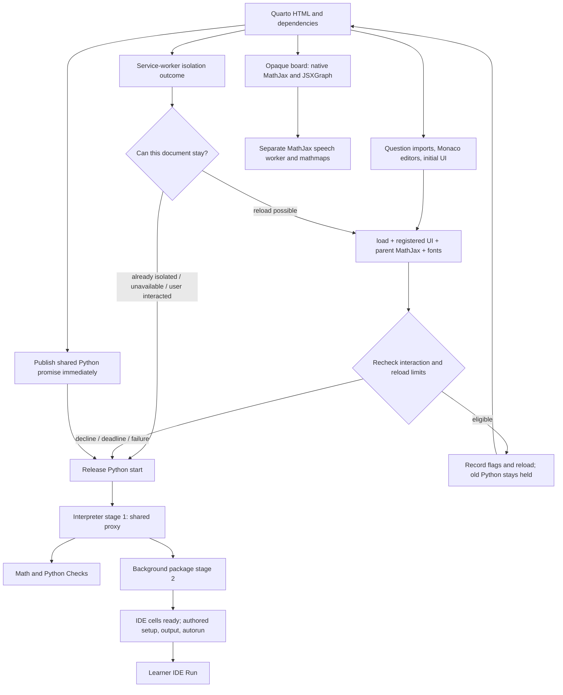

# CTM page loading lifecycle

Draft grounded in the current `work/first-visit-fix` sources. The shared-library registry is frozen for source review; consumer changes are still being tested. This describes the proposed combined ordering, not an activated release or completed static-first-visit acceptance. Asset download completion, component UI readiness, interpreter readiness, and authored startup completion are different milestones.

## Readiness states are separate

- **UI ready:** question/editor controls exist and their initial rendering/assets have settled under the registered contract.
- **Interpreter ready:** a particular backend can accept commands. Python stage 1 says nothing about an independent Maxima backend.
- **Component packages ready:** that component's required checker modules/packages are usable; optional IDE background packages have a separate outcome.
- **Question ready:** the question's own context/inputs and required grader dependencies are prepared. A visible question, a completed interpreter bootstrap, and a saved answer are not by themselves a successful assessment.

There is no single existing promise that truthfully collapses all four states across every CTM component. `needs-reload` is a retained-document/manual-navigation boundary, not proof isolation will become available in this document.

## Entry points, assets and navigation

Quarto/Lua is the source producer: it emits shared dependency tags, component module order and cell definitions. `CTMAssets` chooses the configured asset URLs; local-asset mode changes where bytes come from, not the distinction between readiness phases. Browser script/module, CSS/font and worker downloads are separate request lifecycles. Shared Python bootstrap and Monaco/KaTeX UI work must not be conflated.

The isolation service worker can replace a page navigation with an isolated response and initiate a bounded reload decision. It is distinct from an offline cache/service-worker installation: service-worker registration or control alone proves neither all resources cached nor future offline operation. Cross-page navigation creates a new document, readiness registry and runtime lifecycle; saved answers can restore without automatically grading/executing them. A reset/restart inside a page has a different runtime epoch from a page navigation.

The inventory to audit spans Quarto dependency generation, runtime/asset configuration, component imports and editor callbacks, navigation/reload policy, the Python worker, opaque board/MathJax speech worker, and separately any offline producer/cache policy. This draft makes no new offline acceptance claim.

## What loads, and what waits

Quarto emits dependencies and collected cell definitions. Shared classic scripts expose `CTMAssets`, `MathExerciseRuntime`, and `CTMWorker`; the Python IDE modules then load in their emitted order: locale/storage → document status/COI decision → storage settings/worker plugin → engine initialization → plots → cell classes and initial cell construction. Browser downloads can overlap; emitted execution/dependency order still matters. Math and Python exercise initialization starts from `DOMContentLoaded`.

| Milestone / owner | Actual signal | Waits for | Releases / does not release |
|---|---|---|---|
| Initial component UI / shared runtime | `trackInitialUI(promise)`; shared `whenInitialUIReady()` | `window.load`, registered UI promises, existing **parent** `MathJax.startup.promise`, then current `document.fonts.ready` | Makes a pending automatic reload eligible for its final checks; does not mean every iframe/request is finished |
| Math question UI / math-exercise | Registered initial-UI promise | KaTeX stylesheet + both dynamic ES-module imports, question rendering and field setup | Visible question/inputs; Python preload is started without awaiting it in this UI promise |
| Code editor UI / py-exercise and IDE | Registered editor-construction promises | Monaco loader/AMD callbacks and actual editor setup | Editing/storage hooks; does not wait for Python, grading, setup cells or autorun |
| COI decision / IDE document-status | `qpyodideCoiSettled`; `qpyodideInputState` | Service-worker outcome, readiness barrier only when a reload is still possible | Either commits navigation without releasing old-document Python, or releases current-document Python |
| Shared Python identity / IDE engine | `qpyodideReady` / `qpyodideInstance` | Published immediately as a promise; resolution waits for allowed worker start and stage 1 | Other components reuse one interpreter promise instead of creating a fallback interpreter |
| Interpreter stage 1 / CTMWorker | Start promise resolves; `mainPyodide` proxy | Pyodide bootstrap and explicitly configured stage-1 packages | Math/Python checks can use RPC; does not imply background packages or authored startup finished |
| Extra packages stage 2 / CTMWorker | `proxy.whenSetup`; retry via `proxy.retrySetup()` | Background package closure, verified wheel bytes/install, configured background Python | IDE sets `qpyodideCellsReady` and emits `qpyodide-cells-ready` after success **or reported setup failure** |
| Authored startup / IDE cell container | `qpyodideStartupPhaseDone`; `qpyodide-startup-done` | Stage-2 outcome, then setup cells → output cells → interactive cells explicitly marked autorun | A learner Run during that startup phase waits for its phase promise; normal interactive cells do not autorun |
| Learner Check / math or py-exercise | Component result/feedback | Shared stage-1 interpreter, component checker/modules/packages, actual grader | Independent component assessment; does not wait for all IDE authored startup just because stage 2 exists |
| Learner IDE Run | Cell output/completion | IDE readiness, current authored-startup phase, actual worker command | Actual execution; input/interrupt capabilities depend on the page's isolation/shared buffers |

Initial cell construction explicitly bounds registration: restored extra IDE editors constructed in that initial batch are included; a later user-added editor is not an initial-loading task. A late initial registration is a contract error. All registered failures remain visible; readiness must reject with the original failure.

The arrows are dependency relationships, not a promise that every download is serial. UI and service-worker work overlap. Stage-2 prefetch yields between bounded ranges to foreground commands; package installation and worker Python commands use the worker's idle/queue protocol. Check-specific packages can still take time. Shared `whenSetup` is an extra-package milestone, not a universal page-ready signal.

## Isolation paths and limits

| Scenario | Navigation and Python startup | Capability / failure boundary |
|---|---|---|
| Headered page already isolated | No reload/UI-barrier wait before worker start; UI and Python proceed concurrently | Actual shared buffers available subject to worker initialization; input/Stop behavior is not inferred from a flag alone |
| Fresh static host, supported isolation | Publish promise, hold Python worker, await actual SW-ready + initial UI, recheck, reload once; replacement document starts normally | Prevents starting packages/authored cells in the document intentionally replaced; not a blanket guarantee about opaque-frame traffic |
| Isolation unsupported or recently failed | Explicit `unavailable` releases ordinary worker startup; existing recent-check policy prevents reload loops | Ordinary Python can run; blocking `input()` and shared-buffer interruption unavailable. WebKit credentialless fallback is a known example |
| Learner interacts before reload commit | `keydown`, `pointerdown` or `input` retains document, marks `needs-reload`, releases Python | Do not discard edits. No reload flags written after the final eligibility check declines |
| UI slow or failed | 30-second pending-UI deadline cancels automatic navigation and releases Python; failure also logs/rejects | Late UI completion cannot trigger a delayed reload. Deadline is a decision bound, not proof UI/network succeeded |
| COI script never reports | Existing five-second missing-outcome fallback releases startup as unavailable | A missing service worker must not hold Python indefinitely |

Duplicate ready events cannot commit multiple reloads. Existing two-minute recent-reload counting (including bounded hard-reload handling), controlled failed-check detection, and 24-hour failed-check expiry remain. The barrier must never await `qpyodideReady`, `whenSetup`, or authored startup: those can wait for the COI decision that is waiting for the barrier.

Runtime load consumers retain their existing 180-second load limit. Stage-2 wheel range fetches have a 30-second no-byte stall abort and bounded retry waits. Stage-2 failure is reported and offers Retry; IDE readiness then permits code that does not need the missing package. Interpreter failure, UI failure, execution failure, and user Stop/restart are distinct routes. Restart invalidates pending calls/old startup epoch, publishes replacement readiness and repeats authored startup once for the new epoch. None of these paths permits hiding raw browser errors.

## The board worker is separate

A sandboxed board has an opaque document origin. Its original native async `MathJax-script` still loads MathJax; the preloader configures the supported adaptor before that script and preserves native loading. Default startup uses the canonical speech worker/mathmaps through the data-worker adaptor. Authored `startup.ready` or a custom adaptor retains ownership; those controls do not inherit an accessibility claim automatically. Board code waits for its window load and `MathJax.startup.promise` before updating labels.

This MathJax/SRE worker is not `CTMWorker`, Pyodide, the IDE package loader, or the service worker. Parent `MathJax.startup.promise` does not await child-board startup. The shared initial-UI barrier does not claim arbitrary opaque-frame settlement.

## What the traces establish

The frozen headered demo passed real grading/quiz/board checks in all three engines at desktop and 390px. That demonstrates the tested headered composition, not raw-clean static first visit.

Retained first-visit baseline failures remain failures. The targeted Chromium CDP diagnostic completed actual isolation, IDE 42, board SVG/speech/braille and had zero actual raw errors, but its strict pending guard failed. It attributed a missing-terminal font to a superseded top-document loader even though the Frame object remained attached; current-loader consumption completed separately. Downstream SW completion is not proof the old client consumed bytes. Three missing-terminal requests belonged to the retired initial board. All remain retained unknown lifecycles.

That diagnostic observed 13 successful Matplotlib range requests initiated by canonical CTMWorker stage-2 `fetchRange`, separate from the board speech worker. It did not reproduce or explain the original Chromium `ERR_ABORTED`, which occurred before teardown. No failure is waived, no future requests are declared finished, and no static/offline all-browser clearance follows from these observations. Combined fixed-source browser evidence is still required.

## Future Maxima boundary

This map identifies the seam, not a Maxima runtime design. A future Maxima consumer must distinguish its UI/assets, interpreter readiness, optional packages/session initialization, and authored execution. If it can trigger startup before a possible navigation, its startup identity and COI requirements need an explicit relationship to the page decision. Its UI-ready task must not wait for an interpreter that waits on that same decision. It needs its own error/retry/cancel and stale-session behavior. This does not authorize another worker, a generic loading framework, backend changes, or an assumption that Python readiness means Maxima readiness.

## Source anchors

- `ctm-libs`: `runtime/pyodide-runtime.js` (initial UI registry, shared runtime selection/load limit), `runtime/pyodide-worker.js` (publish/start, stage 1/2, range prefetch, queue/restart), `runtime/coi-serviceworker.js` (outcome and isolation response policy), `runtime/mathjax-opaque-adaptor.js` (board speech transport).
- `pyodide-interaktiv`: `qpyodide.lua` (emitted dependency/module order), `qpyodide-document-status.js` (COI decision/reload), `qpyodide-document-engine-initialization.js` (published promise/start follower), `qpyodide-cell-initialization.js` and `qpyodide-cell-classes.js` (initial editors, startup ordering, Run).
- `math-exercise.js` / `py-exercise.js`: initial UI/import/editor work and real Check paths.
- Local diagnostic evidence: `work/first-visit-probe/chromium-provenance.json` (SHA256 `deb570b5615aafdacac35b7d68642489b49bac5b00e85ba2ca07a0fb1355edd9`), deterministic provenance summary and retained baseline reports. These are local evidence paths, not shipped runtime dependencies.
